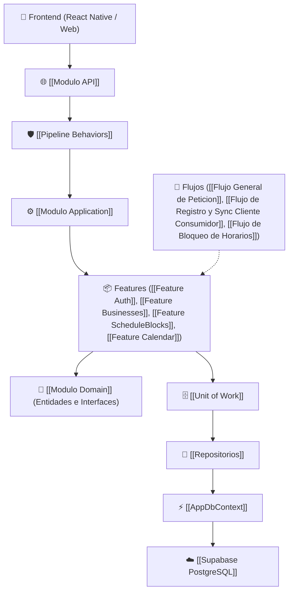

# 📚 Slotify Backend - Knowledge Hub (Índice General)

Bienvenido a la base de conocimiento interactiva y centro de documentación técnica de **Slotify Backend (.NET 8 / PostgreSQL)**.

> [!tip] Navegación Interactiva en Obsidian
> Presiona `Ctrl + G` para abrir la **Vista de Grafo** y explorar cómo se conectan las historias de usuario, las capas de Clean Architecture, los flujos de información, las entidades del dominio y la persistencia relacional.

---

## 🧭 Mapa de Navegación del Sistema

### 📋 1. [[01 - Requerimientos e Historias de Usuario|01. Requerimientos e Historias de Usuario (Scrum)]]
* [[Indice de Historias de Usuario]]: Directorio completo de User Stories y Criterios Gherkin.
* [[HISTORIAS_DE_USUARIO_Y_FLUJO_INTEGRAL]]: Visión integral del sistema y escenarios de prueba.
  * [[US-001 - Registro y Autenticacion Multi-Inquilino y Clientes|US-001: Registro y Autenticación Multi-Inquilino]]
  * [[US-002 - Plantillas por Sector y Configuracion de Negocio|US-002: Plantillas por Sector]]
  * [[US-003 - Calendario Tactil Multiformato y Consulta de Citas|US-003: Calendario Táctil y Citas]]
  * [[US-004 - Dashboard Dinamico y Manejo de Estados Vacios|US-004: Dashboard y Estado Vacío]]
  * [[US-005 - Micro-Onboarding para Consumidor Final|US-005: Micro-Onboarding Consumidor]]
  * [[US-008 - Bloqueo Manual de Horarios y Disponibilidad|US-008: Bloqueo Manual de Horarios]]

---

### 🏛️ 2. [[02 - Arquitectura y Capas|02. Arquitectura y Capas del Sistema]]
* [[Clean Architecture]]: Estructura de capas, patrón CQRS y principios arquitectónicos.
* [[Modulo API]]: Controladores HTTP RESTful, Swagger/OpenAPI, inyección de dependencias y middlewares.
* [[Modulo Application]]: Casos de uso (CQRS con MediatR), Comandos, Queries, DTOs y validaciones.
* [[Modulo Domain]]: Núcleo de entidades de negocio, interfaces de repositorios y reglas de dominio puras.
* [[Modulo Infrastructure]]: Entity Framework Core 9 (Npgsql), configuración Fluent API, Unit of Work y repositorios.
* [[Pipeline Behaviors]]: Interceptores transversales de MediatR para validación automática (`FluentValidation`) y logging.

---

### 🌊 3. [[03 - Flujos de Informacion|03. Flujos de Información (Ciclo de Vida End-to-End)]]
* [[Flujo General de Peticion]]: Recorrido universal y ciclo de vida de una petición HTTP desde la app hasta PostgreSQL.
* [[Flujo de Registro y Sync Cliente Consumidor]]: Sincronización B2C para clientes finales y micro-onboarding.
* [[Flujo de Registro y Sync Auth]]: Sincronización B2B para administradores y creación de negocios.
* [[Flujo de Bloqueo de Horarios]]: Creación, consulta y eliminación de bloqueos manuales de agenda.
* [[Flujo de Consulta de Citas y Estado Vacio]]: Ciclo de consulta y renderizado de agenda con estados vacíos.

---

### 📦 4. [[04 - Modulos Funcionales (Features)|04. Módulos Funcionales (Features)]]
* [[Feature Auth]]: Autenticación y sincronización de usuarios (`DUENO` y `CLIENTE`).
* [[Feature Businesses]]: Catálogo público, cambio de plantillas de rubro y formularios dinámicos JSON.
* [[Feature ScheduleBlocks]]: Gestión y bloqueo de franjas horarias no disponibles.
* [[Feature Calendar]]: Consultas de disponibilidad de turnos en tiempo real y agenda táctil.
* [[Feature SectorTemplates]]: Plantillas predefinidas por rubro comercial (Barbería, Spa, Consultorio, etc.).
* [[Bloqueos de Agenda]]: Documentación de endpoints y contratos de bloqueos.

---

### 🧩 5. [[05 - Entidades y Dominio|05. Entidades y Modelo de Dominio]]
* [[Entidad User]]: Usuarios del sistema, roles (`DUENO`, `EMPLEADO`) y credenciales.
* [[Entidad Client]]: Clientes consumidores finales (B2C) asociados a la tabla `clientes`.
* [[Entidad Business]]: Negocios/inquilinos con configuración y plantillas de sector.
* [[Entidad Appointment]]: Citas y reservaciones de servicios.
* [[Entidad ScheduleBlock]]: Bloqueos manuales de horarios y excepciones.
* [[Entidad AvailabilitySchedule]]: Esquemas de horarios de atención semanales.
* [[Entidad SectorTemplate]]: Plantillas de catálogo y servicios por sector.

---

### 🗄️ 6. [[06 - Acceso a Datos y Persistencia|06. Persistencia y Base de Datos]]
* [[AppDbContext]]: DbContext central de Entity Framework Core 9.
* [[Unit of Work]]: Patrón transaccional para operaciones atómicas.
* [[Repositorios]]: Abstracciones e implementaciones de acceso a datos.
* [[Supabase PostgreSQL]]: Base de datos relacional en la nube.
* [[Modelo de Datos]]: Diagramas ERD y descripción de tablas.
* [[Base de datos - Proyecto]]: Script SQL completo de inicialización y constraints.

---

### 🚀 7. [[07 - Guias y Despliegue|07. Guías y Despliegue]]
* [[Despliegue en Render]]: Guía para publicar el backend Web API .NET 8 en Render con Docker.

---

## 🧭 Grafo de Arquitectura General

