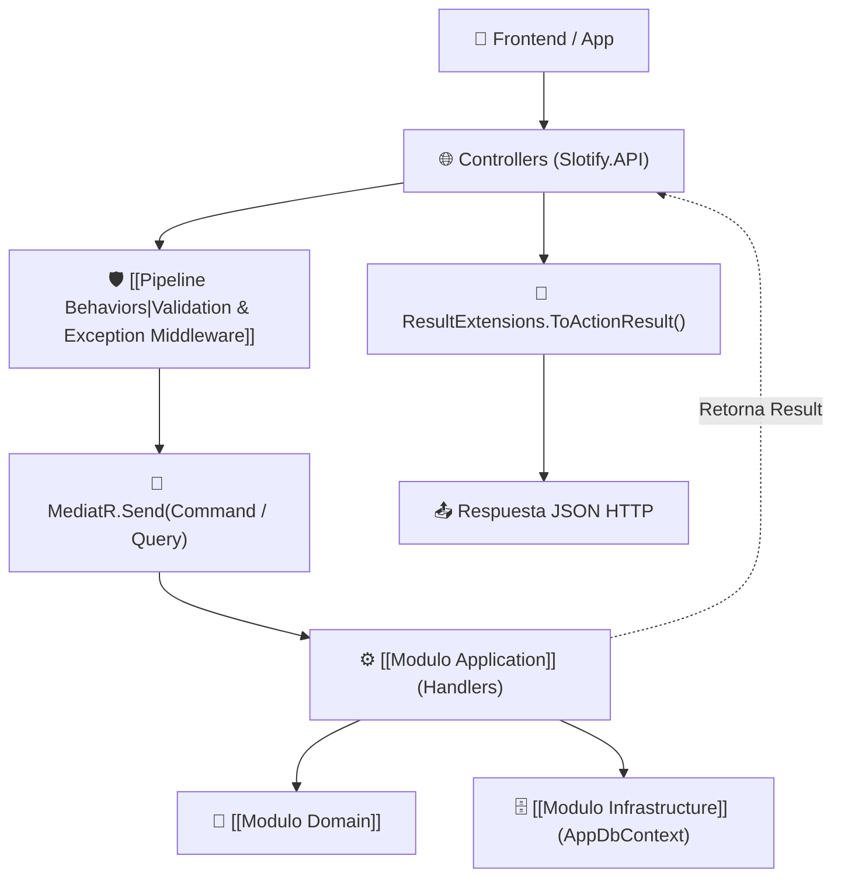

# Módulo API (`Slotify.API`)

El proyecto **`Slotify.API`** constituye la capa de presentación externa y el punto de entrada HTTP para todos los clientes del ecosistema Slotify (Aplicación Móvil en React Native / Expo, Panel Web de Administración y herramientas de prueba HTTP).

Implementado sobre **ASP.NET Core 9**, orquesta las peticiones entrantes, valida la seguridad perimetral mediante tokens JWT y delega la ejecución de los casos de uso hacia el [[Modulo Application]] mediante el patrón mediador (**MediatR**).

---

## 🎯 Responsabilidades Principales

1. **Exposición de Contratos RESTful:** Definir rutas canónicas `/api/...`, métodos HTTP semánticos y códigos de estado estandarizados.
2. **Despacho Desacoplado (CQRS):** Recibir solicitudes HTTP, enlazar modelos (Model Binding) y despacharlas como Comandos o Consultas a través de `IMediator`.
3. **Seguridad Perimetral y Autenticación:** Validar tokens Bearer JWT firmados simétricamente, extrayendo el contexto de identidad y pertenencia multi-inquilino (`businessId`).
4. **Carga y Configuración del Entorno:** Cargar variables de entorno locales desde ficheros `.env` utilizando `DotNetEnv` e integrarlas con la jerarquía de `IConfiguration` y `appsettings.json`.
5. **Manejo Centralizado de Excepciones:** Interceptar fallos no controlados y errores de validación de `FluentValidation` para devolver respuestas JSON predecibles sin filtrar información interna ni stack traces.
6. **Documentación OpenAPI Nativa (.NET 9):** Generar y exponer la especificación OpenAPI v1 en `/openapi/v1.json` sin dependencias de librerías externas de terceros.

---

## ⚙️ Inicialización y Pipeline HTTP (`Program.cs`)

El archivo [Program.cs](file:///D:/Aplicaciones/Slotify_back/src/Slotify.API/Program.cs) configura la inyección de dependencias y la secuencia ordenada del pipeline de middlewares HTTP:

```
Petición Cliente
       │
       ▼
[GlobalExceptionMiddleware] ──► Captura ValidationException (400) y excepciones no controladas (500)
       │
       ▼
[UseSerilogRequestLogging]   ──► Registro estructurado de método, ruta, código HTTP y latencia
       │
       ▼
[UseCors ("AllowAll")]       ──► Cabeceras CORS abiertas (AllowAnyOrigin, AllowAnyMethod, AllowAnyHeader)
       │
       ▼
[UseHttpsRedirection]        ──► Redirección HTTPS en entornos que no sean de desarrollo
       │
       ▼
[UseAuthentication]          ──► Decodificación y validación de firma criptográfica de JWT
       │
       ▼
[UseAuthorization]           ──► Evaluación de directivas [Authorize] y [AllowAnonymous]
       │
       ▼
[MapControllers]             ──► Enrutamiento hacia Controllers de aplicación
       │
       ▼
[MapGet("/health")]          ──► Endpoint mínimo de verificación de estado y uptime
```

### Carga de Variables de Entorno
La inicialización utiliza `DotNetEnv.Env.TraversePath().Load();` al inicio de `Program.cs`. Esto permite ubicar automáticamente el archivo `.env` en la raíz de la solución o del proyecto sin necesidad de componentes auxiliares ficticios.

### Política de CORS
La API expone la política nombrada `"AllowAll"`, diseñada específicamente para facilitar la comunicación con la aplicación móvil React Native en emuladores físicos, Android Studio, Expo Go y clientes web de desarrollo:
- Permite cualquier origen (`AllowAnyOrigin`).
- Permite cualquier método HTTP (`AllowAnyMethod`).
- Permite cualquier cabecera (`AllowAnyHeader`).

### Documentación OpenAPI Nativa
En lugar de Swashbuckle, el backend utiliza el paquete oficial de .NET 9 `Microsoft.AspNetCore.OpenApi`:
- Registro: `builder.Services.AddOpenApi();`
- Endpoint expuesto en desarrollo: `app.MapOpenApi();`, accesible en la ruta `/openapi/v1.json`.

---

## 🔐 Seguridad y Contexto de Usuario (`ICurrentUserService`)

La autenticación se implementa mediante `Microsoft.AspNetCore.Authentication.JwtBearer`:
- **Esquema:** `Bearer`.
- **Firma:** Clave simétrica `SymmetricSecurityKey` configurada en `Jwt:Secret`.
- **ClockSkew:** `TimeSpan.Zero` para expiración estricta sin tolerancia temporal adicional.

El servicio [CurrentUserService.cs](file:///D:/Aplicaciones/Slotify_back/src/Slotify.API/Services/CurrentUserService.cs) implementa la interfaz `ICurrentUserService` de la capa de aplicación:

```csharp
public interface ICurrentUserService
{
    bool IsAuthenticated { get; }
    Guid? UserId { get; }
    Guid? BusinessId { get; }
    string? Role { get; }
}
```

- `UserId` se resuelve inspeccionando `ClaimTypes.NameIdentifier` o `JwtRegisteredClaimNames.Sub`.
- `BusinessId` se extrae del claim personalizado `"businessId"` o `"business_id"`, garantizando el aislamiento de datos por inquilino en cada consulta o mutación.
- `Role` se obtiene del claim estándar `ClaimTypes.Role` o `"role"`.

---

## 🛡️ Manejo de Errores y Excepciones

La arquitectura desacopla el manejo de fallos en dos mecanismos complementarios:

### 1. `GlobalExceptionMiddleware`
Middleware personalizado que envuelve toda la ejecución de la petición:
- **`ValidationException` (FluentValidation):** Captura fallos arrojados por el [[Pipeline Behaviors|ValidationBehavior]] y devuelve HTTP `400 Bad Request` con el formato:
  ```json
  {
    "success": false,
    "message": "Los datos enviados no son válidos.",
    "errors": [
      "El nombre comercial es obligatorio.",
      "El teléfono debe contener entre 8 y 20 caracteres."
    ]
  }
  ```
- **`Exception` (No controlada):** Devuelve HTTP `500 Internal Server Error` con:
  ```json
  {
    "success": false,
    "message": "Ocurrió un error interno en el servidor."
  }
  ```

### 2. `GlobalExceptionHandler` (`IExceptionHandler`)
Implementación nativa de ASP.NET Core 9 registrada con `builder.Services.AddExceptionHandler<GlobalExceptionHandler>()` que actúa como salvaguarda secundaria devolviendo códigos `400` o `500` con `ProblemDetails`.

---

## 🔄 Traducción de Resultados: `ResultExtensions`

Para evitar que los Controllers contengan lógica condicional de negocio o mapeos redundantes, la clase estática [ResultExtensions.cs](file:///D:/Aplicaciones/Slotify_back/src/Slotify.API/Common/ResultExtensions.cs) traduce objetos `Result` y `Result<T>` a `IActionResult`:

| `Result.ErrorType` | Código HTTP Resultante | Estructura de Respuesta |
| :--- | :--- | :--- |
| **Éxito (`Success == true`)** | `200 OK` (o `201 Created` si se pasa delegado `onSuccess`) | `r` completo o dato transformado |
| `ErrorType.NotFound` | `404 Not Found` | `{ success: false, message, errors, error }` |
| `ErrorType.Forbidden` | `403 Forbidden` | `{ success: false, message, errors, error }` |
| `ErrorType.Conflict` | `409 Conflict` | `{ success: false, message, errors, error }` |
| `ErrorType.Validation` / `Failure` | `400 Bad Request` | `{ success: false, message, errors, error }` |

Cuerpo estándar de error emitido por `ResultExtensions`:
```json
{
  "success": false,
  "message": "Mensaje descriptivo del fallo",
  "errors": [
    "Detalle 1 del error",
    "Detalle 2 del error"
  ],
  "error": "Detalle 1 del error"
}
```

---

## 📂 Controladores y Mapeo de Endpoints

La capa API expone **6 controladores de aplicación** y **1 endpoint de infraestructura**:

| Controlador | Ruta Base | Casos de Uso / Responsabilidad | Documentación Detallada |
| :--- | :--- | :--- | :--- |
| [AuthController](file:///D:/Aplicaciones/Slotify_back/src/Slotify.API/Controllers/AuthController.cs) | `/api/auth` | Login con Supabase, registro de Administrador y sincronización de clientes finales | [[Feature Auth]] |
| [OnboardingController](file:///D:/Aplicaciones/Slotify_back/src/Slotify.API/Controllers/OnboardingController.cs) | `/api/onboarding` | Alta completa de negocio en 5 pasos (datos, branding, horarios, servicios) | [[Feature Onboarding]] |
| [BusinessesController](file:///D:/Aplicaciones/Slotify_back/src/Slotify.API/Controllers/BusinessesController.cs) | `/api/businesses` | Catálogo público, cambio de plantilla de sector, formularios dinámicos y branding | [[Feature Businesses]] |
| [CalendarController](file:///D:/Aplicaciones/Slotify_back/src/Slotify.API/Controllers/CalendarController.cs) | `/api/calendar` | Consulta unificada de disponibilidad (slots) y creación de citas | [[Feature Calendar]] |
| [ScheduleBlocksController](file:///D:/Aplicaciones/Slotify_back/src/Slotify.API/Controllers/ScheduleBlocksController.cs) | `/api/schedule-blocks` | Creación, consulta en rango y cancelación de bloqueos manuales de horario | [[Feature ScheduleBlocks]] |
| [SectorTemplatesController](file:///D:/Aplicaciones/Slotify_back/src/Slotify.API/Controllers/SectorTemplatesController.cs) | `/api/sector-templates` | Catálogo de giros comerciales y configuraciones predefinidas (seed data) | [[Feature SectorTemplates]] |
| **Infraestructura (Minimal API)** | `/health` | Verificación de disponibilidad y estado operativo del servicio | [[Contratos de API REST#🩺 8. Endpoints de Infraestructura y Diagnóstico|GET /health]] |

> [!important] Especificación Técnica Completa de Contratos
> La especificación detallada de cada uno de los 17 endpoints HTTP con sus modelos JSON, parámetros de ruta, query strings, códigos de estado, validaciones y ejemplos se encuentra documentada en:
> 👉 **[[Contratos de API REST]]**

---

## 🔗 Relaciones Arquitectónicas

- **Depende de:** [[Modulo Application]], [[Modulo Infrastructure]], [[Pipeline Behaviors]]
- **Referencia de Contratos:** [[Contratos de API REST]]
- **Flujos relacionados:** [[Flujo General de Peticion]], [[Flujo de Registro y Sync Auth]], [[Flujo de Registro y Sync Cliente Consumidor]], [[Flujo de Bloqueo de Horarios]], [[Flujo de Consulta de Citas y Estado Vacio]]


