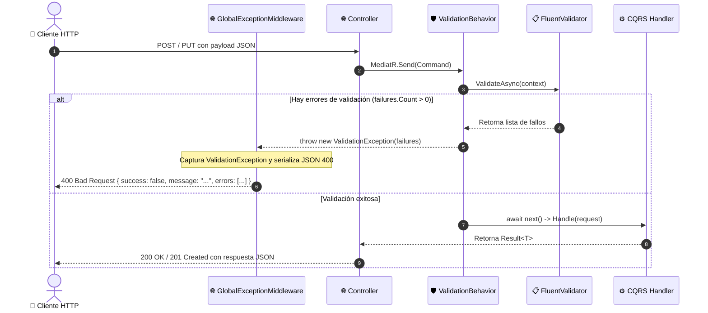

# 🛡️ Pipeline Behaviors de MediatR

Los **Pipeline Behaviors** son interceptores transversales de tipo *Middleware* que envuelven la ejecución de cada comando y query despachado hacia el [[Modulo Application]]. Permiten ejecutar validaciones, registros de auditoría o mediciones de rendimiento de forma desacoplada antes de alcanzar los *Handlers*.

---

## ⚡ 1. `ValidationBehavior<TRequest, TResponse>`

Implementado en [ValidationBehavior.cs](file:///D:/Aplicaciones/Slotify_back/src/Slotify.Application/Common/Behaviors/ValidationBehavior.cs). Antes de que un Handler se ejecute, el pipeline intercepta la petición y ejecuta automáticamente todas las reglas registradas en **FluentValidation**:

### Funcionamiento Técnico:
1. **Detección Automática:** Si no hay validadores registrados para `TRequest`, continúa directamente con `next()`.
2. **Evaluación Concurrente:** Ejecuta `Task.WhenAll` sobre todos los validadores inyectados (`IEnumerable<IValidator<TRequest>>`).
3. **Interrupción por Excepción:** Si detecta errores, **no retorna un objeto de error**; arroja deliberadamente un `ValidationException(failures)` que interrumpe la ejecución del caso de uso.
4. **Manejo Centralizado:** `GlobalExceptionMiddleware` en [[Modulo API]] atrapa el `ValidationException`, extrae los mensajes únicos con `Select(e => e.ErrorMessage).Distinct()` y responde HTTP `400 Bad Request` en formato estándar.

---

## 📋 2. Validadores FluentValidation Implementados

Todos los validadores residen en sus respectivas subcarpetas dentro de `Slotify.Application/Features`:

| Validador | Comando Asociado | Principales Reglas Aplicadas |
| :--- | :--- | :--- |
| `RegisterAdminValidator` | `RegisterAdminCommand` | ID de Supabase no vacío, formato RFC de email, nombre comercial obligatorio (máx. 100 chars), `SectorTemplateId > 0`. |
| `RegisterClientValidator` | `RegisterClientCommand` | ID de Supabase no vacío, email válido, nombre obligatorio. |
| `CompleteBusinessOnboardingValidator` | `CompleteBusinessOnboardingCommand` | Valida propietario (ID, email, nombre), datos de negocio (nombre máx. 150 chars, sector existente en BD), al menos 1 horario configurado con `startTime < endTime`, y al menos 1 servicio con duración > 0 y precio >= 0. |
| `CreateAppointmentValidator` | `CreateAppointmentCommand` | Nombre de cliente no vacío (máx. 100), `StartTime < EndTime`, `AgreedTotal >= 0`, email válido si existe. |
| `CreateScheduleBlockValidator` | `CreateScheduleBlockCommand` | `StartDateTime < EndDateTime`, motivo no nulo opcional (máx. 255 chars). |
| `UpdateBusinessBrandIdentityValidator` | `UpdateBusinessBrandIdentityCommand` | Valida códigos hexadecimales válidos para `AccentColor` y `SecondaryColor` si son enviados, y URL válida para `LogoUrl`. |
| `UpdateBusinessFormConfigValidator` | `UpdateBusinessFormConfigCommand` | Valida que la estructura del formulario JSONB sea consistente y parseable. |

---

## 🔗 Relaciones Arquitectónicas
- **Ubicación en Código:** [ValidationBehavior.cs](file:///D:/Aplicaciones/Slotify_back/src/Slotify.Application/Common/Behaviors/ValidationBehavior.cs)
- **Registro en DI:** `AddApplicationServices()` en [DependencyInjection.cs](file:///D:/Aplicaciones/Slotify_back/src/Slotify.Application/DependencyInjection.cs)
- **Manejo HTTP:** `GlobalExceptionMiddleware.cs` y `GlobalExceptionHandler.cs` en [[Modulo API]]
- **Flujo Global:** [[Flujo General de Peticion]]
