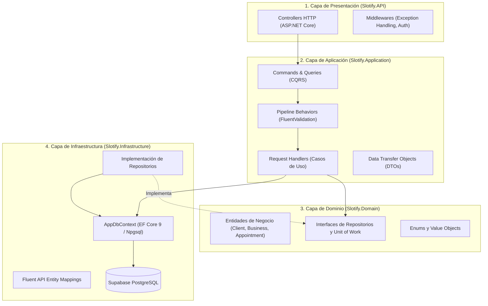
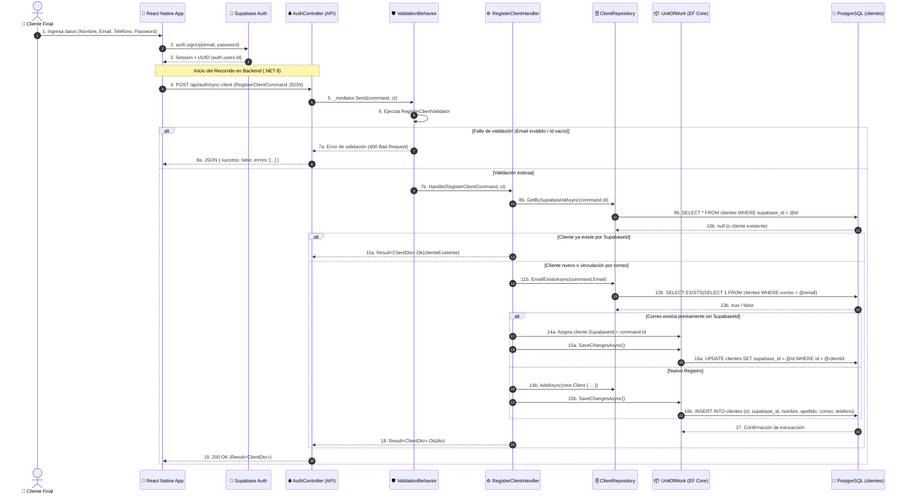

# Flujo General de una Petición (End-to-End) en Slotify Backend

Este documento describe detalladamente la **arquitectura del backend**, el **recorrido universal de la información en cada petición HTTP** y el ciclo de vida completo de los datos desde el cliente hasta la persistencia física en **PostgreSQL (Supabase)**.

---

##  0. Aspectos Generales de la Arquitectura

El backend de **Slotify** está construido sobre **.NET 8** adoptando el paradigma de **Clean Architecture** (Arquitectura Limpia) y el patrón **CQRS** (Command Query Responsibility Segregation) desacoplado mediante **MediatR**.

### Las 4 Capas de la Solución



### 🔁 El Recorrido Universal de una Petición (Request Lifecycle)

1. **Recepción HTTP (`Slotify.API`):**
   - El cliente (React Native / Web) envía una solicitud HTTP con payload JSON a un endpoint de [[Modulo API]].
   - El *Model Binder* de ASP.NET Core deserializa automáticamente el cuerpo de la petición en un objeto fuertemente tipado (`IRequest<Result<T>>`).

2. **Despacho y Pipeline de Mediación (`Slotify.Application`):**
   - El controlador no contiene lógica de negocio; únicamente despacha la petición al bus en memoria mediante `_mediator.Send(command, cancellationToken)`.
   - La petición ingresa a los [[Pipeline Behaviors]].

3. **Validación Automática (`FluentValidation`):**
   - El `ValidationBehavior` intercepta la petición antes de que llegue al Handler. Si existen errores de validación de formato o reglas previas, se corta el flujo inmediatamente y se devuelve un `Result.Fail(...)` con código HTTP 400 Bad Request.

4. **Ejecución del Caso de Uso (Handler):**
   - El Handler correspondiente toma el comando validado, consulta o actualiza entidades de dominio a través de `IUnitOfWork` e interfaces de repositorios (`IClientRepository`, etc.), aplicando las reglas de negocio del [[Modulo Domain]].

5. **Persistencia y Transaccionalidad (`Slotify.Infrastructure`):**
   - Los cambios en entidades se rastrean en el `ChangeTracker` de `AppDbContext`.
   - Al ejecutar `_unitOfWork.SaveChangesAsync()`, Entity Framework Core traduce las operaciones en sentencias SQL parametrizadas (`INSERT`, `UPDATE`, `SELECT`) y las envía por TCP a **PostgreSQL (Supabase)** en una transacción atómica.

6. **Envoltorio Estándar de Respuesta (`Result<T>`):**
   - El handler mapea la entidad a un DTO y la envuelve en un sobre estándar `Result<T>.Ok(dto)` o `Result<T>.Fail(error)`. El controlador recibe el resultado y emite la respuesta HTTP correspondiente (200 OK, 201 Created, 400 Bad Request o 409 Conflict).

---

### 🌐 ¿Aplica este Recorrido a Cualquier Petición o Ruta del Sistema?

**Sí, el 99% de las rutas del backend de Slotify siguen exactamente este mismo ciclo de vida.** La arquitectura fue diseñada para ser estrictamente consistente y predecible en todos los módulos de la aplicación.

#### 1. La Regla de Oro: Commands vs. Queries (CQRS)
Sin importar a qué controlador o ruta HTTP se haga la llamada, la capa de Presentación siempre delega el trabajo a través de `_mediator.Send()`:

| Tipo de Acción HTTP | Tipo de Mensaje en MediatR | Propósito Arquitectónico | Ejemplos Reales en Slotify |
| :--- | :--- | :--- | :--- |
| **`POST`, `PUT`, `DELETE`** | **Command (Comando)** | Solicita una mutación de estado (crear, actualizar o eliminar registros en la base de datos). | `POST /api/auth/sync-client` → `RegisterClientCommand`<br>`POST /api/schedule-blocks` → `CreateScheduleBlockCommand` |
| **`GET`** | **Query (Consulta)** | Solicita información de solo lectura sin alterar el estado del sistema. | `GET /api/sector-templates` → `GetSectorTemplatesQuery`<br>`GET /api/calendar/appointments` → `GetCalendarAppointmentsQuery` |

> [!TIP]
> **Consistencia Total:** En Slotify, ningún controlador consulta directamente la base de datos ni contiene reglas de negocio. Todos son **Controladores Delgados (*Thin Controllers*)** de 3 a 5 líneas de código por endpoint.

---

#### 2. La Analogía del Restaurante (¿Cómo visualizarlo?)
Para tener una imagen mental clara del flujo universal:

```
[ Cliente (Móvil/Web) ] ──> [ Mesero (Controller) ] ──> [ Ticket (Command/Query) ] ──> [ Ventanilla (MediatR) ] ──> [ Aduana (Validation) ] ──> [ Cocinero (Handler) ]
```

* **El Mesero (`Controller`):** Recibe la orden del cliente, no cocina ni pica verduras. Solo anota el pedido en un ticket.
* **El Ticket (`Command` o `Query`):** Objeto fuertemente tipado con los datos que llegaron en la petición HTTP.
* **La Ventanilla (`_mediator.Send`):** Punto central donde se entrega el ticket sin necesidad de buscar al cocinero en persona.
* **La Aduana (`ValidationBehavior`):** Control de calidad e integridad previo a la ejecución.
* **El Cocinero (`Handler`):** El especialista del caso de uso que toma los ingredientes (repositorios de PostgreSQL) y prepara el resultado final.

---

#### 3. El Comportamiento Inteligente de la Aduana (`ValidationBehavior`)
Una duda común es: *¿Si todas las peticiones pasan por la aduana, no se vuelve lento el sistema para peticiones sencillas?*

La respuesta es **no**, gracias a la verificación inteligente en `ValidationBehavior.cs`:

```csharp
public async Task<TResponse> Handle(TRequest request, RequestHandlerDelegate<TResponse> next, ...)
{
    // ⚡ Vía Rápida: Si la petición NO requiere validación, no gasta recursos
    if (!validators.Any())
        return await next();

    // 🛡️ Vía con Inspección: Si tiene reglas registradas, las evalúa en paralelo
    var context = new ValidationContext<TRequest>(request);
    var validationResults = await Task.WhenAll(validators.Select(v => v.ValidateAsync(context, cancellationToken)));
    ...
}
```

* **Rutas de Escritura con Reglas (`POST`, `PUT`):** Tienen un validador registrado en FluentValidation (ej. `RegisterClientValidator`, `CreateScheduleBlockValidator`). La aduana frena la petición, ejecuta las reglas y, si algo está mal, **cortocircuita inmediatamente** respondiendo `400 Bad Request` sin tocar la base de datos PostgreSQL.
* **Rutas Simples o de Consulta (`GET`):** Si una petición no define validadores (ej. `GetSectorTemplatesQuery`), la aduana detecta `!validators.Any()` y en nanosegundos cede el paso hacia el Handler sin penalización de rendimiento.

---

#### 4. Las Únicas Excepciones: Endpoints Técnicos de Infraestructura
Las únicas rutas que **NO** siguen este recorrido de MediatR y Clean Architecture son los endpoints de infraestructura definidos directamente en `Program.cs`:
* **Health Check:** `GET /health` (`app.MapGet("/health", ...)`), que solo devuelve el estado del servidor.
* **Documentación OpenAPI / Swagger:** `/openapi/v1.json`, gestionado internamente por el motor de ASP.NET Core.

Cualquier otra ruta alojada en la carpeta `Controllers/` cumple estrictamente el recorrido universal descrito en este documento.

---

## 1. 📌 Resumen del Caso de Uso Guiado (Ejemplo de Referencia)

### Caso de Uso: Sincronización y Registro de Cliente Consumidor (`POST /api/auth/sync-client`)
Permite registrar o sincronizar los datos de perfil de un **Cliente Final (B2C)** en PostgreSQL inmediatamente después de que completa su registro en **Supabase Auth**.

> [!info] Idempotencia y Multi-Negocio
> El cliente consumidor no pertenece a un `business_id` en particular (a diferencia de un Administrador o Empleado). El flujo garantiza **idempotencia**: si el cliente ya existe o ya fue creado previamente sin Supabase ID, vincula su identificador sin generar duplicados.

---

## 2. 🔄 Diagrama de Secuencia (Mermaid)



---

## 3. 🔍 Paso a Paso del Flujo de Información (Trace Detallado)

### Paso 1: Controlador HTTP (`Slotify.API`)
* **Archivo:** `src/Slotify.API/Controllers/AuthController.cs`
* **Método:** `SyncClient([FromBody] RegisterClientCommand command, CancellationToken ct)`
* **Responsabilidad:** Recibir la solicitud y delegarla a MediatR.
```csharp
[HttpPost("sync-client")]
[ProducesResponseType(StatusCodes.Status200OK)]
[ProducesResponseType(StatusCodes.Status400BadRequest)]
public async Task<IActionResult> SyncClient(
    [FromBody] RegisterClientCommand command,
    CancellationToken cancellationToken)
{
    var result = await _mediator.Send(command, cancellationToken);

    if (!result.Success)
        return BadRequest(result);

    return Ok(result);
}
```

### Paso 2: Validación en Pipeline (`Slotify.Application`)
* **Archivo:** `src/Slotify.Application/Features/Auth/Commands/RegisterClientValidator.cs`
* **Reglas comprobadas:**
  - `Id`: Obligatorio (`NotEmpty`).
  - `FirstName` / `FullName`: Al menos uno no vacío.
  - `Email`: Obligatorio, máximo 150 caracteres y formato RFC de correo válido.
  - `Phone`: Máximo 30 caracteres.

### Paso 3: Orquestación del Handler (`Slotify.Application`)
* **Archivo:** `src/Slotify.Application/Features/Auth/Commands/RegisterClientHandler.cs`
* **Lógica de negocio:**
  1. Consulta `IClientRepository.GetBySupabaseIdAsync()`. Si lo halla, retorna el DTO del cliente existente.
  2. Si el email ya existía pero con `SupabaseId == null`, actualiza el ID y persiste.
  3. Si no existe, normaliza nombre y apellido e instancia una nueva entidad [[Client]] asignando `Id = request.Id` (garantizando paridad 1:1 con `auth.users.id`).
  4. Llama a `_clientRepository.AddAsync(client)` y `_unitOfWork.SaveChangesAsync()`.

### Paso 4: Capa de Persistencia (`Slotify.Infrastructure`)
* **Archivos:** `ClientRepository.cs`, `AppDbContext.cs`, `ClientConfiguration.cs`
* **Mapeo:** EF Core mapea los campos C# a la tabla `clientes` y genera el SQL nativo para PostgreSQL.

---

## 4. Ejemplo Práctico de Payload / Datos en Tránsito

### A. HTTP Request Payload (`Frontend ➡️ Backend`)
```json
POST /api/auth/sync-client
Content-Type: application/json

{
  "id": "7b8f9e12-3456-4789-abcd-0123456789ab",
  "firstName": "Andrea",
  "lastName": "Gómez",
  "fullName": "Andrea Gómez",
  "email": "andrea.gomez@correo.com",
  "phone": "+5215587654321"
}
```

### B. Comando C# Deserializado (`Application Layer`)
```csharp
public record RegisterClientCommand : IRequest<Result<ClientDto>>
{
    public Guid Id { get; init; } = Guid.Parse("7b8f9e12-3456-4789-abcd-0123456789ab");
    public string FirstName { get; init; } = "Andrea";
    public string LastName { get; init; } = "Gómez";
    public string? FullName { get; init; } = "Andrea Gómez";
    public string Email { get; init; } = "andrea.gomez@correo.com";
    public string? Phone { get; init; } = "+5215587654321";
}
```

### C. HTTP Response Payload (`Backend ➡️ Frontend`)
```json
HTTP/1.1 200 OK
Content-Type: application/json

{
  "success": true,
  "message": null,
  "errors": [],
  "data": {
    "id": "7b8f9e12-3456-4789-abcd-0123456789ab",
    "supabaseId": "7b8f9e12-3456-4789-abcd-0123456789ab",
    "firstName": "Andrea",
    "lastName": "Gómez",
    "fullName": "Andrea Gómez",
    "email": "andrea.gomez@correo.com",
    "phone": "+5215587654321"
  }
}
```

---

## 5.  Acceso Final a la Base de Datos

### Esquema y Tabla
* **Esquema:** `public`
* **Tabla:** `clientes`
* **Mapeo Fluent API (`ClientConfiguration.cs`):**

| Propiedad C# | Columna PostgreSQL | Tipo SQL | Restricciones |
| :--- | :--- | :--- | :--- |
| `Id` | `id` | `UUID` | Primary Key |
| `SupabaseId` | `supabase_id` | `UUID` | UNIQUE |
| `FirstName` | `nombre` | `VARCHAR(100)` | NOT NULL |
| `LastName` | `apellido` | `VARCHAR(100)` | NULL |
| `Email` | `correo` | `VARCHAR(150)` | NOT NULL, UNIQUE |
| `Phone` | `telefono` | `VARCHAR(30)` | NULL |
| `CreatedAt` | `fecha_creacion` | `TIMESTAMPTZ` | DEFAULT `CURRENT_TIMESTAMP` |
| `UpdatedAt` | `fecha_actualizacion` | `TIMESTAMPTZ` | DEFAULT `CURRENT_TIMESTAMP` |

### Sentencia SQL Ejecutada en PostgreSQL
```sql
INSERT INTO clientes (
    id, 
    supabase_id, 
    nombre, 
    apellido, 
    correo, 
    telefono, 
    fecha_creacion, 
    fecha_actualizacion
) 
VALUES (
    '7b8f9e12-3456-4789-abcd-0123456789ab',
    '7b8f9e12-3456-4789-abcd-0123456789ab',
    'Andrea',
    'Gómez',
    'andrea.gomez@correo.com',
    '+5215587654321',
    CURRENT_TIMESTAMP,
    CURRENT_TIMESTAMP
)
RETURNING id;
```

> [!success] Integridad Relacional
> El identificador de la entidad `Client` coincide 1:1 con el `auth.users.id` de Supabase, lo que permite que cualquier consulta futura de citas (`appointments`) se relacione directamente con el usuario autenticado sin requerir tablas intermedias de mapeo.

---

## 🔗 Enlaces Relacionados
* [[Modulo API]]
* [[Modulo Application]]
* [[Modulo Domain]]
* [[Modulo Infrastructure]]
* [[Pipeline Behaviors]]
* [[Flujo de Registro y Sync Auth]]
* [[Flujo de Registro y Sync Cliente Consumidor]]
* [[Base de datos - Proyecto]]
