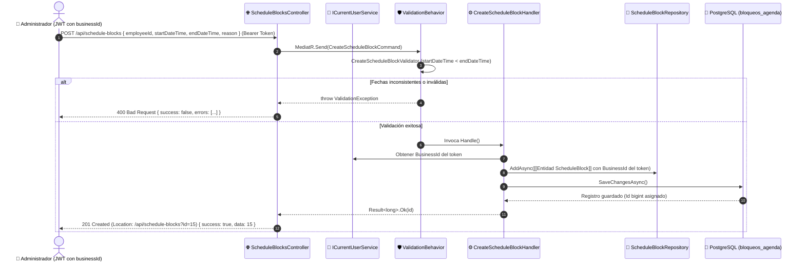

# 📅 Flujo de Bloqueo de Horarios (`ScheduleBlocks`)

Permite a un negocio bloquear franjas de tiempo en su agenda para que ningún cliente ni colaborador pueda agendar citas en ese periodo.

---

## 🔄 Diagrama de Secuencia: Creación de Bloqueo

---

## 🔍 Consulta de Bloqueos (`GET /api/schedule-blocks`)

Cuando el calendario del negocio se abre:
1. El cliente envía `GET /api/schedule-blocks?startDate=...&endDate=...` con cabecera `Authorization: Bearer <token>`.
2. `GetScheduleBlocksHandler` extrae el `BusinessId` de `ICurrentUserService` y llama a `ScheduleBlockRepository.GetByDateRangeAsync()`.
3. Entity Framework consulta la tabla `bloqueos_agenda` filtrando por `id_negocio = @businessId` y solapamiento de fechas con zona horaria UTC.
4. Se retornan los bloqueos mapeados a `Result<IEnumerable<ScheduleBlockDto>>`.

---

## ⚠️ Incidencia de Integración en Frontend
> [!warning] Estado en Frontend
> Aunque el backend tiene completamente implementados y cubiertos por pruebas unitarias e integración estos endpoints (`POST`, `GET`, `DELETE /api/schedule-blocks`), el frontend en `src/features/schedule-blocks/api/index.ts` mantiene stubs con `TODO` que arrojan excepciones explícitas (`throw new Error('US-008: createScheduleBlock no implementado')`).

---

## 🔗 Componentes Relacionados
* [[Feature ScheduleBlocks]]
* [[Entidad ScheduleBlock]]
* [[Entidad Business]]
* [[Contratos de API REST]]
* [[Repositorios]]
* [[Pipeline Behaviors]]
