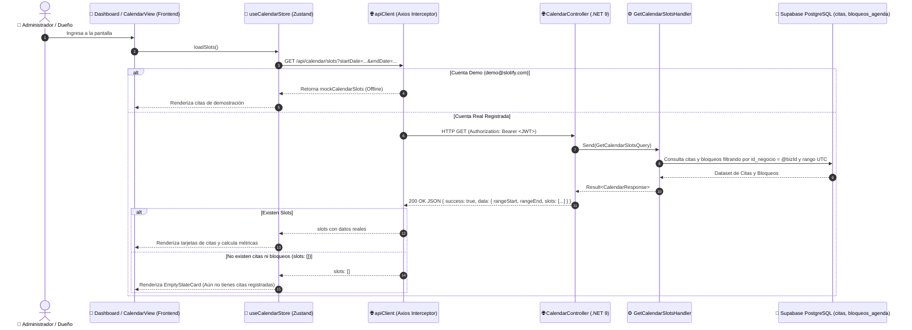

# 📅 Flujo de Consulta de Citas y Manejo de Estados Vacíos

Este documento describe el flujo integral desde la **Historia de Usuario** hasta el tránsito de datos entre los módulos del **Frontend (React Native / Expo)** y el **Backend (.NET 9 Web API / Supabase PostgreSQL)**.

---

## 🎯 Historia de Usuario Asociada: US-003 / US-004

* **Como:** Dueño de negocio o empleado autenticado en Slotify.
* **Quiero:** Consultar las citas registradas en tiempo real para mi negocio y disponer de una interfaz clara cuando aún no tenga citas programadas.
* **Para:** Administrar la operatividad diaria, dar seguimiento a clientes y crear nuevas reservas fácilmente.

### Criterios de Aceptación:
1. **Aislamiento Demo:** La cuenta `demo@slotify.com` / `admin@slotify.com` renderiza datos simulados offline.
2. **Cuentas Reales:** Consulta el endpoint `GET /api/calendar/slots` autenticado vía Bearer JWT (`businessId`).
3. **Manejo de Estado Vacío:** Si el backend responde sin citas (`slots: []`), el frontend muestra un componente de estado vacío con botones de acción rápida (*Crear Cita*, *Compartir Enlace*) y métricas en cero sin provocar errores.

---

## 📊 Diagrama de Secuencia End-to-End

---

## 🔄 Tránsito de la Información por Capas

### 1. Capa de Presentación (Frontend)
* **Componentes:** `DashboardScreen`, `CalendarView`, `EmptyStateCard`.
* **Comportamiento:** Escucha reactivamente el estado de `slots` en `useCalendarStore`. Si `slots.length === 0`, renderiza el mensaje informativo con enlaces de acción.

### 2. Capa ViewModel / Store (Frontend)
* **Archivo:** `src/features/calendar/model/index.ts`
* **Acción:** Invoca `loadSlots()`, calcula métricas en tiempo real (Citas Hoy, Clientes, Ingresos Hoy, Pendientes).

### 3. Capa de Red (API Client)
* **Archivo:** `src/features/calendar/api/index.ts`
* **Responsabilidad:** Gestiona la llamada a `GET /api/calendar/slots`. Para cuentas no-demo, propaga la respuesta real del backend sin inyectar datos falsos.

### 4. Capa de Controladores (Backend)
* **Controlador:** `CalendarController.cs`
* **Endpoint:** `[HttpGet("slots")]`
* **Seguridad:** Extrae el `BusinessId` del claim del JWT del usuario autenticado (*Zero Trust* vía `ICurrentUserService`).

### 5. Capa de Aplicación (Backend MediatR Handler)
* **Query:** `GetCalendarSlotsQuery`
* **Handler:** `GetCalendarSlotsHandler`
* **Lógica:** Consulta las citas activas y bloqueos del negocio para el rango de fechas solicitado, mapeando ambos conceptos a una lista polimórfica de `CalendarSlotDto`.

### 6. Capa de Persistencia (Base de Datos)
* **Tablas involucradas:** `citas`, `bloqueos_agenda`, `horarios_disponibilidad`, `negocios`.
* **Filtro Multi-Tenant:** `WHERE id_negocio = @businessId`.

---

## 🔗 Enlaces Relacionados
* [[Flujo General de Peticion]]
* [[Feature Calendar]]
* [[Contratos de API REST]]
* [[AppDbContext]]
