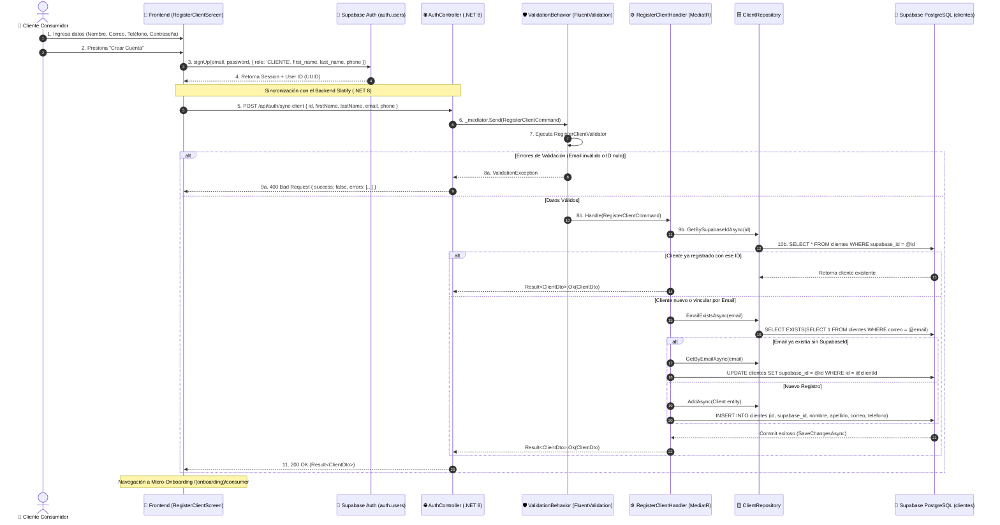

# 👤 Flujo de Registro y Sincronización de Cliente Consumidor (B2C)

Este documento detalla el ciclo de vida completo del registro y sincronización de un **Cliente Consumidor Final** (rol `CLIENTE`) entre la aplicación móvil/web (**React Native / Expo**), el servicio de autenticación (**Supabase Auth**) y la base de datos relacional de **Slotify (.NET 8 Web API / PostgreSQL)**, describiendo el recorrido arquitectónico paso a paso.

---

## 🏛️ 0. Aspectos Generales de la Arquitectura en este Flujo

La arquitectura desacoplada de Slotify procesa este caso de uso a través de sus cuatro capas:

1. **Presentación (`Slotify.API`):** Expone el endpoint `POST /api/auth/sync-client` mediante `AuthController.cs`.
2. **Aplicación (`Slotify.Application`):** Orquesta el comando [[RegisterClientCommand]] a través del `RegisterClientHandler`, con validación previa de [[RegisterClientValidator]].
3. **Dominio (`Slotify.Domain`):** Modela la entidad [[Client]] y define las abstracciones de repositorio (`IClientRepository`).
4. **Infraestructura (`Slotify.Infrastructure`):** Realiza la persistencia relacional con `AppDbContext`, `ClientConfiguration` y `ClientRepository` sobre la tabla `clientes` en **PostgreSQL**.

---

## 1. 📌 Resumen del Caso de Uso

### Historia de Usuario: US-001 (Cliente Final)
* **Como:** Cliente consumidor que desea agendar citas en negocios.
* **Quiero:** Crear mi cuenta con nombre, correo, teléfono y contraseña, y sincronizar mi perfil con la base de datos de Slotify.
* **Para:** Descubrir negocios, reservar servicios 24/7 y gestionar mis citas sin llamadas.

> [!info] Aislamiento B2C (Multi-Negocio)
> A diferencia de los administradores o colaboradores de un negocio, el **Cliente Consumidor** no pertenece a un inquilino único (`business_id = null`); es un usuario transversal que puede interactuar con múltiples negocios en la plataforma.

---

## 2. 🔄 Diagrama de Secuencia (Mermaid)



---

## 3. 🔍 Paso a Paso del Flujo de Información (Trace Detallado)

### 1. Desencadenador en Frontend (`React Native / Expo`)
* **Pantalla:** `src/features/auth/ui/RegisterClientScreen.tsx`
* **Llamada de API:** `authApi.registerClient(payload)` envía solicitud POST hacia `/api/auth/sync-client`.

### 2. Capa de Presentación (`Slotify.API`)
* **Controlador:** `AuthController.cs`
* **Endpoint:** `[HttpPost("sync-client")]`
* **Acción:** Recibe el cuerpo de la petición deserializado en `RegisterClientCommand` y lo envía a través de MediatR:
  ```csharp
  [HttpPost("sync-client")]
  [ProducesResponseType(StatusCodes.Status200OK)]
  [ProducesResponseType(StatusCodes.Status400BadRequest)]
  public async Task<IActionResult> SyncClient(
      [FromBody] RegisterClientCommand command,
      CancellationToken cancellationToken)
  ```

### 3. Pipeline de Validación (`Slotify.Application`)
* **Validador:** `RegisterClientValidator.cs` (FluentValidation)
* **Reglas aplicadas:**
  - `Id`: Obligatorio (Guid no vacío).
  - `FirstName` o `FullName`: Obligatorio al menos uno.
  - `Email`: Obligatorio, formato válido y máx. 150 caracteres.
  - `Phone`: Opcional, máx. 30 caracteres.

### 4. Orquestación del Caso de Uso (`Slotify.Application`)
* **Handler:** `RegisterClientHandler.cs`
* **Lógica de Idempotencia y Normalización:**
  1. **Verificación de duplicados por SupabaseId:** Si el cliente ya existe, se devuelve inmediatamente su `ClientDto` con status `Success = true`.
  2. **Vincular por correo:** Si el correo ya existía (ej. precargado manualmente por un administrador de negocio) pero no tenía `SupabaseId`, se le asigna el nuevo `request.Id` y se guardan los cambios.
  3. **Normalización de Nombres:** Si no se suministró `LastName`, extrae automáticamente el apellido a partir de `FullName`.
  4. **Instanciación de la Entidad:** Se genera la entidad `Client` asignando `Id = request.Id`.

### 5. Persistencia y Base de Datos (`Slotify.Infrastructure`)
* **Repositorio:** `ClientRepository.cs`
* **Unit of Work:** `IUnitOfWork.SaveChangesAsync(cancellationToken)`
* **EF Core Context:** `AppDbContext.cs` traduce el cambio a una sentencia SQL nativa parametrizada y la ejecuta en PostgreSQL.

---

## 4. 📦 Ejemplo Práctico de Payload / Datos en Tránsito

### A. Solicitud HTTP (`POST /api/auth/sync-client`)
```json
{
  "id": "e4d7a123-9876-4321-bcf0-abcdef012345",
  "firstName": "Sofía",
  "lastName": "Martínez",
  "fullName": "Sofía Martínez",
  "email": "sofia.martinez@example.com",
  "phone": "+5215544332211"
}
```

### B. Comando C# en Memoria (`RegisterClientCommand`)
```csharp
public record RegisterClientCommand : IRequest<Result<ClientDto>>
{
    public Guid Id { get; init; } = Guid.Parse("e4d7a123-9876-4321-bcf0-abcdef012345");
    public string FirstName { get; init; } = "Sofía";
    public string LastName { get; init; } = "Martínez";
    public string? FullName { get; init; } = "Sofía Martínez";
    public string Email { get; init; } = "sofia.martinez@example.com";
    public string? Phone { get; init; } = "+5215544332211";
}
```

### C. Respuesta HTTP (`200 OK con Result<ClientDto>`)
```json
{
  "success": true,
  "message": null,
  "errors": [],
  "data": {
    "id": "e4d7a123-9876-4321-bcf0-abcdef012345",
    "supabaseId": "e4d7a123-9876-4321-bcf0-abcdef012345",
    "firstName": "Sofía",
    "lastName": "Martínez",
    "fullName": "Sofía Martínez",
    "email": "sofia.martinez@example.com",
    "phone": "+5215544332211"
  }
}
```

---

## 5. 🗄️ Acceso Final a la Base de Datos

### Esquema y Tabla
* **Esquema:** `public`
* **Tabla Afectada:** `clientes`

### Mapeo EF Core (`ClientConfiguration.cs`)
```csharp
builder.ToTable("clientes");
builder.HasKey(x => x.Id);
builder.Property(x => x.Id).HasColumnName("id");
builder.Property(x => x.SupabaseId).HasColumnName("supabase_id");
builder.HasIndex(x => x.SupabaseId).IsUnique();
builder.Property(x => x.FirstName).HasColumnName("nombre").HasMaxLength(100).IsRequired();
builder.Property(x => x.LastName).HasColumnName("apellido").HasMaxLength(100);
builder.Ignore(x => x.FullName);
builder.Property(x => x.Email).HasColumnName("correo").HasMaxLength(150).IsRequired();
builder.HasIndex(x => x.Email).IsUnique();
builder.Property(x => x.Phone).HasColumnName("telefono").HasMaxLength(30);
builder.Property(x => x.CreatedAt).HasColumnName("fecha_creacion").HasDefaultValueSql("CURRENT_TIMESTAMP");
builder.Property(x => x.UpdatedAt).HasColumnName("fecha_actualizacion").HasDefaultValueSql("CURRENT_TIMESTAMP");
```

### Sentencia SQL Ejecutada (PostgreSQL)
```sql
INSERT INTO clientes (
    id, 
    supabase_id, 
    nombre, 
    apellido, 
    correo, 
    telefono, 
    fecha_creacion, 
    fecha_actualizacion
) 
VALUES (
    'e4d7a123-9876-4321-bcf0-abcdef012345',
    'e4d7a123-9876-4321-bcf0-abcdef012345',
    'Sofía',
    'Martínez',
    'sofia.martinez@example.com',
    '+5215544332211',
    CURRENT_TIMESTAMP,
    CURRENT_TIMESTAMP
)
RETURNING id;
```

> [!success] Garantía de Idempotencia y Resiliencia
> La sincronización maneja los tres escenarios posibles (nuevo registro, reintento de sincronización y vinculación de cliente previamente registrado) sin producir colisiones de unicidad en PostgreSQL.

---

## 🔗 Enlaces Relacionados
* [[Flujo General de Peticion]]
* [[Modulo API]]
* [[Modulo Application]]
* [[Modulo Infrastructure]]
* [[Pipeline Behaviors]]
* [[Base de datos - Proyecto]]
