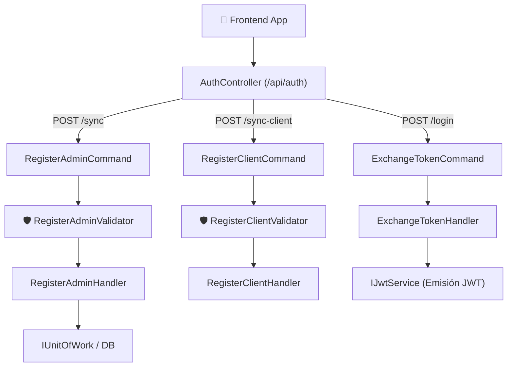

# 🔐 Feature Auth (Autenticación, Registro y Emisión de JWT)

> [!abstract] Propósito del Módulo
> Orquesta el ciclo de autenticación, alta multi-inquilino y sincronización de perfiles en PostgreSQL tras la validación de identidad en **Supabase Auth**.
> - **Supabase Auth:** Responsable externo de la gestión de identidades, contraseñas, proveedores OAuth y emisión de sesiones de usuario.
> - **Backend Slotify:** Responsable de sincronizar los perfiles de administradores (`usuarios`) y clientes (`clientes`), asociar el negocio inquilino (`negocios`) y emitir el token JWT propio con el claim `businessId` para gobernar el aislamiento multi-tenant.

---

## 🧭 Estado de Implementación

| Endpoint / Caso de Uso | Implementado | Probado | Integrado en Frontend | Estado Global |
| :--- | :---: | :---: | :---: | :---: |
| `POST /api/auth/login` (Intercambio de Token) | ✅ Sí | ✅ Sí (`ProtectedEndpointsTests`) | ❌ No (Frontend no lo invoca) | **Implementado / Requiere integración** |
| `POST /api/auth/sync` (Sincronización Dueño B2B) | ✅ Sí | ✅ Sí (`ProtectedEndpointsTests`) | ✅ Sí (`RegisterScreen.tsx`, Onboarding Store) | **Implementado, Probado e Integrado** |
| `POST /api/auth/sync-client` (Sincronización B2C) | ✅ Sí | ⚠️ Mocks (`ApiTests`) | ✅ Sí (`RegisterClientScreen.tsx`) | **Implementado e Integrado** |

---

## 🛠️ Controlador y Rutas Asociadas

* **Controlador:** [AuthController.cs](file:///D:/Aplicaciones/Slotify_back/src/Slotify.API/Controllers/AuthController.cs)
* **Ruta base:** `/api/auth`
* **Seguridad:** `[AllowAnonymous]` a nivel de clase (Puntos de entrada públicos para intercambio y sincronización).

| Método | Ruta | Descripción | Payload | Código HTTP Éxito |
| :--- | :--- | :--- | :--- | :---: |
| `POST` | `/api/auth/login` | Intercambia identificadores (`userId`, `email`) por JWT Slotify con claim `businessId`. | `ExchangeTokenCommand` | `200 OK` |
| `POST` | `/api/auth/sync` | Registra administrador en `usuarios` y provisiona su negocio en `negocios`. | `RegisterAdminCommand` | `200 OK` |
| `POST` | `/api/auth/sync-client` | Registra o actualiza de forma idempotente un cliente consumidor en `clientes`. | `RegisterClientCommand` | `200 OK` |

---

## ⚙️ Commands, Handlers y Validaciones



### 1. `ExchangeTokenCommand` (US-000 / US-022)
* **Handler:** [ExchangeTokenCommand.cs](file:///D:/Aplicaciones/Slotify_back/src/Slotify.Application/Features/Auth/Commands/ExchangeTokenCommand.cs)
* **Mecanismo Real:**
  1. Recibe el payload `{ Guid userId, string email }` en el cuerpo JSON de la petición.
  2. **No recibe cabeceras de autorización, ni tokens JWT de Supabase, ni valida firmas asimétricas externas**.
  3. Consulta al usuario en la base de datos mediante `_userRepository.GetByIdAsync(request.UserId)`.
  4. Valida coincidencia insensible a mayúsculas con `request.Email` y que pertenezca a un negocio activo.
  5. Invoca a `IJwtService.GenerateAccessToken(user)` y `IJwtService.GenerateRefreshToken()`.
  6. Retorna `Result<AuthResponse>`.

### 2. `RegisterAdminCommand` (US-001)
* **Handler:** `RegisterAdminHandler.cs`
* **Validador:** `RegisterAdminValidator.cs` (`FluentValidation`):
  - `FirstName` o `FullName` obligatorios (máx. 100 caracteres).
  - `Email` obligatorio con sintaxis RFC válida (máx. 150 caracteres).
  - `Id` (Supabase UUID) obligatorio.
  - `BusinessName` obligatorio (máx. 100 caracteres).
* **Lógica de Negocio:**
  1. Verifica que el correo no esté duplicado en `usuarios` (retorna `Conflict` / HTTP 409 si existe).
  2. Genera el slug mediante `Business.GenerateSlug(command.BusinessName)`.
  3. Persiste de forma atómica la entidad [[Entidad Business]] (`negocios`) y [[Entidad User]] con rol `UserRole.Owner` (`"DUENO"`).
  4. Retorna `Result<AuthUserDto>` con token de acceso emitido.

### 3. `RegisterClientCommand` (US-001 / US-005)
* **Handler:** `RegisterClientHandler.cs`
* **Validador:** `RegisterClientValidator.cs` (`FluentValidation`).
* **Lógica de Negocio:**
  1. Comprueba si el cliente ya existe por `SupabaseId` o `Email` en [[Entidad Client]] (`clientes`).
  2. Si existe, actualiza de forma idempotente nombres y teléfono. Si no, crea un nuevo registro.
  3. Retorna `Result<ClientDto>` (sin emitir JWT, pues la sesión del cliente la administra Supabase).

---

## 📦 Modelos y DTOs

### Entrada
* **`ExchangeTokenCommand`:** `{ Guid userId, string email }`
* **`RegisterAdminCommand`:**
  ```json
  {
    "id": "a1b2c3d4-e5f6-7a8b-9c0d-1e2f3a4b5c6d",
    "firstName": "Roberto",
    "lastName": "Gómez",
    "fullName": "Roberto Gómez",
    "email": "roberto@barberia.com",
    "businessName": "Barbería Capital",
    "businessPhone": "+525512345678",
    "sectorTemplateId": 1
  }
  ```
* **`RegisterClientCommand`:**
  ```json
  {
    "id": "f9a8b7c6-1234-4567-890a-bcdef1234567",
    "firstName": "Sofía",
    "lastName": "Valenzuela",
    "fullName": "Sofía Valenzuela",
    "email": "sofia@cliente.com",
    "phone": "+525587654321"
  }
  ```

### Salida Real
* **`AuthResponse`:** `{ string accessToken, string refreshToken, DateTime expiresAt, AuthUserDto user }`
* **`AuthUserDto`:** `{ Guid id, string firstName, string lastName, string fullName, string email, string role, Guid businessId, string? accessToken, string? refreshToken }`
* **`ClientDto`:** `{ Guid id, Guid? supabaseId, string firstName, string lastName, string fullName, string email, string? phone }`

---

## 🗄️ Entidades y Tablas Involucradas
* [[Entidad User]] ➡️ Tabla `"usuarios"`
* [[Entidad Business]] ➡️ Tabla `"negocios"`
* [[Entidad Client]] ➡️ Tabla `"clientes"`
* [[Entidad SectorTemplate]] ➡️ Tabla `"plantillas_sector"`
* Persistencia administrada mediante [[AppDbContext]] y [[06 - Acceso a Datos y Persistencia/Unit of Work|Unit of Work]].

---

## 🛡️ Seguridad, Autorización y Aislamiento Multi-Tenant
1. **Emisión de Claims:** `JwtService.cs` inyecta en el access token los siguientes claims estandarizados:
   - `sub`: `user.Id`
   - `email`: `user.Email`
   - `role`: `"DUENO"` o `"EMPLEADO"`
   - `businessId`: `user.BusinessId` (clave para la autorización de todos los módulos subsecuentes).
2. **Cero Confianza (*Zero Trust*):** La contraseña nunca viaja en los comandos ni se almacena en texto plano; la seguridad de credenciales reside exclusivamente en Supabase Auth. El campo `password_hash` en PostgreSQL almacena la constante `"managed_by_supabase"`.
3. **Estado de `IPasswordHasher` / `PasswordHasher`:**
   - La abstracción `IPasswordHasher` y su implementación `PasswordHasher` (BCrypt workFactor 12) existen y están registradas en el contenedor de dependencias (`DependencyInjection.cs:47`), pero **no se inyectan ni consumen en ningún handler ni controller**.
   - Constituye código durmiente/inactivo; no existe flujo activo de hashing o verificación local de contraseñas.

---

## 🧪 Pruebas Automatizadas Existentes
* **`ProtectedEndpointsTests.cs`:**
  - Verifica rechazo con `401 Unauthorized` cuando no se envía token a rutas protegidas.
  - Verifica rechazo con `401 Unauthorized` ante tokens expirados.
  - Verifica rechazo con `403 Forbidden` si el `businessId` del token no coincide con el recurso solicitado.
  - Valida el filtrado correcto de recursos para tokens con pertenencia legítima al inquilino.
* **`ApiTests.cs`:** Mocks sintéticos legados (no ejecutan controllers reales).

---

## ⚠️ Discrepancias, Riesgos de Seguridad y Limitaciones

> [!caution] Vulnerabilidad Crítica en el Proceso de Emisión de Tokens (Inspección Estática)
> - **Endpoint Anónimo:** `POST /api/auth/login` está decorado con `[AllowAnonymous]`.
> - **Ausencia de Validación Criptográfica:** El backend no recibe ni valida el access token emitido por Supabase ni consulta endpoints de autenticación federada (JWKS).
> - **Riesgo Estático de Suplantación:** Si un atacante conoce el `UserId` (UUID) y el `Email` de un administrador, puede enviar una petición al endpoint y obtener un JWT legítimo de Slotify con rol `DUENO` y el `businessId` del negocio correspondiente.
> - **Nota Metodológica:** Este riesgo se deriva exclusivamente del análisis de código estático; no constituye evidencia de incidentes de seguridad reales ni explotación en producción.

1. **Discrepancia en Expiración de Token:**
   - Expiración criptográfica fijada en `JwtService.cs`: **15 minutos** (`DateTime.UtcNow.AddMinutes(15)`).
   - Expiración informada en el DTO `AuthResponse`: **60 minutos** (`ExpiresAt = DateTime.UtcNow.AddMinutes(60)`).
   - Configuración en `Program.cs`: `ClockSkew = TimeSpan.Zero`.
   - Consecuencia: Al cumplirse los 15 minutos, el backend rechaza peticiones con `401 Unauthorized`, produciendo una desincronización funcional con clientes que asuman una vigencia de 60 minutos.
2. **Ausencia de Refresh Token Interno en Backend:**
   - No existe endpoint `/api/auth/refresh` ni entidad de persistencia para refresco de JWT propio en Slotify.
   - El refresco gestionado por el SDK de Supabase en el frontend solo renueva el token de Supabase, no el JWT propio de Slotify.
3. **Manejo de Almacenamiento e Interceptor en Frontend (`api.ts`):**
   - El frontend almacena credenciales mediante `storage.secureSet('accessToken', ...)` (`expo-secure-store` en React Native y `window.localStorage` en Web).
   - Si no encuentra un token local, consulta `supabase.auth.getSession()` y adjunta `session.access_token` en `Authorization: Bearer <token>`.
   - Al recibir HTTP 401 en endpoints protegidos que portaban cabecera de autorización, ejecuta `storage.secureRemove('accessToken')` y `storage.secureRemove('refreshToken')`.
   - La navegación es gobernada de forma reactiva por las guardas de Expo Router ante cambios de sesión.

---

## 🔗 Trazabilidad con la Bóveda
* **Historias de Usuario:** [[US-001 - Registro y Autenticacion Multi-Inquilino y Clientes]], [[US-005 - Micro-Onboarding para Consumidor Final]]
* **Entidades:** [[Entidad User]], [[Entidad Business]], [[Entidad Client]]
* **Capa Arquitectura:** [[Modulo API]], [[Contratos de API REST]], [[Modulo Application]], [[Pipeline Behaviors]]
* **Persistencia:** [[AppDbContext]], [[Repositorios]], [[06 - Acceso a Datos y Persistencia/Unit of Work|Unit of Work]]
* **Flujos:** [[Flujo de Registro y Sync Auth]], [[Flujo de Registro y Sync Cliente Consumidor]], [[Flujo General de Peticion]]
