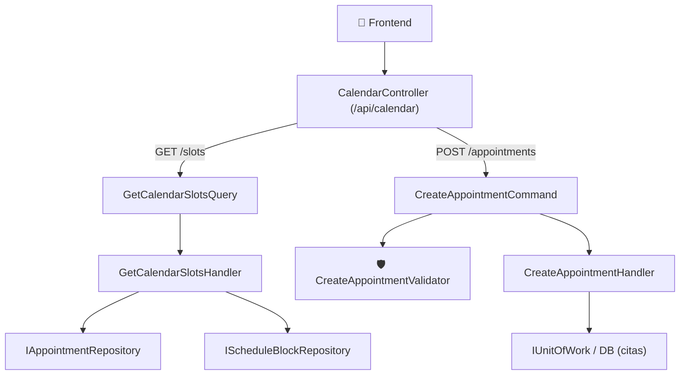

# 🗓️ Feature Calendar (Agenda Táctil, Disponibilidad y Citas)

> [!abstract] Propósito del Módulo
> Provee la inteligencia de calendario para calcular en tiempo real los slots de disponibilidad, unificando citas programadas ([[Entidad Appointment]]) y bloqueos manuales ([[Entidad ScheduleBlock]]) en una matriz coherente. Gestiona además el agendamiento y persistencia de nuevas citas (US-011).

---

## 🧭 Estado de Implementación

| Endpoint / Operación | Implementado | Probado | Integrado en Frontend | Estado Global |
| :--- | :---: | :---: | :---: | :---: |
| `GET /api/calendar/slots` (Consulta de Slots) | ✅ Sí | ✅ Sí (`ProtectedEndpointsTests`) | ✅ Sí (`calendarApi.fetchCalendarSlots`) | **Implementado, Probado e Integrado** |
| `POST /api/calendar/appointments` (Crear Cita) | ✅ Sí | ✅ Sí (`CreateAppointmentTests`) | ❌ No (Sin consumidor UI) | **Implementado y Probado (Pendiente en Frontend)** |

---

## 🛠️ Controlador y Rutas Asociadas

* **Controlador:** `src/Slotify.API/Controllers/CalendarController.cs`
* **Ruta base:** `/api/calendar`
* **Seguridad:** `[Authorize]` en todo el controlador. El `BusinessId` se extrae automáticamente del token Bearer JWT vía `ICurrentUserService`.

| Método | Ruta | Query / Body | Descripción | Códigos HTTP |
| :--- | :--- | :--- | :--- | :---: |
| `GET` | `/api/calendar/slots` | `startDate`, `endDate`, `employeeId?` | Retorna los slots unificados (citas y bloqueos) para el rango indicado. | `200`, `401`, `403` |
| `POST` | `/api/calendar/appointments` | `CreateAppointmentCommand` | Agenda y persiste una nueva cita en el calendario del negocio. | `200`, `400`, `401` |

---

## ⚙️ Commands, Queries, Handlers y Validaciones



### 1. `GetCalendarSlotsQuery` (US-003)
* **Handler:** `GetCalendarSlotsHandler.cs`
* **Parámetros de Query:**
  - `StartDate` (`DateTime`, UTC).
  - `EndDate` (`DateTime`, UTC).
  - `EmployeeId` (`Guid?`, opcional para filtrar por profesional).
* **Algoritmo de Unificación:**
  1. Extrae el `businessId` del usuario autenticado mediante `ICurrentUserService`.
  2. Consulta citas en la tabla `citas` en el rango de fechas (y empleado si aplica).
  3. Consulta bloqueos en la tabla `bloqueos_agenda` en el mismo intervalo.
  4. Mapea cada cita a un `CalendarSlotDto` con `type = "appointment"`, formateando el precio (`$250 MXN`) y estado (`confirmed`, etc.).
  5. Mapea cada bloqueo a un `CalendarSlotDto` con `type = "block"`, `status = "blocked"` y `title = Reason`.
  6. Retorna la respuesta unificada encapsulada en `Result<CalendarResponse>`.

### 2. `CreateAppointmentCommand` (US-011)
* **Handler:** `CreateAppointmentHandler.cs`
* **Validador:** `CreateAppointmentValidator.cs` (`FluentValidation`):
  - `ClientName`: Obligatorio, máx. 100 caracteres.
  - `StartTime`: Obligatorio y menor que `EndTime`.
  - `EndTime`: Obligatorio y mayor que `StartTime`.
  - `AgreedTotal`: Mayor o igual a 0.
  - `ClientEmail`: Formato válido si fue provisto.
  - `ClientPhone`: Máximo 20 caracteres.
* **Lógica de Persistencia:**
  1. Asigna el `BusinessId` del token autenticado.
  2. Genera un token de cancelación criptográfico único (`Guid.NewGuid().ToString("N")`).
  3. Persiste la cita con estado inicial `AppointmentStatus.Confirmed`.
  4. Retorna `{ success: true, id: Guid, data: Guid }`.

---

## 📦 Modelos y DTOs

### Respuesta Completa de Calendario (`CalendarResponse`)
```json
{
  "rangeStart": "2026-11-20T00:00:00Z",
  "rangeEnd": "2026-11-20T23:59:59Z",
  "slots": [
    {
      "type": "appointment",
      "resourceId": "c4d5e6f7-8a9b-0c1d-2e3f-4a5b6c7d8e9f",
      "startTime": "2026-11-20T10:00:00Z",
      "endTime": "2026-11-20T11:00:00Z",
      "title": "Cita - Mateo Morales",
      "status": "confirmed",
      "clientName": "Mateo Morales",
      "clientPhone": "+525544332211",
      "servicePrice": "$350 MXN",
      "blockReason": null,
      "employeeName": null
    },
    {
      "type": "block",
      "resourceId": "15",
      "startTime": "2026-11-20T13:00:00Z",
      "endTime": "2026-11-20T14:00:00Z",
      "title": "Almuerzo de equipo",
      "status": "blocked",
      "clientName": null,
      "clientPhone": null,
      "servicePrice": null,
      "blockReason": "Almuerzo de equipo",
      "employeeName": null
    }
  ]
}
```

### Petición de Agendamiento (`CreateAppointmentCommand`)
```json
{
  "employeeId": null,
  "startTime": "2026-11-20T16:00:00Z",
  "endTime": "2026-11-20T17:00:00Z",
  "clientName": "Mateo Morales",
  "clientEmail": "mateo@correo.com",
  "clientPhone": "+525544332211",
  "agreedTotal": 350.00
}
```

---

## 🗄️ Entidades y Tablas Involucradas
* [[Entidad Appointment]] ➡️ Tabla `"citas"`
* [[Entidad ScheduleBlock]] ➡️ Tabla `"bloqueos_agenda"`
* [[Entidad AvailabilitySchedule]] ➡️ Tabla `"horarios_disponibilidad"`
* [[Entidad Business]] ➡️ Tabla `"negocios"`
* Persistencia orquestada con [[AppDbContext]], `IAppointmentRepository`, `IScheduleBlockRepository` y [[06 - Acceso a Datos y Persistencia/Unit of Work|Unit of Work]].

---

## 🛡️ Autorización y Aislamiento Multi-Tenant (US-022)
* Ningún usuario puede consultar slots ni agendar citas en un negocio que no sea el asignado en su JWT.
* El `BusinessId` se inyecta desde el contexto de seguridad (`ICurrentUserService`), evitando que un cliente altere el parámetro en la URL o cuerpo HTTP.

---

## 🧪 Pruebas Automatizadas Existentes
* **`CreateAppointmentTests.cs` (Unitarias):**
  - Falla de validación cuando `ClientName` es vacío.
  - Falla de validación cuando `StartTime` es posterior a `EndTime`.
  - Aprobación exitosa con datos válidos.
  - Ejecución correcta del Handler persistiendo la cita en repositorio mock.
* **`ProtectedEndpointsTests.cs` (Integración):**
  - Confirma rechazo con `401 Unauthorized` si no se envía cabecera `Authorization`.
  - Confirma filtrado exclusivo por el negocio del token.

---

## ⚠️ Discrepancias y Limitaciones Detectadas
1. **Creación de Citas sin Consumidor Frontend:** Aunque el backend tiene completamente implementado y testeado `POST /api/calendar/appointments`, la aplicación cliente frontend no posee ninguna pantalla ni cliente HTTP configurado para enviar esta solicitud.
2. **Cálculo de Huecos Libres (*Available Slots*):** El handler actualmente proyecta citas confirmadas y bloqueos; los espacios libres entre huecos son calculados dinámicamente en el cliente mediante la grilla del frontend.
3. **Validación contra Solapamientos:** La prevención de solapamientos se delega principalmente a nivel de base de datos relacional y restricciones de PostgreSQL (`EXCLUDE USING gist`), sin validación en memoria previa en `CreateAppointmentValidator`.

---

## 🔗 Trazabilidad con la Bóveda
* **Historias de Usuario:** [[US-003 - Calendario Tactil Multiformato y Consulta de Citas]], [[US-004 - Dashboard Dinamico y Manejo de Estados Vacios]]
* **Entidades:** [[Entidad Appointment]], [[Entidad ScheduleBlock]], [[Entidad AvailabilitySchedule]], [[Entidad Business]]
* **Capa Arquitectura:** [[Modulo API]], [[Contratos de API REST]], [[Modulo Application]], [[Pipeline Behaviors]]
* **Persistencia:** [[AppDbContext]], [[Repositorios]], [[06 - Acceso a Datos y Persistencia/Unit of Work|Unit of Work]]
* **Flujos:** [[Flujo de Consulta de Citas y Estado Vacio]], [[Flujo General de Peticion]]
