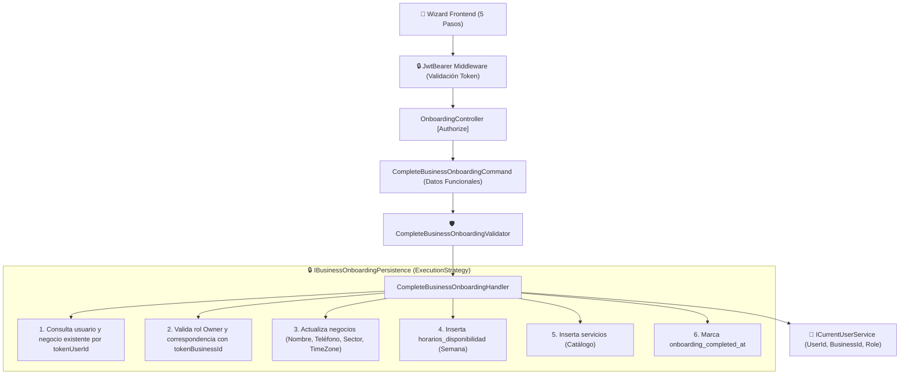

# 🚀 Feature Onboarding (Asistente Comercial B2B)

> [!abstract] Propósito del Módulo
> Orquesta la finalización integral del asistente de alta comercial en 5 pasos. Ejecuta una operación atómica y transaccional mediante `ExecutionStrategy` en PostgreSQL para actualizar el negocio del propietario autenticado, registrar sus horarios de apertura semanales y crear su catálogo inicial de servicios, marcando la fecha de culminación (`onboarding_completed_at`).
> 
> **Seguridad y Aislamiento (Fase 10.3):** Protegido mediante `[Authorize]`. La identidad del usuario y la titularidad del negocio se derivan exclusivamente de los claims criptográficos del JWT (`ICurrentUserService`), eliminando la confianza en identificadores enviados en el cuerpo JSON.

---

## 🧭 Estado de Implementación

| Endpoint / Operación | Implementado | Probado | Integrado en Frontend | Estado Global |
| :--- | :---: | :---: | :---: | :---: |
| `POST /api/onboarding/complete-business-onboarding` | ✅ Sí | ✅ Probado (12 pruebas en `OnboardingSecurityTests.cs`) | ✅ Sí (`businessOnboardingApi.ts`) | **Implementado, Protegido y Probado** |

---

## 🛠️ Controlador y Rutas Asociadas

* **Controlador:** [OnboardingController.cs](file:///D:/Aplicaciones/Slotify_back/src/Slotify.API/Controllers/OnboardingController.cs)
* **Ruta base:** `/api/onboarding`
* **Seguridad:** Endpoint protegido con `[Authorize]`. Valida la firma del token JWT de Slotify y resuelve la identidad del administrador exclusivamente mediante `ICurrentUserService` (`ClaimTypes.NameIdentifier` / `sub`, claim `role == "Owner"` y claim `businessId`). No confía en identificadores del cuerpo JSON.

| Método | Ruta | Payload | Descripción | Códigos HTTP |
| :--- | :--- | :--- | :--- | :--- |
| `POST` | `/api/onboarding/complete-business-onboarding` | `CompleteBusinessOnboardingCommand` | Persiste atómicamente la configuración del negocio, horarios y servicios del administrador autenticado. | `200 OK`, `400 BadRequest`, `401 Unauthorized`, `403 Forbidden`, `404 NotFound`, `409 Conflict` |

---

## ⚙️ Commands, Handlers y Persistencia Transaccional



* **Comando:** `CompleteBusinessOnboardingCommand.cs` (contiene exclusivamente datos funcionales: `FirstName`, `LastName`, `FullName`, `Business`, `BusinessHours`, `Services`).
* **Handler:** `CompleteBusinessOnboardingHandler.cs` (inyecta `ICurrentUserService`, valida rol `UserRole.Owner` y claim `businessId`, orquesta la transacción).
* **Validador:** `CompleteBusinessOnboardingValidator.cs` (`FluentValidation`):
  - Verifica que el nombre del propietario sea válido.
  - Verifica que el nombre comercial no exceda 150 caracteres.
  - Comprueba mediante `ISectorTemplateRepository` que el `SectorTemplateId` exista en la base de datos.
  - Valida que al menos un día comercial esté configurado en `BusinessHours` con `startTime < endTime`.
  - Valida que los servicios tengan duración > 0 y precio >= 0.

### Mecanismo de Resiliencia y Transaccionalidad
Utiliza la abstracción `IBusinessOnboardingPersistence` (`BusinessOnboardingPersistence.cs`):
```csharp
await _persistence.ExecuteInTransactionAsync(async ct =>
{
    // 1. Obtener usuario autenticado y su negocio asociado desde el tokenUserId
    // 2. Validar rol Owner y correspondencia estricta con tokenBusinessId
    // 3. Validar idempotencia (si ya se completó, responder OK sin mutaciones)
    // 4. Validar que no tenga datos parciales conflictivos
    // 5. Actualizar datos de Negocio y generar slug centralizado
    // 6. Insertar horarios de apertura (horarios_disponibilidad)
    // 7. Insertar catálogo de servicios (servicios)
    // 8. Marcar onboarding_completed_at = DateTime.UtcNow
    // 9. Commit atómico
}, cancellationToken);
```
Si cualquiera de las operaciones falla (ej. colisión de slug o desconexión), se aplica un `Rollback` completo garantizando que nunca existan negocios con configuración parcial corrupta.

---

## 📦 Modelos y DTOs

### Estructura de Entrada (`CompleteBusinessOnboardingCommand`)
El comando transporta únicamente los datos funcionales del negocio y perfil; la identidad proviene del token `Authorization: Bearer <token>`:
```json
{
  "firstName": "Héctor",
  "lastName": "Vázquez",
  "fullName": "Héctor Vázquez",
  "business": {
    "name": "Barbería Capital CDMX",
    "phone": "+525512345678",
    "sectorTemplateId": 1,
    "timeZone": "America/Mexico_City"
  },
  "businessHours": [
    {
      "dayOfWeek": 1,
      "startTime": "09:00",
      "endTime": "19:00"
    },
    {
      "dayOfWeek": 2,
      "startTime": "09:00",
      "endTime": "19:00"
    }
  ],
  "services": [
    {
      "name": "Corte de Cabello",
      "durationMinutes": 45,
      "price": 250.00
    }
  ]
}
```

### Respuesta Exitosa (`Result<AuthUserDto>`)
Retorna el perfil del usuario autenticado con el `businessId` asignado y el rol normalizado:
```json
{
  "success": true,
  "message": null,
  "errors": [],
  "data": {
    "id": "a1b2c3d4-e5f6-7a8b-9c0d-1e2f3a4b5c6d",
    "firstName": "Héctor",
    "lastName": "Vázquez",
    "fullName": "Héctor Vázquez",
    "email": "contacto@barberiacapital.com",
    "role": "Owner",
    "businessId": "b8f2d1e0-3c4a-4a5e-b9f1-7c8d9e0f1a2b",
    "accessToken": null,
    "refreshToken": null
  }
}
```

---

## 🗄️ Entidades y Tablas Involucradas
* [[Entidad Business]] ➡️ Tabla `"negocios"`
* [[Entidad User]] ➡️ Tabla `"usuarios"`
* [[Entidad Service]] ➡️ Tabla `"servicios"`
* [[Entidad AvailabilitySchedule]] ➡️ Tabla `"horarios_disponibilidad"`
* [[Entidad SectorTemplate]] ➡️ Tabla `"plantillas_sector"`
* Persistencia transaccional mediante `BusinessOnboardingPersistence` y [[AppDbContext]].

---

## 🛡️ Seguridad y Remediación (Fase 10.3)

> [!important] Estado de Seguridad: Remediado y Verificado
> 1. **Autenticación Perimetral Obligatoria:** `OnboardingController` está decorado con `[Authorize]`. Cualquier petición anónima es rechazada inmediatamente con `401 Unauthorized`.
> 2. **Resolución de Identidad vía Claims (Zero Trust):** `CompleteBusinessOnboardingHandler` inyecta `ICurrentUserService`. El usuario a modificar se determina exclusivamente por `_currentUserService.UserId`. Si un cliente envía `id` o `email` en el cuerpo JSON, son completamente ignorados.
> 3. **Aislamiento Multi-Inquilino Estricto:** Se valida que el claim `businessId` coincida con el negocio registrado del usuario (`user.BusinessId == tokenBusinessId`). Tokens con negocios cruzados son rechazados con `403 Forbidden`.
> 4. **Normalización de Rol:** Se comprueba que `user.Role == UserRole.Owner` en base de datos y que el claim `role` corresponda a `"Owner"`. Usuarios con otros roles reciben `403 Forbidden`.
> 5. **Mapeo de Respuestas HTTP Consistente:** El controlador utiliza `result.ToActionResult()`, devolviendo códigos semánticos (`200 OK`, `400 BadRequest`, `401 Unauthorized`, `403 Forbidden`, `404 NotFound`, `409 Conflict`).
> 6. **Cobertura Automatizada:** Cubierto al 100% por 12 pruebas de integración y unitarias en `OnboardingSecurityTests.cs`.

---

## 🔗 Trazabilidad con la Bóveda
* **Historias de Usuario:** [[US-001 - Registro y Autenticacion Multi-Inquilino y Clientes]], [[US-002 - Plantillas por Sector y Configuracion de Negocio]], [[US-017 - Onboarding Transaccional B2B y Formulario Dinamico]], [[US-022 - Aislamiento Multi-Inquilino por Token JWT]]
* **Seguridad y Remediación:** [[Proteccion del Onboarding]]
* **Entidades:** [[Entidad Business]], [[Entidad User]], [[Entidad Service]], [[Entidad AvailabilitySchedule]], [[Entidad SectorTemplate]]
* **Capa Arquitectura:** [[Modulo API]], [[Contratos de API REST]], [[Modulo Application]], [[Modulo Infrastructure]], [[Pipeline Behaviors]]
* **Persistencia:** [[AppDbContext]], [[Modelo de Datos]]
