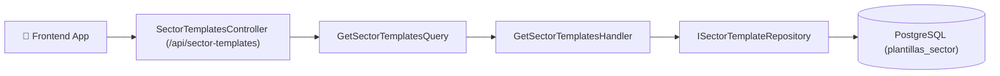

# 📋 Feature SectorTemplates (Plantillas por Giro Comercial)

> [!abstract] Propósito del Módulo
> Provee el catálogo de plantillas preconfiguradas por industria o rubro comercial (Barbería, Estética/Salón, Spa, Consultorio Dental, etc.). Alimenta el paso inicial del onboarding (US-006 / US-002) entregando una configuración prediseñada de módulos, servicios iniciales sugeridos y esquemas de formulario.

---

## 🧭 Estado de Implementación

| Endpoint / Operación | Implementado | Probado | Integrado en Frontend | Estado Global |
| :--- | :---: | :---: | :---: | :---: |
| `GET /api/sector-templates` (Listar Plantillas) | ✅ Sí | ✅ Sí (`ProtectedEndpointsTests`) | ✅ Sí (`templates.tsx`, `useSectorTemplateStore`) | **Implementado, Probado e Integrado** |

---

## 🛠️ Controlador y Rutas Asociadas

* **Controlador:** `src/Slotify.API/Controllers/SectorTemplatesController.cs`
* **Ruta base:** `/api/sector-templates`
* **Seguridad:** Endpoint público (accesible antes de que el usuario tenga un negocio registrado o token JWT).

| Método | Ruta | Descripción | Payload | Código HTTP |
| :--- | :--- | :--- | :--- | :---: |
| `GET` | `/api/sector-templates` | Obtiene todas las plantillas activas con sus módulos y servicios sugeridos. | Ninguno | `200 OK` |

---

## ⚙️ Queries, Handlers y Arquitectura



* **Query:** `GetSectorTemplatesQuery.cs`
* **Handler:** `GetSectorTemplatesHandler.cs`
* **Lógica de Deserialización JSONB:**
  1. Recupera las filas de la tabla `plantillas_sector`.
  2. Deserializa automáticamente las columnas JSONB a colecciones tipadas de C#:
     - `modulos_defecto` $\to$ `List<string> DefaultModules`
     - `servicios_sugeridos` $\to$ `List<SuggestedServiceDto> SuggestedServices`
     - `configuracion_formulario` $\to$ `BookingFormConfigDto FormConfig`
  3. Retorna la lista tipada `IEnumerable<SectorTemplateDto>`.

---

## 📦 Modelos y DTOs

### Modelo de Salida (`SectorTemplateDto`)
```json
[
  {
    "id": 1,
    "name": "Barbería / Peluquería",
    "defaultModules": [
      "citas",
      "servicios",
      "empleados",
      "bloqueos"
    ],
    "suggestedServices": [
      {
        "name": "Corte Clásico",
        "durationMinutes": 30,
        "price": 200.00
      },
      {
        "name": "Afeitado Tradicional",
        "durationMinutes": 25,
        "price": 150.00
      }
    ],
    "formConfig": {
      "title": "Reservación Barbería",
      "description": "Elige tu corte y profesional",
      "presentationStyle": "classic_scroll",
      "accentColor": "#E07A5F",
      "secondaryColor": "#3D405B",
      "logoUrl": null,
      "businessName": null,
      "fields": []
    }
  }
]
```

---

## 🗄️ Entidades y Persistencia
* [[Entidad SectorTemplate]] ➡️ Tabla `"plantillas_sector"`
* Persistencia mediante `ISectorTemplateRepository` y [[AppDbContext]].
* Datos inicializados como datos semilla (*seed data*) en PostgreSQL.

---

## 🧪 Pruebas Automatizadas Existentes
* **`ProtectedEndpointsTests.cs` (Integración):**
  - Confirma que el endpoint `GET /api/sector-templates` no requiere autorización y responde con éxito `200 OK`.

---

## 🔗 Trazabilidad con la Bóveda
* **Historias de Usuario:** [[US-002 - Plantillas por Sector y Configuracion de Negocio]]
* **Entidades:** [[Entidad SectorTemplate]], [[Entidad Business]], [[Entidad Service]]
* **Capa Arquitectura:** [[Modulo API]], [[Modulo Application]]
* **Persistencia:** [[AppDbContext]], [[Repositorios]]
* **Flujos:** [[Flujo General de Peticion]]
