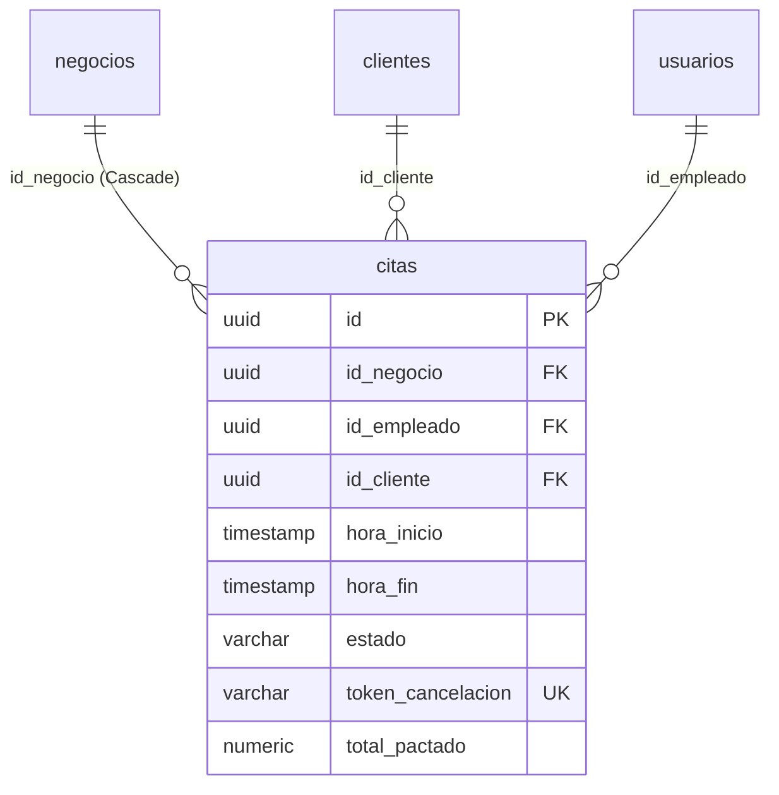

# 🎟️ Entidad `Appointment`

> [!abstract] Resumen de la Entidad
> Representa una reservación o cita agendada por un cliente en un negocio. Vincula el intervalo de tiempo reservado (`StartTime` y `EndTime`), la información de contacto desnormalizada del cliente, el total monetario acordado y un token criptográfico seguro para cancelación sin necesidad de inicio de sesión.

---

## 📍 Metadatos Técnicos
* **Archivo:** `src/Slotify.Domain/Entities/Appointment.cs`
* **Namespace:** `Slotify.Domain.Entities`
* **Herencia:** `AuditableEntity` $\to$ `BaseEntity`
* **Tabla física en PostgreSQL:** `"citas"`
* **Configuración EF Core:** `src/Slotify.Infrastructure/Data/Configurations/AppointmentConfiguration.cs`
* **DbSet:** `AppDbContext.Appointments`

---

## 🔑 Clave Primaria
* **`Id` (`Guid`):** Identificador único de la cita, autogenerado con `uuid_generate_v4()`.

---

## 📋 Mapeo de Propiedades C# vs Columnas de Base de Datos

| Propiedad C# | Tipo C# | Columna PostgreSQL | Tipo SQL | Nulo | Valor por Defecto / Configuración |
| :--- | :--- | :--- | :--- | :---: | :--- |
| `Id` | `Guid` | `id` | `uuid` | No | `uuid_generate_v4()` |
| `BusinessId` | `Guid` | `id_negocio` | `uuid` | No | FK hacia `negocios.id` |
| `EmployeeId` | `Guid?` | `id_empleado` | `uuid` | Sí | FK opcional hacia `usuarios.id` |
| `StartTime` | `DateTime` | `hora_inicio` | `timestamp` | No | Fecha y hora UTC de inicio |
| `EndTime` | `DateTime` | `hora_fin` | `timestamp` | No | Fecha y hora UTC de término |
| `ClientName` | `string` | `nombre_cliente` | `varchar(150)` | No | Nombre del cliente al momento de agendar |
| `ClientEmail` | `string` | `correo_cliente` | `varchar(150)` | No | Correo para confirmación y notificaciones |
| `ClientPhone` | `string` | `telefono_cliente` | `varchar(20)` | No | Teléfono de contacto |
| `Status` | `AppointmentStatus` (Enum) | `estado` | `varchar(20)` | No | `"confirmed"` (por defecto). Conversión: `confirmed`, `cancelled`, `completed`, `no_show`. |
| `CancellationToken` | `string` | `token_cancelacion` | `varchar(64)` | No | Hash único para enlace público de cancelación |
| `AgreedTotal` | `decimal` | `total_pactado` | `numeric(10,2)` | No | `0.00` (Precio pactado al agendar) |
| `ClientId` | `Guid?` | `id_cliente` | `uuid` | Sí | FK opcional hacia `clientes.id` (si tiene cuenta B2C) |
| `CreatedAt` | `DateTime` | `fecha_creacion` | `timestamp` | No | `CURRENT_TIMESTAMP` |
| `UpdatedAt` | `DateTime?` | `fecha_actualizacion` | `timestamp` | Sí | `CURRENT_TIMESTAMP` |

---

## 🔗 Relaciones y Claves Foráneas



* **Relación N:1 con [[Entidad Business]] (`negocios`):**
  - **Propiedad de navegación:** `public Business Business { get; set; } = null!;`
  - **FK física:** `id_negocio`
  - **Comportamiento en cascada:** `DeleteBehavior.Cascade`.
* **Relación N:1 opcional con [[Entidad Client]] (`clientes`):**
  - **Propiedad de navegación:** `public Client? Client { get; set; }`
  - **FK física:** `id_cliente`
* **Relación N:1 opcional con empleado ([[Entidad User]]):**
  - **FK física:** `id_empleado` (apunta a `usuarios.id`).

---

## 🛡️ Índices y Restricciones
1. **Clave Primaria:** `PK_citas` en `id`.
2. **Índice Único:** `IX_citas_token_cancelacion` sobre `token_cancelacion` (`builder.HasIndex(x => x.CancellationToken).IsUnique()`).
3. **Índice Compuesto de Calendario:** `idx_citas_calendario` en `(id_negocio, hora_inicio, hora_fin)`. Optimiza la consulta masiva de slots.
4. **Índice Compuesto por Empleado:** `idx_citas_empleado` en `(id_empleado, hora_inicio, hora_fin)`.
5. **Prevención de Solapamiento (Exclusión PostgreSQL):**
   ```sql
   -- Definido a nivel DDL en base de datos:
   CONSTRAINT no_citas_solapadas EXCLUDE USING gist (
       id_negocio WITH =,
       tstzrange(hora_inicio, hora_fin) WITH &&
   ) WHERE (estado = 'confirmed');
   ```

---

## 💼 Reglas de Negocio Identificadas
1. **Preservación Histórica:** El nombre, correo y teléfono del cliente se almacenan directamente en la fila de la cita (`nombre_cliente`, `correo_cliente`, `telefono_cliente`). Esto asegura que el historial contable y operativo no se altere si el cliente modifica o elimina su cuenta posteriormente.
2. **Cancelación Segura sin Autenticación:** La propiedad `CancellationToken` contiene una cadena aleatoria de alta entropía (generada mediante `Guid.NewGuid().ToString("N")`). Permite estructurar enlaces web seguros como `/cancelar/{token}` accesibles desde correo o SMS.
3. **Estados de la Cita (`AppointmentStatus`):**
   - `Confirmed` (`"confirmed"`): Cita reservada y activa. Ocupa disponibilidad en el calendario.
   - `Cancelled` (`"cancelled"`): Cancelada por el negocio o el cliente. Libera el slot.
   - `Completed` (`"completed"`): Servicio concluido con éxito.
   - `NoShow` (`"no_show"`): El cliente no se presentó a su cita.

---

## 🧪 Ejemplo de Registro Ilustrativo

> [!example] Datos Simulados para Pruebas
> ```json
> {
>   "id": "e2f1b4a0-5678-4a9b-bcde-112233445566",
>   "businessId": "b8f2d1e0-3c4a-4a5e-b9f1-7c8d9e0f1a2b",
>   "employeeId": null,
>   "clientId": "f9a8b7c6-1234-4567-890a-bcdef1234567",
>   "startTime": "2026-11-20T16:00:00Z",
>   "endTime": "2026-11-20T17:00:00Z",
>   "clientName": "Mateo Morales",
>   "clientEmail": "mateo.morales@correo.com",
>   "clientPhone": "+525544332211",
>   "status": "confirmed",
>   "cancellationToken": "a987f6543210fedcba9876543210fedc",
>   "agreedTotal": 350.00,
>   "createdAt": "2026-11-17T20:15:00Z",
>   "updatedAt": "2026-11-17T20:15:00Z"
> }
> ```

---

## 🔗 Enlaces Relacionados
* [[Modulo Domain]]
* [[Entidad Business]]
* [[Entidad Client]]
* [[Entidad User]]
* [[Entidad ScheduleBlock]]
* [[AppDbContext]]
* [[Feature Calendar]]
