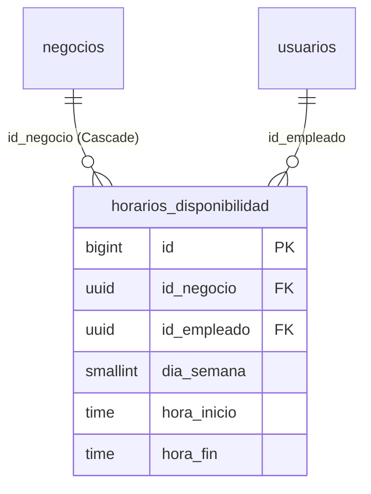

# ⏰ Entidad `AvailabilitySchedule`

> [!abstract] Resumen de la Entidad
> Modela la disponibilidad recurrente y los horarios de operación semanal de un negocio o de un empleado específico. Permite al motor de reservas calcular los bloques válidos para agendar citas en función del día de la semana (0 = Domingo a 6 = Sábado).

---

## 📍 Metadatos Técnicos
* **Archivo:** `src/Slotify.Domain/Entities/AvailabilitySchedule.cs`
* **Namespace:** `Slotify.Domain.Entities`
* **Herencia:** Clase pura de dominio (no hereda de `BaseEntity` debido a clave primaria `long`).
* **Tabla física en PostgreSQL:** `"horarios_disponibilidad"`
* **Configuración EF Core:** `src/Slotify.Infrastructure/Data/Configurations/AvailabilityScheduleConfiguration.cs`
* **DbSet:** `AppDbContext.AvailabilitySchedules`

---

## 🔑 Clave Primaria
* **`Id` (`long`):** Identificador autoincremental de 64 bits (`BIGSERIAL` / `ValueGeneratedOnAdd()`).

---

## 📋 Mapeo de Propiedades C# vs Columnas de Base de Datos

| Propiedad C# | Tipo C# | Columna PostgreSQL | Tipo SQL | Nulo | Valor por Defecto / Configuración |
| :--- | :--- | :--- | :--- | :---: | :--- |
| `Id` | `long` | `id` | `bigint` | No | `BIGSERIAL` autoincremental |
| `BusinessId` | `Guid` | `id_negocio` | `uuid` | No | FK hacia `negocios.id` |
| `EmployeeId` | `Guid?` | `id_empleado` | `uuid` | Sí | FK opcional hacia `usuarios.id` |
| `DayOfWeek` | `short` | `dia_semana` | `smallint` | No | Día de la semana (0 = Domingo ... 6 = Sábado) |
| `StartTime` | `TimeOnly` | `hora_inicio` | `time without time zone` | No | Hora de apertura / inicio de turno |
| `EndTime` | `TimeOnly` | `hora_fin` | `time without time zone` | No | Hora de cierre / fin de turno |

---

## 🔗 Relaciones y Claves Foráneas



* **Relación N:1 con [[Entidad Business]] (`negocios`):**
  - **Propiedad de navegación:** `public Business Business { get; set; } = null!;`
  - **FK física:** `id_negocio`
  - **Comportamiento en eliminación:** `DeleteBehavior.Cascade`.
* **Relación N:1 opcional con [[Entidad User]] (`usuarios`):**
  - **FK física:** `id_empleado`

---

## 🛡️ Índices y Restricciones
1. **Clave Primaria:** `PK_horarios_disponibilidad` en `id`.
2. **Restricción CHECK de Rango de Día:**
   ```sql
   CHECK (dia_semana BETWEEN 0 AND 6)
   ```
3. **Restricción CHECK de Coherencia Horaria:**
   ```sql
   CHECK (hora_fin > hora_inicio)
   ```

---

## 💼 Reglas de Negocio Identificadas
1. **Ámbito General vs Particular:**
   - Si `EmployeeId` es `null`, la franja define el horario general en que el establecimiento comercial permanece abierto al público.
   - Si `EmployeeId` tiene valor, define el turno de trabajo asignado a dicho profesional.
2. **Tipo de Dato `TimeOnly`:** Al no requerir componentes de fecha ni huso horario en una regla recurrente, .NET 9 y EF Core mapean directamente a `time without time zone`, evitando desfases por horario de verano.

---

## 🧪 Ejemplo de Registro Ilustrativo

> [!example] Horario Comercial Ilustrativo (Lunes de 09:00 a 19:00)
> ```json
> {
>   "id": 104,
>   "businessId": "b8f2d1e0-3c4a-4a5e-b9f1-7c8d9e0f1a2b",
>   "employeeId": null,
>   "dayOfWeek": 1,
>   "startTime": "09:00:00",
>   "endTime": "19:00:00"
> }
> ```

---

## 🔗 Enlaces Relacionados
* [[Modulo Domain]]
* [[Entidad Business]]
* [[Entidad User]]
* [[Entidad Appointment]]
* [[AppDbContext]]
* [[Feature Calendar]]
