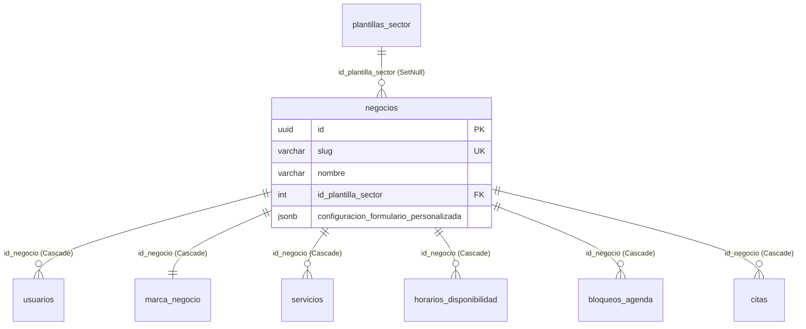

# 🏢 Entidad `Business`

> [!abstract] Resumen de la Entidad
> Representa la unidad central del modelo multi-inquilino (*multi-tenant*): el establecimiento comercial o empresa registrada en Slotify. Contiene las políticas de reserva, zona horaria, identidad comercial, vinculación con su plantilla de sector ([[Entidad SectorTemplate]]) y su configuración de marca personalizada ([[Entidad BusinessBrand]]).

---

## 📍 Metadatos Técnicos
* **Archivo:** `src/Slotify.Domain/Entities/Business.cs`
* **Namespace:** `Slotify.Domain.Entities`
* **Herencia:** `AuditableEntity` $\to$ `BaseEntity`
* **Tabla física en PostgreSQL:** `"negocios"`
* **Configuración EF Core:** `src/Slotify.Infrastructure/Data/Configurations/BusinessConfiguration.cs`
* **DbSet:** `AppDbContext.Businesses`

---

## 🔑 Clave Primaria
* **`Id` (`Guid`):** Identificador único del negocio, generado automáticamente mediante `uuid_generate_v4()`.

---

## 📋 Mapeo de Propiedades C# vs Columnas de Base de Datos

| Propiedad C# | Tipo C# | Columna PostgreSQL | Tipo SQL | Nulo | Valor por Defecto / Configuración |
| :--- | :--- | :--- | :--- | :---: | :--- |
| `Id` | `Guid` | `id` | `uuid` | No | `uuid_generate_v4()` |
| `Slug` | `string` | `slug` | `varchar(100)` | No | Índice único (`idx_negocios_slug`). Identificador de URL pública. |
| `Name` | `string` | `nombre` | `varchar(150)` | No | Longitud máx: 150. |
| `Phone` | `string?` | `telefono` | `varchar(20)` | Sí | Teléfono o WhatsApp de contacto. |
| `TimeZone` | `string` | `zona_horaria` | `varchar(50)` | No | `"America/Mexico_City"` |
| `MinAdvanceHours` | `int` | `anticipacion_minima_horas` | `integer` | No | `2` (horas mínimas previas al turno). |
| `MaxAdvanceDays` | `int` | `anticipacion_maxima_dias` | `integer` | No | `30` (horizonte máximo de citas a futuro). |
| `SectorTemplateId` | `int?` | `id_plantilla_sector` | `integer` | Sí | FK opcional hacia `plantillas_sector.id`. |
| `CustomFormConfig` | `string?` | `configuracion_formulario_personalizada` | `jsonb` | Sí | Esquema dinámico de preguntas y colores en JSON. |
| `OnboardingCompletedAt` | `DateTime?` | `onboarding_completed_at` | `timestamptz` | Sí | `null` mientras esté en configuración preliminar. |
| `CreatedAt` | `DateTime` | `fecha_creacion` | `timestamp` | No | `CURRENT_TIMESTAMP` |
| `UpdatedAt` | `DateTime?` | `fecha_actualizacion` | `timestamp` | Sí | `CURRENT_TIMESTAMP` |

---

## 🔗 Relaciones y Claves Foráneas



* **Relación N:1 con [[Entidad SectorTemplate]] (`plantillas_sector`):**
  - **Propiedad de navegación:** `public SectorTemplate? SectorTemplate { get; set; }`
  - **FK física:** `id_plantilla_sector`
  - **Comportamiento en eliminación:** `DeleteBehavior.SetNull` (si la plantilla se borra, el negocio preserva sus datos desacoplados).
* **Relación 1:N con [[Entidad User]] (`usuarios`):**
  - **Propiedad de navegación:** `public ICollection<User> Users { get; set; } = [];`
* **Relación 1:1 con [[Entidad BusinessBrand]] (`marca_negocio`):**
  - **Propiedad de navegación:** `public BusinessBrand? Brand { get; set; }`
* **Relación 1:N con [[Entidad Service]] (`servicios`):**
  - **Propiedad de navegación:** `public ICollection<Service> Services { get; set; } = [];`

---

## 🛡️ Índices y Restricciones
1. **Clave Primaria:** `PK_negocios` en columna `id`.
2. **Índice Único:** `IX_negocios_slug` sobre `slug` (`builder.HasIndex(x => x.Slug).IsUnique()`).
3. **Clave Foránea:** `FK_negocios_plantillas_sector_id_plantilla_sector` hacia `plantillas_sector(id)` con `ON DELETE SET NULL`.

---

## 💼 Métodos y Lógica de Dominio
La clase encapsula comportamientos esenciales de negocio de manera estática y centralizada:

1. **Generación Determinista de Slugs (`GenerateSlug`):**
   ```csharp
   public static string GenerateSlug(string name) =>
       name.Trim().ToLowerInvariant().Replace(" ", "-");
   ```
2. **Validación de Colores Corporativos (`IsValidCorporateHexColor`):**
   - Evalúa contra la expresión regular `^#([0-9A-Fa-f]{6}|[0-9A-Fa-f]{3})$`.
3. **Validación de Logotipos (`IsValidLogoSource`):**
   - Acepta URLs HTTP/HTTPS absolutas.
   - Acepta imágenes en Data URI Base64 (`data:image/...`) con peso menor a ~4MB (límite de longitud 5,500,000 caracteres).

---

## 🧪 Ejemplo de Registro Ilustrativo

> [!example] Datos Simulados para Pruebas
> ```json
> {
>   "id": "b8f2d1e0-3c4a-4a5e-b9f1-7c8d9e0f1a2b",
>   "slug": "barberia-capital-cdmx",
>   "name": "Barbería Capital CDMX",
>   "phone": "+525512345678",
>   "timeZone": "America/Mexico_City",
>   "minAdvanceHours": 2,
>   "maxAdvanceDays": 30,
>   "sectorTemplateId": 1,
>   "customFormConfig": "{\"title\":\"Cita Barbería\",\"accentColor\":\"#E07A5F\",\"secondaryColor\":\"#3D405B\",\"fields\":[]}",
>   "onboardingCompletedAt": "2026-11-01T15:00:00Z",
>   "createdAt": "2026-11-01T12:00:00Z",
>   "updatedAt": "2026-11-15T10:00:00Z"
> }
> ```

---

## 🔗 Enlaces Relacionados
* [[Modulo Domain]]
* [[Entidad SectorTemplate]]
* [[Entidad BusinessBrand]]
* [[Entidad Service]]
* [[Entidad User]]
* [[AppDbContext]]
