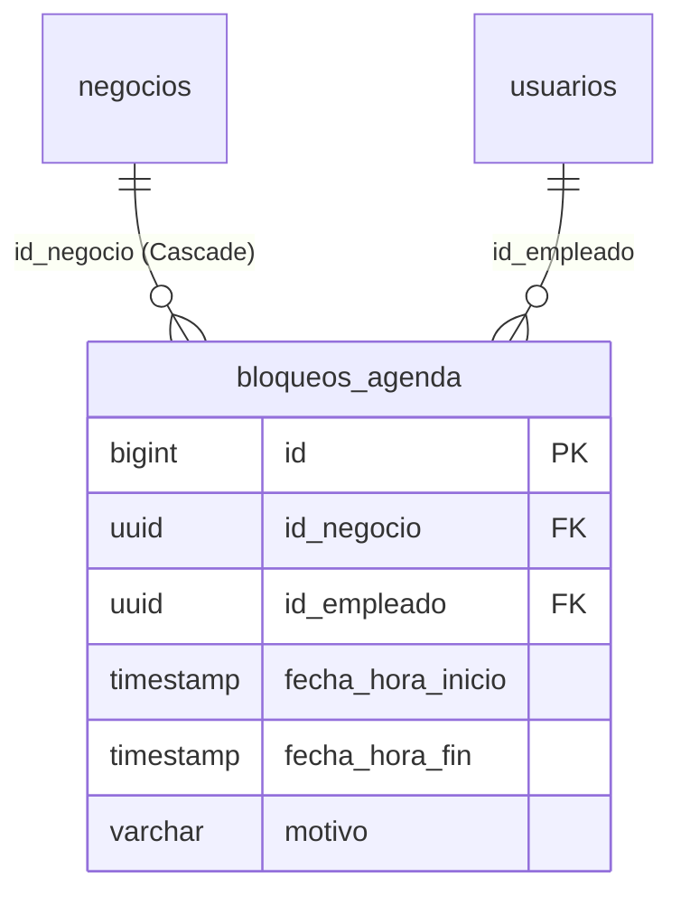

# 🚫 Entidad `ScheduleBlock`

> [!abstract] Resumen de la Entidad
> Representa una inhabilitación manual de una franja de tiempo en el calendario comercial (por descansos, almuerzos, eventos especiales o mantenimiento de cabinas/sillones). Impide de forma activa que los clientes seleccionen esos turnos para agendar citas.

---

## 📍 Metadatos Técnicos
* **Archivo:** `src/Slotify.Domain/Entities/ScheduleBlock.cs`
* **Namespace:** `Slotify.Domain.Entities`
* **Herencia:** Clase pura de dominio (sin herencia de `BaseEntity` al usar `long` como PK).
* **Tabla física en PostgreSQL:** `"bloqueos_agenda"`
* **Configuración EF Core:** `src/Slotify.Infrastructure/Data/Configurations/ScheduleBlockConfiguration.cs`
* **DbSet:** `AppDbContext.ScheduleBlocks`

---

## 🔑 Clave Primaria
* **`Id` (`long`):** Identificador autoincremental de 64 bits (`BIGSERIAL` / `UseIdentityAlwaysColumn()`).

---

## 📋 Mapeo de Propiedades C# vs Columnas de Base de Datos

| Propiedad C# | Tipo C# | Columna PostgreSQL | Tipo SQL | Nulo | Valor por Defecto / Configuración |
| :--- | :--- | :--- | :--- | :---: | :--- |
| `Id` | `long` | `id` | `bigint` | No | `BIGSERIAL` / `GENERATED ALWAYS AS IDENTITY` |
| `BusinessId` | `Guid` | `id_negocio` | `uuid` | No | FK hacia `negocios.id` |
| `EmployeeId` | `Guid?` | `id_empleado` | `uuid` | Sí | FK opcional hacia `usuarios.id` |
| `StartDateTime` | `DateTime` | `fecha_hora_inicio` | `timestamp` | No | Fecha y hora UTC de inicio del bloqueo |
| `EndDateTime` | `DateTime` | `fecha_hora_fin` | `timestamp` | No | Fecha y hora UTC de finalización |
| `Reason` | `string?` | `motivo` | `varchar(255)` | Sí | Descripción o causa del bloqueo (ej. "Mantenimiento") |

---

## 🔗 Relaciones y Claves Foráneas



* **Relación N:1 con [[Entidad Business]] (`negocios`):**
  - **Propiedad de navegación:** `public Business Business { get; set; } = null!;`
  - **FK física:** `id_negocio`
  - **Comportamiento en cascada:** `DeleteBehavior.Cascade`.
* **Relación N:1 opcional con empleado ([[Entidad User]]):**
  - **FK física:** `id_empleado`

---

## 🛡️ Índices y Restricciones
1. **Clave Primaria:** `PK_bloqueos_agenda` en `id`.
2. **Restricción CHECK de Coherencia Temporal:**
   ```sql
   CHECK (fecha_hora_fin > fecha_hora_inicio)
   ```

---

## 💼 Reglas de Negocio Identificadas
1. **Alcance Global vs Personal:**
   - Si `EmployeeId == null`, el bloqueo se aplica a toda la sucursal (ningún empleado puede recibir citas en esa franja).
   - Si `EmployeeId` está asignado, solo bloquea la disponibilidad de dicho profesional.
2. **Unificación en la Matriz de Disponibilidad:**
   - En el cálculo de slots (`GetCalendarSlotsHandler`), cada bloqueo activo se mapea directamente como un `CalendarSlotDto` con `type: "block"`, `status: "blocked"` y `title: Reason ?? "Horario Bloqueado"`.

---

## 🧪 Ejemplo de Registro Ilustrativo

> [!example] Bloqueo por Mantenimiento (Datos Simulados)
> ```json
> {
>   "id": 42,
>   "businessId": "b8f2d1e0-3c4a-4a5e-b9f1-7c8d9e0f1a2b",
>   "employeeId": null,
>   "startDateTime": "2026-11-21T13:00:00Z",
>   "endDateTime": "2026-11-21T15:00:00Z",
>   "reason": "Mantenimiento general de compresores y esterilización"
> }
> ```

---

## 🔗 Enlaces Relacionados
* [[Modulo Domain]]
* [[Entidad Business]]
* [[Entidad User]]
* [[Entidad Appointment]]
* [[AppDbContext]]
* [[Feature ScheduleBlocks]]
