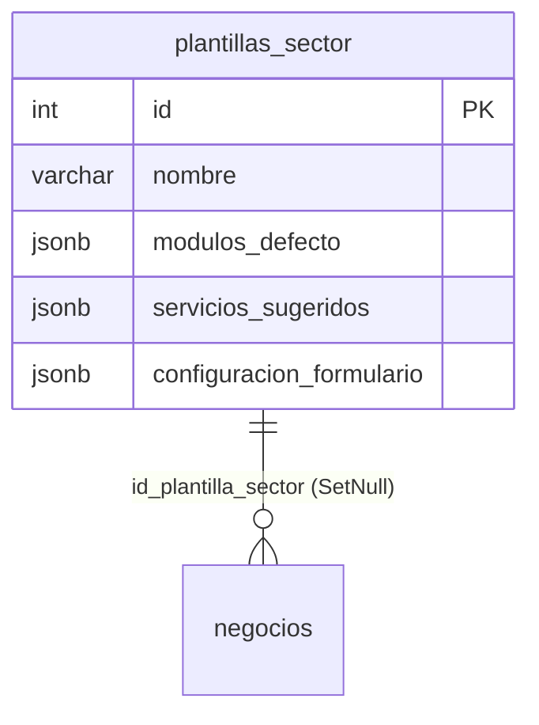

# 📋 Entidad `SectorTemplate`

> [!abstract] Resumen de la Entidad
> Define las plantillas preconfiguradas por industria o giro comercial (Barbería, Spa, Consultorio Médico, etc.). Almacena datos semilla que dictaminan qué módulos funcionales se activan de inicio, qué servicios sugeridos se precargan y cuál es el esquema inicial del formulario dinámico de agendamiento.

---

## 📍 Metadatos Técnicos
* **Archivo:** `src/Slotify.Domain/Entities/SectorTemplate.cs`
* **Namespace:** `Slotify.Domain.Entities`
* **Herencia:** Clase pura de dominio (sin herencia de `BaseEntity` al usar `int` autoincremental).
* **Tabla física en PostgreSQL:** `"plantillas_sector"`
* **Configuración EF Core:** `src/Slotify.Infrastructure/Data/Configurations/SectorTemplateConfiguration.cs`
* **DbSet:** `AppDbContext.SectorTemplates`

---

## 🔑 Clave Primaria
* **`Id` (`int`):** Identificador autoincremental de 32 bits (`SERIAL` / `UseSerialColumn()`).

---

## 📋 Mapeo de Propiedades C# vs Columnas de Base de Datos

| Propiedad C# | Tipo C# | Columna PostgreSQL | Tipo SQL | Nulo | Valor por Defecto / Configuración |
| :--- | :--- | :--- | :--- | :---: | :--- |
| `Id` | `int` | `id` | `integer` | No | `SERIAL` PostgreSQL |
| `Name` | `string` | `nombre` | `varchar(100)` | No | Nombre del giro (ej. "Barbería / Peluquería") |
| `DefaultModules` | `string` (JSON) | `modulos_defecto` | `jsonb` | No | `'[]'::jsonb` (Módulos activados por defecto) |
| `SuggestedServices` | `string` (JSON) | `servicios_sugeridos` | `jsonb` | No | `'[]'::jsonb` (Catálogo sugerido para onboarding) |
| `FormConfig` | `string` (JSON) | `configuracion_formulario` | `jsonb` | No | `'{}'::jsonb` (Esquema de campos para reservas) |

---

## 🔗 Relaciones y Claves Foráneas



* **Relación 1:N con [[Entidad Business]] (`negocios`):**
  - **Propiedad de navegación:** `public ICollection<Business> Businesses { get; set; } = [];`
  - **FK física en destino:** `negocios.id_plantilla_sector`
  - **Comportamiento en eliminación:** `DeleteBehavior.SetNull`.

---

## 🛡️ Índices y Restricciones
1. **Clave Primaria:** `PK_plantillas_sector` en columna `id`.
2. **Restricción de Tipo JSONB:** Columnas `modulos_defecto`, `servicios_sugeridos` y `configuracion_formulario` garantizan sintaxis JSON válida en base de datos.

---

## 💼 Reglas de Negocio Identificadas
1. **Pre-carga y Seed Data:** Los registros de esta tabla son estáticos y se precargan durante la inicialización del sistema para alimentar el paso inicial del onboarding comercial (`US-006`).
2. **Inmutabilidad del Negocio al Instanciarse:** Cuando un negocio selecciona una plantilla, sus servicios y configuración de formulario se copian e independizan (el negocio puede modificarlos posteriormente sin afectar a la plantilla base).
3. **Desacoplamiento Relacional (`ON DELETE SET NULL`):** Si una plantilla de sector se descontinúa o elimina, los negocios que la utilizaban no son borrados; únicamente su campo `id_plantilla_sector` pasa a ser `null`.

---

## 🧪 Ejemplo de Registro Ilustrativo

> [!example] Plantilla de Barbería (Seed Data Ilustrativo)
> ```json
> {
>   "id": 1,
>   "name": "Barbería / Peluquería",
>   "defaultModules": "[\"citas\", \"servicios\", \"empleados\", \"bloqueos\"]",
>   "suggestedServices": "[{\"name\":\"Corte Clásico\",\"durationMinutes\":30,\"price\":200.00},{\"name\":\"Afeitado Tradicional\",\"durationMinutes\":25,\"price\":150.00}]",
>   "formConfig": "{\"title\":\"Reservación Barbería\",\"presentationStyle\":\"classic_scroll\",\"accentColor\":\"#E07A5F\",\"secondaryColor\":\"#3D405B\",\"fields\":[]}"
> }
> ```

---

## 🔗 Enlaces Relacionados
* [[Modulo Domain]]
* [[Entidad Business]]
* [[AppDbContext]]
* [[Feature SectorTemplates]]
