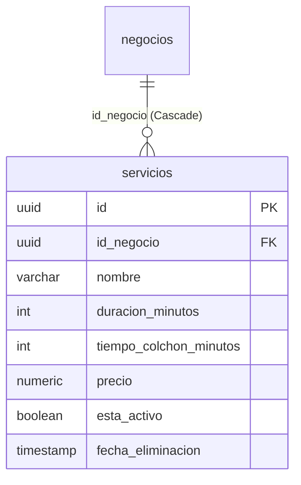

# 💇 Entidad `Service`

> [!abstract] Resumen de la Entidad
> Modela los servicios comerciales que un establecimiento ofrece a sus clientes (ej. corte de cabello, tratamiento facial, consulta general). Define la duración requerida, el tiempo de colchón (*buffer time*) entre turnos consecutivos, el precio monetario y el soporte para borrado lógico (*soft delete*).

---

## 📍 Metadatos Técnicos
* **Archivo:** `src/Slotify.Domain/Entities/Service.cs`
* **Namespace:** `Slotify.Domain.Entities`
* **Herencia:** `BaseEntity`
* **Tabla física en PostgreSQL:** `"servicios"`
* **Configuración EF Core:** `src/Slotify.Infrastructure/Data/Configurations/ServiceConfiguration.cs`
* **DbSet:** `AppDbContext.Services`

---

## 🔑 Clave Primaria
* **`Id` (`Guid`):** Identificador global único del servicio (`uuid_generate_v4()`).

---

## 📋 Mapeo de Propiedades C# vs Columnas de Base de Datos

| Propiedad C# | Tipo C# | Columna PostgreSQL | Tipo SQL | Nulo | Valor por Defecto / Configuración |
| :--- | :--- | :--- | :--- | :---: | :--- |
| `Id` | `Guid` | `id` | `uuid` | No | `uuid_generate_v4()` |
| `BusinessId` | `Guid` | `id_negocio` | `uuid` | No | FK hacia `negocios.id` |
| `Name` | `string` | `nombre` | `varchar(150)` | No | Longitud máx: 150 |
| `DurationMinutes` | `int` | `duracion_minutos` | `integer` | No | Duración neta del servicio en minutos |
| `BufferTimeMinutes` | `int` | `tiempo_colchon_minutos` | `integer` | No | `0` (Margen de limpieza / descanso entre turnos) |
| `Price` | `decimal` | `precio` | `numeric(10,2)` | No | `0.00` (Precisión 10 dígitos, 2 decimales) |
| `IsActive` | `bool` | `esta_activo` | `boolean` | No | `true` (Disponible para agendamiento) |
| `DeletedAt` | `DateTime?` | `fecha_eliminacion` | `timestamp` | Sí | `null` mientras no sea eliminado lógicamente |

---

## 🔗 Relaciones y Claves Foráneas



* **Relación N:1 con [[Entidad Business]] (`negocios`):**
  - **Propiedad de navegación:** `public Business Business { get; set; } = null!;`
  - **FK física:** `id_negocio`
  - **Configuración Fluent API:**
    ```csharp
    builder.HasOne(x => x.Business)
           .WithMany(x => x.Services)
           .HasForeignKey(x => x.BusinessId)
           .OnDelete(DeleteBehavior.Cascade);
    ```
  - **Comportamiento en eliminación:** `DeleteBehavior.Cascade`.

---

## 🛡️ Índices y Restricciones
1. **Clave Primaria:** `PK_servicios` en `id`.
2. **Restricción CHECK de Duración:**
   ```sql
   CHECK (duracion_minutos > 0)
   ```
3. **Restricción CHECK de Colchón:**
   ```sql
   CHECK (tiempo_colchon_minutos >= 0)
   ```
4. **Restricción CHECK de Precio:**
   ```sql
   CHECK (precio >= 0)
   ```

---

## 💼 Reglas de Negocio Identificadas
1. **Tiempo de Colchón (`BufferTimeMinutes`):** El motor de agendamiento suma la duración neta del servicio más el colchón para calcular el bloqueo efectivo de agenda. Ejemplo: un servicio de 45 min con 15 min de colchón reserva un bloque total de 60 min.
2. **Borrado Lógico (*Soft Delete*):** Cuando un negocio deja de ofrecer un servicio, se establece `DeletedAt = DateTime.UtcNow` y `IsActive = false`. Nunca se ejecuta un borrado físico (`DELETE`) para evitar romper la integridad referencial de citas históricas que hayan registrado dicho servicio.

---

## 🧪 Ejemplo de Registro Ilustrativo

> [!example] Servicio Comercial de Barbería
> ```json
> {
>   "id": "d1c2b3a4-5678-90ab-cdef-1234567890ab",
>   "businessId": "b8f2d1e0-3c4a-4a5e-b9f1-7c8d9e0f1a2b",
>   "name": "Corte de Cabello y Barba Ritual",
>   "durationMinutes": 45,
>   "bufferTimeMinutes": 10,
>   "price": 320.00,
>   "isActive": true,
>   "deletedAt": null
> }
> ```

---

## 🔗 Enlaces Relacionados
* [[Modulo Domain]]
* [[Entidad Business]]
* [[Entidad Appointment]]
* [[AppDbContext]]
* [[Modelo de Datos]]
