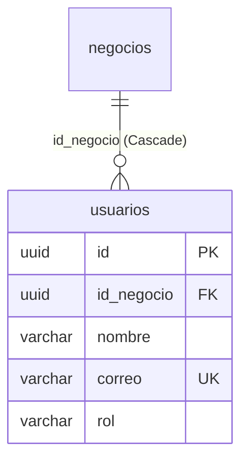

# 👤 Entidad `User`

> [!abstract] Resumen de la Entidad
> Representa a los usuarios con acceso administrativo u operativo a un negocio específico en Slotify (propietarios y empleados). Implementa el patrón multi-inquilino (*multi-tenant*) ligando cada cuenta a un `BusinessId` obligatorio. Los clientes finales consumidores no pertenecen a esta tabla, sino a [[Entidad Client]].

---

## 📍 Metadatos Técnicos
* **Archivo:** `src/Slotify.Domain/Entities/User.cs`
* **Namespace:** `Slotify.Domain.Entities`
* **Herencia:** `AuditableEntity` $\to$ `BaseEntity`
* **Tabla física en PostgreSQL:** `"usuarios"`
* **Configuración EF Core:** `src/Slotify.Infrastructure/Data/Configurations/UserConfiguration.cs`
* **DbSet:** `AppDbContext.Users`

---

## 🔑 Clave Primaria
* **`Id` (`Guid`):** Identificador global único del usuario. Corresponde directamente al UUID emitido por Supabase Auth (`auth.users.id`).

---

## 📋 Mapeo de Propiedades C# vs Columnas de Base de Datos

| Propiedad C# | Tipo C# | Columna PostgreSQL | Tipo SQL | Nulo | Valor por Defecto / Configuración |
| :--- | :--- | :--- | :--- | :---: | :--- |
| `Id` | `Guid` | `id` | `uuid` | No | PK proveniente de Supabase Auth |
| `BusinessId` | `Guid` | `id_negocio` | `uuid` | No | FK hacia `negocios.id` |
| `FirstName` | `string` | `nombre` | `varchar(100)` | No | Longitud máx: 100 |
| `LastName` | `string` | `apellido` | `varchar(100)` | Sí | Longitud máx: 100 (`string.Empty` por defecto) |
| `FullName` | `string` | *(No mapeada)* | *(Calculada)* | — | Ignorada en EF Core (`[NotMapped]`). Concatena `FirstName` y `LastName`. |
| `Email` | `string` | `correo` | `varchar(150)` | No | Índice único (`idx_usuarios_correo`). Longitud máx: 150. |
| `PasswordHash` | `string` | `password_hash` | `varchar(255)` | No | `"managed_by_supabase"`. Conservado por compatibilidad de schema. |
| `Role` | `UserRole` (Enum) | `rol` | `varchar(20)` | No | Conversión EF Core: `UserRole.Owner` $\leftrightarrow$ `"DUENO"`, `UserRole.Employee` $\leftrightarrow$ `"EMPLEADO"`. |
| `IsActive` | `bool` | `esta_activo` | `boolean` | No | `true` |
| `EmailVerified` | `bool` | `correo_verificado` | `boolean` | No | `false` |
| `LastLogin` | `DateTime?` | `ultimo_inicio_sesion` | `timestamp` | Sí | `null` hasta el primer inicio de sesión |
| `CreatedAt` | `DateTime` | `fecha_creacion` | `timestamp` | No | `CURRENT_TIMESTAMP` (Gestionado en `SaveChangesAsync`) |
| `UpdatedAt` | `DateTime?` | `fecha_actualizacion` | `timestamp` | Sí | `CURRENT_TIMESTAMP` en modificaciones |

---

## 🔗 Relaciones y Claves Foráneas



* **Relación N:1 con [[Entidad Business]] (`negocios`):**
  - **Propiedad de navegación:** `public Business Business { get; set; } = null!;`
  - **FK física:** `id_negocio`
  - **Comportamiento en cascada:** `DeleteBehavior.Cascade` (si se elimina el negocio, se eliminan sus usuarios asociados).

---

## 🛡️ Índices y Restricciones
1. **Clave Primaria:** `PK_usuarios` en columna `id`.
2. **Índice Único:** `IX_usuarios_correo` sobre la columna `correo` (`builder.HasIndex(x => x.Email).IsUnique()`).
3. **Restricción CHECK de Dominio (Base de datos):**
   ```sql
   CHECK (rol IN ('DUENO', 'EMPLEADO'))
   ```

---

## 💼 Reglas de Negocio Identificadas
1. **Separación Estricta B2B vs B2C:** Los clientes finales no se registran en `usuarios`. Pertenecen exclusivamente a la entidad [[Entidad Client]] (`clientes`).
2. **Identidad Delegada (Zero Trust):** La verificación de contraseñas y emisión de sesiones base se realiza en Supabase Auth. El `Id` de `usuarios` se sincroniza con el identificador de Supabase.
3. **Multi-Tenancy Obligatorio:** Todo usuario en esta tabla debe estar inexorablemente asociado a un `id_negocio`. No existen usuarios "huérfanos" ni administradores globales sin tenant.
4. **Propiedad Calculada `FullName`:** Proporciona un formateo limpio si el apellido no fue provisto (evita espacios dobles o valores `"null"` en vistas).

---

## 🧪 Ejemplo de Registro Ilustrativo

> [!example] Datos Simulados para Pruebas
> ```json
> {
>   "id": "c3e9817f-7128-403f-9174-8848a27d2c39",
>   "businessId": "b8f2d1e0-3c4a-4a5e-b9f1-7c8d9e0f1a2b",
>   "firstName": "Héctor",
>   "lastName": "Vázquez",
>   "fullName": "Héctor Vázquez",
>   "email": "hector@barberiacapital.mx",
>   "passwordHash": "managed_by_supabase",
>   "role": "DUENO",
>   "isActive": true,
>   "emailVerified": true,
>   "lastLogin": "2026-11-17T18:30:00Z",
>   "createdAt": "2026-11-01T12:00:00Z",
>   "updatedAt": "2026-11-17T18:30:00Z"
> }
> ```

---

## 🔗 Enlaces Relacionados
* [[Modulo Domain]]
* [[Entidad Business]]
* [[Entidad Client]]
* [[AppDbContext]]
* [[Feature Auth]]
* [[Clean Architecture]]
