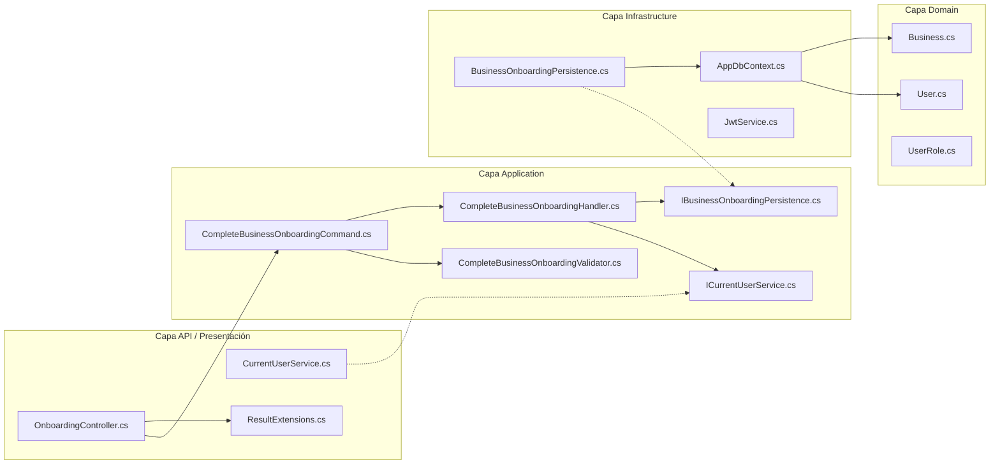
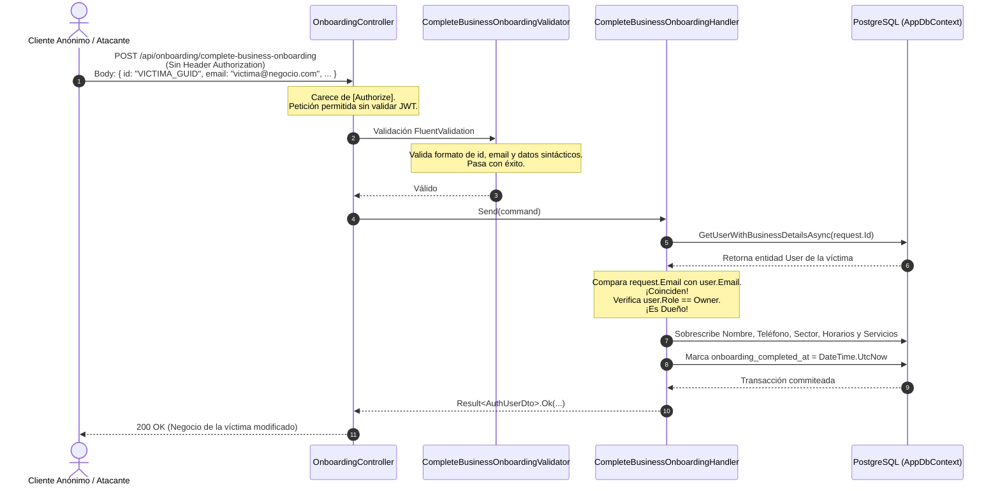
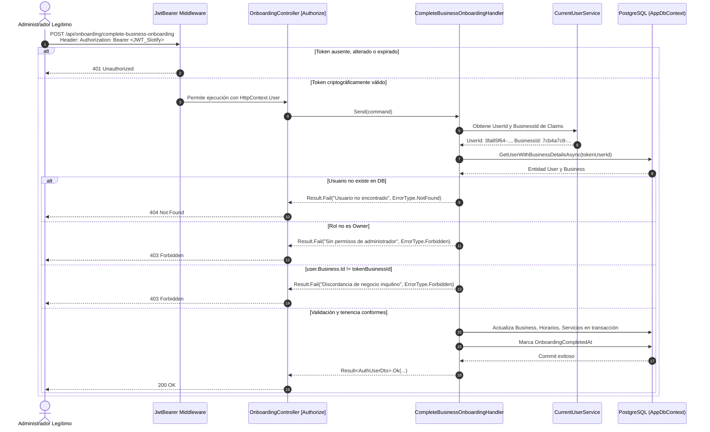

# 🛡️ Diagnóstico Técnico y Remediación de Seguridad: Protección del Onboarding B2B y Resolución de Identidad desde Claims

> [!abstract] Resumen Ejecutivo
> El presente documento contiene la auditoría técnica exhaustiva, el modelado de amenazas, el diseño arquitectónico y la **implementación de remediación de seguridad (Fase 10.3)** para el flujo de alta comercial B2B (`POST /api/onboarding/complete-business-onboarding`).
> 
> La vulnerabilidad de confianza ciega en identificadores del cliente (`request.Id` y `request.Email`) fue **completamente remediada**:
> 1. `OnboardingController` fue decorado con `[Authorize]` y adaptado con `result.ToActionResult()`.
> 2. `CompleteBusinessOnboardingCommand` y su validador fueron purgados de campos de identidad.
> 3. `CompleteBusinessOnboardingHandler` inyecta `ICurrentUserService` y resuelve al usuario autenticado exclusivamente desde el claim `sub` (`UserId`), comprobando además el rol `Owner` y la correspondencia estricta del claim `businessId`.
> 4. Se añadieron 12 pruebas automatizadas en `OnboardingSecurityTests.cs` (8 de integración HTTP y 4 unitarias), superando el 100% de los casos de prueba previstos.

---

## 1. Estado Actual del Endpoint

### 1.1 Verificación de Hallazgos Previos

A partir de la inspección directa del código fuente, se verificaron los 6 hallazgos de la auditoría preliminar:

| # | Hallazgo Auditado | Estado Real Verificado | Evidencia en Código Fuente |
| :---: | :--- | :---: | :--- |
| **1** | `OnboardingController` no tiene `[Authorize]`. | **CONFIRMADO** | `OnboardingController.cs` carece de atributo `[Authorize]` a nivel clase y método. No implementa ninguna directiva de seguridad. |
| **2** | El endpoint permite solicitudes sin autenticación. | **CONFIRMADO** | El pipeline de ASP.NET Core no intercepta la llamada; cualquier cliente anónimo puede invocar `POST /api/onboarding/complete-business-onboarding`. |
| **3** | El handler utiliza `request.Id` y `request.Email` del cuerpo. | **CONFIRMADO** | `CompleteBusinessOnboardingHandler.cs` (líneas 29-51) consulta la base de datos usando `request.Id` y compara cadenas con `request.Email`. |
| **4** | Comprueba existencia, coincidencia de correo y rol. | **CONFIRMADO** | Verifica `user is null`, `!string.Equals(user.Email, request.Email)` y `user.Role != UserRole.Owner`. |
| **5** | Modifica información del negocio, horarios, servicios y estado. | **CONFIRMADO** | Realiza mutaciones críticas: actualiza `Business` (nombre, slug, teléfono, sector, timezone), inserta `BusinessBrand`, `AvailabilitySchedule`, `Service` y estampa `onboarding_completed_at`. |
| **6** | La identidad no se deriva de los claims del JWT. | **CONFIRMADO** | Ni el controlador ni el handler inyectan `ICurrentUserService` ni consultan `HttpContext.User`. La identidad proviene 100% de la entrada suministrada por el cliente. |

### 1.2 Mapeo de Respuesta HTTP en Controlador

Se identificó una deficiencia adicional en el controlador:
```csharp
// OnboardingController.cs - Línea 29
return result.Success ? Ok(result) : BadRequest(result);
```
`OnboardingController` no utiliza el helper centralizado `result.ToActionResult()` (`ResultExtensions.cs`). Cualquier error (incluyendo errores de autorización o entidades inexistentes) es transformado genéricamente a `400 Bad Request`, perdiendo la semántica HTTP estándar (`401 Unauthorized`, `403 Forbidden`, `404 NotFound`).

---

## 2. Archivos y Clases Involucrados



### Detalle de Archivos Auditados

1. **Controlador:**
   - [OnboardingController.cs](file:///D:/Aplicaciones/Slotify_back/src/Slotify.API/Controllers/OnboardingController.cs): Expone la ruta `POST /api/onboarding/complete-business-onboarding`.
2. **Contratos y Casos de Uso:**
   - [CompleteBusinessOnboardingCommand.cs](file:///D:/Aplicaciones/Slotify_back/src/Slotify.Application/Features/Onboarding/Commands/CompleteBusinessOnboardingCommand.cs): Record MediatR con `Id`, `Email`, `FirstName`, `LastName`, `Business`, `BusinessHours`, `Services`.
   - [CompleteBusinessOnboardingHandler.cs](file:///D:/Aplicaciones/Slotify_back/src/Slotify.Application/Features/Onboarding/Commands/CompleteBusinessOnboardingHandler.cs): Orquestador transaccional de la mutación de entidades.
   - [CompleteBusinessOnboardingValidator.cs](file:///D:/Aplicaciones/Slotify_back/src/Slotify.Application/Features/Onboarding/Commands/CompleteBusinessOnboardingValidator.cs): Reglas de FluentValidation que validan sintácticamente el comando.
   - [OnboardingBusinessDto.cs](file:///D:/Aplicaciones/Slotify_back/src/Slotify.Application/Features/Onboarding/DTOs/OnboardingBusinessDto.cs), [OnboardingBusinessHourDto.cs](file:///D:/Aplicaciones/Slotify_back/src/Slotify.Application/Features/Onboarding/DTOs/OnboardingBusinessHourDto.cs), [OnboardingServiceDto.cs](file:///D:/Aplicaciones/Slotify_back/src/Slotify.Application/Features/Onboarding/DTOs/OnboardingServiceDto.cs).
3. **Servicios de Contexto e Identidad:**
   - [ICurrentUserService.cs](file:///D:/Aplicaciones/Slotify_back/src/Slotify.Application/Common/Interfaces/ICurrentUserService.cs): Interfaz con `UserId`, `BusinessId`, `Role`, `IsAuthenticated`.
   - [CurrentUserService.cs](file:///D:/Aplicaciones/Slotify_back/src/Slotify.API/Services/CurrentUserService.cs): Implementación que extrae claims de `IHttpContextAccessor`.
   - [JwtService.cs](file:///D:/Aplicaciones/Slotify_back/src/Slotify.Infrastructure/Services/JwtService.cs): Emisor y validador de JWT internos de Slotify.
4. **Dominio y Persistencia:**
   - [User.cs](file:///D:/Aplicaciones/Slotify_back/src/Slotify.Domain/Entities/User.cs): Entidad de usuario vinculada a un negocio (`BusinessId`).
   - [Business.cs](file:///D:/Aplicaciones/Slotify_back/src/Slotify.Domain/Entities/Business.cs): Entidad de negocio inquilino (`OnboardingCompletedAt`).
   - [IBusinessOnboardingPersistence.cs](file:///D:/Aplicaciones/Slotify_back/src/Slotify.Application/Common/Interfaces/IBusinessOnboardingPersistence.cs) y [BusinessOnboardingPersistence.cs](file:///D:/Aplicaciones/Slotify_back/src/Slotify.Infrastructure/Data/BusinessOnboardingPersistence.cs): Persistencia atómica vía `ExecutionStrategy`.
5. **Configuración y Middleware:**
   - [Program.cs](file:///D:/Aplicaciones/Slotify_back/src/Slotify.API/Program.cs): Registro de JwtBearer, Autorización y DI.

---

## 3. Flujo Actual de Identidad

Actualmente, el flujo de ejecución transcurre sin verificación criptográfica perimetral:



### Análisis del Fallo de Confianza
El backend adopta un modelo de "confianza ciega" en el cliente: asume que quien envía el GUID y el correo electrónico en el JSON es el legítimo propietario de la cuenta, violando las reglas de **Zero Trust** establecidas en `AGENTS.md`.

---

## 4. Vulnerabilidades y Escenarios de Abuso Identificados

> [!CAUTION] Clasificación de Riesgo: ALTO / CRÍTICO (Diseño Arquitectónico)
> Aunque la inspección es de carácter estático y no existen evidencias de ataques en curso, la superficie expuesta habilita múltiples vectores de abuso deterministas.

### Escenario A: Suplantación de Identidad e Insecure Direct Object Reference (IDOR)
* **Vector:** Un atacante descubre o infiere el GUID del usuario administrador y su correo (por ejemplo, a través de respuestas de endpoints públicos de catálogo, fugas informativas en logs de red o ingeniería social).
* **Impacto:** Envía el payload con dichos datos a `POST /api/onboarding/complete-business-onboarding`. El sistema acepta la transacción y muta el negocio de la víctima.

### Escenario B: Secuestro y Alteración de Configuración Comercial (Cross-Tenant Tampering)
* **Vector:** Un usuario autenticado de la empresa "Barbería Alpha" (inquilino legítimo) intercepta sus propias llamadas y sustituye el `id` y `email` en el cuerpo por los de "Spa Beta" (inquilino en proceso de alta).
* **Impacto:** La Barbería Alpha sobrescribe la identidad corporativa, plantilla de giro comercial, zona horaria y catálogo de servicios de Spa Beta.

### Escenario C: Denegación de Servicio y Bloqueo Permanente de Onboarding
* **Vector:** El atacante inyecta horarios incompatibles o una configuración mínima a un negocio antes de que el dueño real termine el formulario, estampando `onboarding_completed_at = DateTime.UtcNow`.
* **Impacto:** 
  1. Cuando el propietario legítimo intenta completar su onboarding, el handler evalúa `business.OnboardingCompletedAt.HasValue` y devuelve `200 OK` inmediatamente sin aplicar los datos reales del usuario legítimo.
  2. Alternativamente, si el atacante inyecta datos parciales, las llamadas posteriores del dueño real son rechazadas con el error: *"El negocio contiene datos parciales de onboarding. Se requiere revisar su información antes de continuar"*. El negocio queda inutilizable.

---

## 5. Diseño Propuesto de Autorización

Para mitigar íntegramente la superficie de ataque, el endpoint debe integrarse en la arquitectura de autorización de Slotify:

### 5.1 Aplicación del Atributo `[Authorize]`
* `OnboardingController` debe decorarse con `[Authorize]` a nivel clase o método.
* Requiere autenticación obligatoria mediante el esquema `JwtBearerDefaults.AuthenticationScheme`.
* Rechaza peticiones sin token o con firmas inválidas con código HTTP `401 Unauthorized` directamente en el pipeline de ASP.NET Core, sin llegar al controlador ni consumir recursos de base de datos.

### 5.2 Restricción por Rol (`Role-Based Authorization`)
* El onboarding comercial está reservado exclusivamente para los administradores o dueños del negocio.
* Se debe exigir que el usuario posea el rol de administrador:
  - Vía atributo/política: `[Authorize(Roles = "Owner")]` (o la política correspondiente).
  - Vía validación en el Handler: Verificación estricta de `user.Role == UserRole.Owner` en base de datos y coincidencia con el claim `role` del token.
* Si un usuario autenticado con rol `Employee` (`EMPLEADO`) o `Customer` (`CLIENTE`) intenta invocar el endpoint, el servidor debe responder `403 Forbidden`.

---

## 6. Diseño Propuesto de Resolución de Identidad mediante Claims

### 6.1 Principio Rector: Cero Confianza en Identificadores del Payload
1. **Eliminación de Autoridad en el Body:** El cliente no debe ser la autoridad de su propia identidad. Los campos `Id` y `Email` del comando no deben utilizarse como criterios de búsqueda ni de autorización.
2. **Inyección de `ICurrentUserService`:** El handler debe recibir `ICurrentUserService` mediante Inyección de Dependencias (DI).
3. **Resolución Criptográfica:**
   - `UserId`: Se extrae de `_currentUserService.UserId`. Si es nulo o `Guid.Empty`, se rechaza con error de autorización (`ErrorType.Forbidden` / `401 Unauthorized`).
   - `BusinessId`: Se extrae de `_currentUserService.BusinessId`. Si es nulo o `Guid.Empty`, se rechaza con `ErrorType.Forbidden`.

### 6.2 Flujo Seguro Propuesto



---

## 7. Validaciones de Propiedad del Negocio y Aislamiento Multi-Inquilino

La validación de tenencia debe impedir que un usuario con un token válido de Negocio A modifique la configuración de Negocio B:

### Matriz de Comprobaciones en Handler

| Etapa | Comprobación | Condición de Fallo | Código / ErrorType | Mensaje de Error |
| :---: | :--- | :--- | :---: | :--- |
| **1** | Autenticación activa | `!_currentUserService.IsAuthenticated` o `UserId == null` | `401 / Forbidden` | `"Petición no autenticada o sesión expirada."` |
| **2** | Presencia de Tenencia | `_currentUserService.BusinessId == null` | `403 Forbidden` | `"El token no contiene un identificador de negocio válido."` |
| **3** | Existencia del Usuario | `user is null` al buscar por `UserId` del token | `404 NotFound` | `"El usuario autenticado no existe en el sistema."` |
| **4** | Autorización de Rol | `user.Role != UserRole.Owner` | `403 Forbidden` | `"El usuario no tiene permisos de administrador del negocio."` |
| **5** | Negocio Vinculado | `user.Business is null` | `404 NotFound` | `"El usuario no cuenta con un negocio asociado."` |
| **6** | Tenencia Cruzada | `user.BusinessId != tokenBusinessId` | `403 Forbidden` | `"El negocio del token no coincide con el asignado al usuario."` |

### Tratamiento de la Idempotencia (Reintentos)
Si un usuario legítimo reenvía la petición tras haber completado el onboarding (`business.OnboardingCompletedAt.HasValue`), el sistema mantiene el comportamiento idempotente actual: retorna exitosamente `Result<AuthUserDto>.Ok(...)` con los datos consolidados sin volver a mutar la base de datos ni generar duplicidad de servicios u horarios.

---

## 8. Contrato de Claims Requerido

Para que el módulo de Onboarding opere de manera transparente, el JWT emitido para el usuario debe portar la siguiente estructura de claims estándar:

```json
{
  "sub": "3fa85f64-5717-4562-b3fc-2c963f66afa6",
  "email": "admin@barberiapremium.com",
  "role": "Owner",
  "businessId": "7cb4a7c8-9df2-4ce1-8637-29cb1152a412",
  "nbf": 1731920000,
  "exp": 1731923600,
  "iss": "Slotify.API",
  "aud": "Slotify.App"
}
```

### Especificación Técnica de los Claims Requeridos:

1. **`sub` (`JwtRegisteredClaimNames.Sub` / `ClaimTypes.NameIdentifier`):**
   - **Tipo:** `string` (formato UUID/Guid).
   - **Propósito:** Identificador unívoco del usuario en la tabla `usuarios.id` (que coincide con el UID de Supabase Auth).
   - **Consumo:** `_currentUserService.UserId`.
2. **`businessId` (Claim personalizado `businessId` o `business_id`):**
   - **Tipo:** `string` (formato UUID/Guid).
   - **Propósito:** Identificador del negocio asignado en `usuarios.id_negocio` y `negocios.id`.
   - **Consumo:** `_currentUserService.BusinessId`.
3. **`role` (`ClaimTypes.Role` o `role`):**
   - **Tipo:** `string`.
   - **Propósito:** Rol administrativo (`"Owner"` / `"DUENO"`).
   - **Consumo:** `_currentUserService.Role` y filtro de políticas `[Authorize]`.
4. **`email` (`JwtRegisteredClaimNames.Email` / `ClaimTypes.Email`):**
   - **Tipo:** `string` (formato correo electrónico).
   - **Propósito:** Trazabilidad y auditoría.

---

## 9. Dependencias y Coordinación con el Módulo de Autenticación

Dado que otro integrante del equipo es responsable de la validación de identidad Supabase y la emisión de tokens JWT, se definen los siguientes puntos de sincronización y acuerdos de contrato:

### 9.1 Aspectos Garantizados por la Arquitectura Actual
* `RegisterAdminHandler.cs` ya vincula un `Business` al registrar un administrador y genera un JWT interno con los claims `sub`, `email`, `role` (`"Owner"`) y `businessId`.
* Por lo tanto, un usuario que acaba de registrarse **ya posee un JWT con `businessId`** antes de ingresar al wizard de Onboarding.

### 9.2 Acuerdos de Coordinación Obligatorios

1. **Nombre y Valor del Claim de Rol:**
   - `JwtService.cs` genera actualmente: `new Claim(ClaimTypes.Role, user.Role.ToString())` (emitiendo el valor `"Owner"`).
   - La base de datos almacena `"DUENO"`.
   - *Acuerdo:* Se debe consensuar si el claim de rol mantendrá `"Owner"` o `"DUENO"`. Se recomienda que `ICurrentUserService` y las validaciones de Onboarding acepten indistintamente ambas cadenas para evitar rupturas de compatibilidad.
2. **Uso Exclusivo del JWT de Slotify en Frontend:**
   - El responsable de autenticación/frontend debe verificar que el interceptor HTTP de la aplicación cliente (`src/shared/lib/api.ts` o `businessOnboardingApi.ts`) envíe el **JWT interno emitido por Slotify**, y **no** el token original emitido directamente por Supabase.
   - Si se envía el token de Supabase, el endpoint protegido retornará `401 Unauthorized` (por discrepancia de firma simétrica HMAC SHA-256 vs clave asimétrica de Supabase) o `403 Forbidden` (por ausencia del claim `businessId`).
3. **Compatibilidad del Payload de Onboarding:**
   - Durante la transición, se recomienda que el frontend pueda seguir enviando o dejar de enviar `id` y `email` en el cuerpo del JSON, pero el backend los ignorará categóricamente, dando precedencia absoluta a los claims.

---

## 10. Archivos Modificados Durante la Implementación (Fase 10.3)

| Archivo | Capa | Modificación Realizada | Estado |
| :--- | :--- | :--- | :---: |
| `src/Slotify.API/Controllers/OnboardingController.cs` | API | Decorado con `[Authorize]`, migrado a `result.ToActionResult()` y respuestas OpenAPI actualizadas (200, 400, 401, 403, 404). | ✅ Completado |
| `src/Slotify.Application/Features/Onboarding/Commands/CompleteBusinessOnboardingCommand.cs` | Application | Se eliminaron `Id` y `Email`. El comando conserva exclusivamente datos funcionales del negocio y perfil. | ✅ Completado |
| `src/Slotify.Application/Features/Onboarding/Commands/CompleteBusinessOnboardingValidator.cs` | Application | Se eliminaron las reglas de validación obligatoria sobre `x.Id` y `x.Email`. | ✅ Completado |
| `src/Slotify.Application/Features/Onboarding/Commands/CompleteBusinessOnboardingHandler.cs` | Application | Inyecta `ICurrentUserService`. Resuelve el usuario por `_currentUserService.UserId`, valida rol `UserRole.Owner`, compara `tokenBusinessId == user.BusinessId`, e ignora cualquier parámetro de identidad del body. | ✅ Completado |
| `src/Slotify.Tests/OnboardingSecurityTests.cs` | Tests | Nueva suite con 12 pruebas de seguridad: 8 de integración HTTP vía `WebApplicationFactory<Program>` y 4 unitarias del handler. | ✅ Completado |

---

## 11. Pruebas de Seguridad Implementadas y Resultados

Se implementó la suite completa en `src/Slotify.Tests/OnboardingSecurityTests.cs`, logrando **12/12 pruebas exitosas**:

```mermaid
graph TD
    TestSuit["Suite de Pruebas: OnboardingSecurityTests (12/12 Aprobadas)"]
    
    TestSuit --> T1["1. Sin Token (401 Unauthorized) - ✅ Aprobada"]
    TestSuit --> T2["2. Token Expirado (401 Unauthorized) - ✅ Aprobada"]
    TestSuit --> T3["3. Rol Inválido / No Dueño (403 Forbidden) - ✅ Aprobada"]
    TestSuit --> T4["4. Claim BusinessId Ausente (403 Forbidden) - ✅ Aprobada"]
    TestSuit --> T5["5. Token de Otro Negocio (403 Forbidden) - ✅ Aprobada"]
    TestSuit --> T6["6. Usuario Inexistente en DB (404 NotFound) - ✅ Aprobada"]
    TestSuit --> T7["7. Usuario Autorizado Completa Onboarding (200 OK) - ✅ Aprobada"]
    TestSuit --> T8["8. Reintento Idempotente de Onboarding (200 OK sin remutar) - ✅ Aprobada"]
    TestSuit --> T9["9. Spoofing de Identidad en Body Neutralizado - ✅ Aprobada"]
    TestSuit --> T10["10. Handler: Usuario No Autenticado (Forbidden) - ✅ Aprobada"]
    TestSuit --> T11["11. Handler: Datos Parciales de Onboarding (Fail) - ✅ Aprobada"]
    TestSuit --> T12["12. Handler: Slug en Uso (Conflict) - ✅ Aprobada"]
```



#### Detalle de Resultados de Pruebas:

1. **`CompleteBusinessOnboarding_SinToken_Retorna401Unauthorized`**:
   - Petición sin cabecera `Authorization`. El middleware `JwtBearer` rechaza la llamada antes del controlador. Código: `401 Unauthorized`.
2. **`CompleteBusinessOnboarding_ConTokenExpirado_Retorna401Unauthorized`**:
   - Petición con JWT firmado pero expirado hace 5 minutos. El validador de tokens rechaza la llamada. Código: `401 Unauthorized`.
3. **`CompleteBusinessOnboarding_ConRolNoAutorizado_Retorna403Forbidden`**:
   - Petición de usuario con rol `Employee` en token y base de datos. Rechazada con `403 Forbidden`.
4. **`CompleteBusinessOnboarding_SinClaimBusinessIdEnToken_Retorna403Forbidden`**:
   - Token válido sin el claim `businessId`. Rechazado con `403 Forbidden`.
5. **`CompleteBusinessOnboarding_ConTokenDeOtroNegocio_Retorna403Forbidden`**:
   - Token del Negocio A intentando completar onboarding de Negocio B. Detección de incompatibilidad multi-inquilino. Código: `403 Forbidden`.
6. **`CompleteBusinessOnboarding_UsuarioNoExisteEnDB_Retorna404NotFound`**:
   - Token válido cuyo `UserId` no existe en la base de datos. Código: `404 NotFound`.
7. **`CompleteBusinessOnboarding_UsuarioAutorizado_Retorna200Ok`**:
   - Flujo exitoso de propietario legítimo. Persiste horarios, servicios, marca y estampa `OnboardingCompletedAt`. Código: `200 OK`.
8. **`CompleteBusinessOnboarding_IdempotenteSiYaCompleto_Retorna200OkSinModificar`**:
   - Reintento tras culminar onboarding. Responde `200 OK` retornando el perfil sin ejecutar mutaciones redundantes ni duplicar servicios/horarios.
9. **`CompleteBusinessOnboarding_BodyConIdentificadoresSpoofeados_IgnoraBodyYOperaSobreToken`**:
   - Payload JSON incluye `id` y `email` de una víctima. El handler los ignora categóricamente y opera exclusivamente sobre el usuario del token. Código: `200 OK`.
10. **Pruebas Unitarias del Handler**:
    - Rechazo cuando `ICurrentUserService.IsAuthenticated` es falso (`Forbidden`).
    - Detección de colisión cuando existen datos parciales de onboarding (`Fail`).
    - Detección y respuesta `Conflict` cuando el slug generado ya existe en `IBusinessRepository`.

---

## 12. Criterios de Aceptación Verificados

Todos los escenarios de aceptación se encuentran implementados y respaldados por pruebas automatizadas:

- ✅ **Escenario 1 (Rechazo de petición anónima):** Retorna `401 Unauthorized` de forma inmediata.
- ✅ **Escenario 2 (Rechazo de usuario no autorizado):** Retorna `403 Forbidden` si el rol no es `Owner`.
- ✅ **Escenario 3 (Resolución de identidad por claims):** Resuelve `UserId` y `BusinessId` desde el token, actualizando el negocio con código `200 OK`.
- ✅ **Escenario 4 (Neutralización de identificadores en body):** Cualquier `id` o `email` en el payload es ignorado por completo.

---

## 13. Estado del Orden de Implementación

- [x] **Paso 1: Sincronización de Contrato de Claims:** Confirmado que `RegisterAdminHandler` emite `sub`, `email`, `role == "Owner"` y `businessId`.
- [x] **Paso 2: Flexibilización del Validador y Comando:** Eliminados `Id` y `Email` de `CompleteBusinessOnboardingCommand` y `CompleteBusinessOnboardingValidator`.
- [x] **Paso 3: Adaptación del Handler:** Inyectado `ICurrentUserService`, validado `user.Role == UserRole.Owner` y pertenencia estricta de `businessId`.
- [x] **Paso 4: Decoración de Controlador:** Añadido `[Authorize]`, migrado a `result.ToActionResult()`.
- [x] **Paso 5: Suite de Pruebas de Seguridad:** Creada `OnboardingSecurityTests.cs` con 12 pruebas ejecutadas y aprobadas.
- [x] **Paso 6: Actualización Documental:** Actualizados `Proteccion del Onboarding.md`, `Feature Onboarding.md`, `Contratos de API REST.md` y `US-017`.
