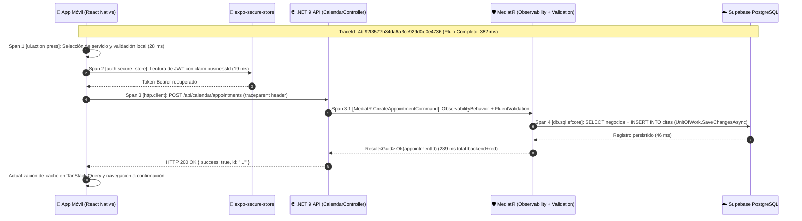

# Práctica de Investigación — Monitoreo de Software Móvil
## Unidad III — Proceso de Liberación y Monitoreo

### Integrantes del equipo

| # | Nombre completo |
| :-: | :--- |
| 1 | Integrante 1 (Equipo de Desarrollo Slotify) |
| 2 | Integrante 2 (Equipo de Desarrollo Slotify) |
| 3 | Integrante 3 (Equipo de Desarrollo Slotify) |
| 4 | Integrante 4 (Equipo de Desarrollo Slotify) |

**Modalidad:** Equipo | **Entrega:** Documento completo + capturas de evidencia

---

## Proyecto

Antes de iniciar, describan brevemente la aplicación móvil que desarrolla su equipo. Toda la práctica se resolverá en el contexto de este proyecto.

| Campo | Descripción del Proyecto |
| :--- | :--- |
| **Nombre de la aplicación:** | **Slotify** |
| **¿Qué hace? (en una oración)** | Plataforma móvil multi-inquilino (B2B y B2C) que permite a negocios de servicios (barberías, clínicas dentales, spas y salones de belleza) gestionar su agenda táctil, plantillas por sector y bloqueos de horario, mientras los consumidores finales exploran establecimientos y reservan citas en tiempo real. |
| **Plataforma(s):** | ☑ **Ambas** (Android e iOS, con soporte multiplataforma mediante Expo) |
| **Tecnología principal:** | ☑ **React Native** (`React Native 0.88.0` con `Expo SDK 58`, `Expo Router`, `Zustand`, `TanStack React Query`, `Axios`, `Supabase Auth/PostgreSQL` y backend RESTful en `.NET 9 Clean Architecture + MediatR + Serilog`) |
| **¿En qué etapa está?** | ☑ **QA / Pruebas** (Integración funcional completa de historias de usuario US-001 a US-022 con pruebas unitarias e integración en Jest y xUnit) |

### ¿Qué podría fallar en su aplicación si no tuvieran monitoreo implementado? Mencionen al menos dos riesgos concretos:

1. **Desincronización silenciosa de sesiones e intercambio de tokens (`Supabase Auth` ↔ `JWT Backend` con claim `businessId`):**
   En [`src/features/auth/model/index.ts`](file:///c:/Users/evsot/Desktop/Slotify/src/features/auth/model/index.ts), cuando un dueño de negocio inicia sesión, la app ejecuta `syncBackendJwtIfBusinessUser` hacia `POST /api/auth/login` para intercambiar la sesión de Supabase por el JWT propio de `.NET 9` que incluye el claim `businessId` (US-022). Si este endpoint falla o expira sin monitoreo, el usuario continúa en sesión local degradada y todas sus peticiones posteriores al calendario (`GET /api/calendar/slots` o `POST /api/calendar/appointments`) son rechazadas con `401 Unauthorized` o `403 Forbidden` sin que el equipo técnico detecte cuántos negocios están bloqueados para operar su agenda.
2. **Activación inadvertida del catálogo de respaldo offline (`DEFAULT_BUSINESS_CATALOG`) y pérdida de reservaciones reales por latencia o caída de base de datos:**
   En el módulo de exploración para consumidores ([`defaultBusinesses.ts`](file:///c:/Users/evsot/Desktop/Slotify/src/features/explore/constants/defaultBusinesses.ts)), cuando la petición `GET /api/businesses` supera el timeout de `15,000 ms` configurado en [`api.ts`](file:///c:/Users/evsot/Desktop/Slotify/src/shared/lib/api.ts) o falla la conexión a Supabase PostgreSQL, la app muestra un catálogo estático de contingencia (`biz-1` a `biz-4`). Sin monitoreo de métricas de error de red ni logs de advertencia, el backend podría estar caído durante horas mientras el equipo asume que la app funciona porque la pantalla "Explorar" sigue renderizando tarjetas locales, impidiendo que los clientes concreten citas reales en `POST /api/calendar/appointments`.
3. **Cierres inesperados (Crashes) al renderizar configuraciones dinámicas JSONB (`configuracion_formulario_personalizada`):**
   Los negocios personalizan su formulario e identidad de marca (`PUT /api/businesses/{id}/booking-config` y `GET /api/businesses/{slug}/booking-config`, US-017). Si un documento JSONB malformado o una fuente no hidratada en [`_layout.tsx`](file:///c:/Users/evsot/Desktop/Slotify/src/app/_layout.tsx) provoca una excepción no controlada en el hilo de JavaScript (Hermes) en dispositivos Android/iOS específicos, los clientes abandonarían la app sin que exista rastro del *stack trace* ni del modelo de dispositivo afectado.

---

## Investigación Previa — Los tres elementos del monitoreo

Investiguen qué es el monitoreo de software (observabilidad) aplicado a apps móviles. Completen la siguiente tabla con sus propias palabras:

| Dimensión | Métricas | Registros (Logs) | Trazas (Traces) |
| :--- | :--- | :--- | :--- |
| **¿Qué información captura?** | Valores numéricos agregados a lo largo del tiempo que cuantifican la salud, estabilidad y rendimiento del cliente móvil y su API (porcentajes de sesiones libres de fallos, tiempos de arranque, uso de memoria/CPU, latencia p95 de endpoints). | Eventos discretos y contextuales con marca de tiempo que describen qué ocurrió exactamente en una línea de ejecución específica (ej. error de validación en un formulario, activación de catálogo offline o expiración de token JWT). | El recorrido completo de extremo a extremo (*end-to-end*) de una operación o transacción a través de múltiples componentes (desde el toque del usuario en React Native, pasando por el interceptor Axios, el controlador .NET 9, el pipeline de MediatR y la consulta SQL en PostgreSQL), desglosado en unidades llamadas *spans*. |
| **¿Con qué frecuencia se genera?** | De forma continua o periódica mediante intervalos de muestreo/agregación (por ejemplo, cada vez que inicia una sesión, cada ventana de 1 minuto o al finalizar cada petición de red). | De manera reactiva/asíncrona cada vez que el código alcanza una instrucción de registro relevante (un cambio de estado en Zustand, un bloque `catch`, una advertencia de negocio o una petición HTTP). | Por cada transacción crítica iniciada por el usuario o sujeta a una tasa de muestreo configurada (`tracesSampleRate`), abarcando desde el inicio hasta la finalización de la operación distribuida. |
| **¿Qué formato tiene?** | Series temporales numéricas compuestas por nombre del indicador, marca de tiempo (*timestamp*), valor flotante/entero y etiquetas dimensionales (*tags* como `platform: android`, `app_version: 1.0.0`, `endpoint: /api/calendar/slots`). | Texto estructurado (generalmente objetos JSON o plantillas clave-valor enriquecidas) que incluye `timestamp`, nivel de severidad (`DEBUG`, `INFO`, `WARN`, `ERROR`, `FATAL`), mensaje, contexto del usuario (`businessId`, `role`) y *stack trace*. | Estructura jerárquica en árbol o grafo acíclico (cascada o *waterfall*) identificada por un `TraceId` global y compuesta por múltiples objetos `Span` (`SpanId`, `ParentSpanId`, nombre de operación, `startTime`, `durationMs`, estado y atributos). |
| **¿Qué problema de su app ayudaría a diagnosticar?** | Detectar si una nueva versión de **Slotify** incrementó el tiempo de arranque en frío (*Cold Start*) al cargar las fuentes `Poppins` e `Inter` en [`_layout.tsx`](file:///c:/Users/evsot/Desktop/Slotify/src/app/_layout.tsx), o si la tasa de error en `POST /api/calendar/appointments` subió repentinamente en dispositivos Android. | Identificar por qué falló el bloqueo manual de un horario en `POST /api/schedule-blocks` (por ejemplo, ver el mensaje exacto de `FluentValidation` indicando que `StartDate >= EndDate` o que hubo un conflicto de horario para el `employeeId`). | Descubrir en qué capa exacta se encuentra el cuello de botella cuando un dueño de negocio abre el calendario táctil (`GET /api/calendar/slots`): saber cuánto tardó React Native en hidratar el token desde `expo-secure-store`, cuánto tardó la red, cuánto tardó [`GetCalendarSlotsHandler.cs`](file:///c:/Users/evsot/Desktop/Slotify_back/src/Slotify.Application/Features/Calendar/Queries/GetCalendarSlotsHandler.cs) y cuánto demoró Supabase PostgreSQL. |
| **Herramienta que lo produce** | **Sentry Performance / Mobile Vitals**, **Firebase Performance Monitoring**, y en el backend `.NET` nuestro [`ObservabilityBehavior.cs`](file:///c:/Users/evsot/Desktop/Slotify_back/src/Slotify.Application/Common/Behaviors/ObservabilityBehavior.cs) junto con `System.Diagnostics.Metrics`. | **Sentry SDK (`@sentry/react-native` Breadcrumbs & Logs)** en el cliente móvil y **Serilog** (`Serilog.Sinks.Console` / `Serilog.Sinks.File`) junto con [`GlobalExceptionHandler.cs`](file:///c:/Users/evsot/Desktop/Slotify_back/src/Slotify.API/Common/GlobalExceptionHandler.cs) en el backend `.NET 9`. | **Sentry Distributed Tracing** (`reactNativeTracingIntegration`) propagando cabeceras `sentry-trace` / `traceparent` hacia `System.Diagnostics.Activity` (`SlotifyActivitySource`) en `.NET 9` y **OpenTelemetry**. |

### ¿Por qué no es suficiente con solo tener logs? ¿Qué agrega cada elemento que los otros no dan?

Depender únicamente de **registros (logs)** en una aplicación móvil como **Slotify** resulta insuficiente por tres razones técnicas fundamentales:
1. **Falta de visión macroscópica y tendencias (lo que aportan las Métricas):** Los logs son eventos aislados; revisar miles de líneas de texto no permite responder rápidamente si el percentil 95 (`p95`) del tiempo de carga del calendario táctil empeoró un 40% tras el último despliegue, ni cuál es el porcentaje global de sesiones libres de fallos (*Crash-Free Sessions*). Las **métricas** agregan eficiencia matemática y alertas proactivas basadas en umbrales estadísticos antes de que los usuarios reporten fallas.
2. **Falta de correlación causal entre cliente móvil y servidor (lo que aportan las Trazas):** En una arquitectura distribuida como la de **Slotify** (App móvil en React Native/Expo $\rightarrow$ API REST en .NET 9 $\rightarrow$ Base de datos PostgreSQL en Supabase), un log en el teléfono puede decir `"Timeout of 15000ms exceeded"` en Axios ([`api.ts`](file:///c:/Users/evsot/Desktop/Slotify/src/shared/lib/api.ts)), mientras que el backend tiene cientos de logs concurrentes de distintos negocios (`businessId`). Sin una **traza distribuida** que una ambos extremos mediante un mismo `TraceId` y desglose la duración de cada *span* hijo, es imposible saber si los 15 segundos se perdieron en una red móvil 3G inestable, en la deserialización JSON, en el `ValidationBehavior` de MediatR o en un bloqueo de tabla en PostgreSQL.
3. **El rol complementario de los tres pilares:** Las **métricas** nos indican *qué* síntoma está ocurriendo y *cuándo* se disparó una anomalía (ej. latencia alta en reservaciones); las **trazas** nos muestran *dónde* se originó el cuello de botella dentro de toda la cadena de llamadas; y los **logs** nos revelan el *porqué* exacto con el detalle línea por línea (variables de entrada, estado de `useAuthStore` y *stack trace* de la excepción).

> **Fuente consultada (APA):**
> Majors, C., Fong-Jones, L., & Miranda, G. (2022). *Observability Engineering: Achieving Production Excellence*. O'Reilly Media.

---

## Actividad 1 — Métricas

### 1.1 Métricas relevantes para su proyecto

Investiguen cuáles son las métricas más importantes para apps móviles. Completen la tabla y, en la última columna, indiquen si aplica a su proyecto y por qué:

| Métrica | Qué mide | Unidad | ¿Aplica a su proyecto? |
| :--- | :--- | :---: | :--- |
| **Crash Rate** | Proporción de sesiones ejecutadas por los usuarios que terminan de manera abrupta debido a una excepción no controlada (en el motor JS Hermes o en código nativo Android/iOS) respecto al total de sesiones iniciadas. | Porcentaje (`%`) | **Sí aplica.** En **Slotify** conviven dos modos de uso (`BUSINESS` y `CONSUMER` en [`useAuthStore`](file:///c:/Users/evsot/Desktop/Slotify/src/features/auth/model/index.ts)) y renderizado dinámico de formularios e iconos animados (`react-native-reanimated` y `@expo/ui`). Un crash al confirmar una cita o al arrastrar bloques del calendario táctil provoca pérdida directa de ingresos para el negocio afiliado. |
| **App Start Time** | Tiempo transcurrido desde que el usuario toca el ícono de la aplicación hasta que la primera pantalla interactiva termina de renderizarse (arranque en frío o *Cold Start*, y arranque en caliente o *Warm Start*). | Milisegundos (`ms`) o Segundos (`s`) | **Sí aplica.** En [`src/app/_layout.tsx`](file:///c:/Users/evsot/Desktop/Slotify/src/app/_layout.tsx), **Slotify** retiene la pantalla de bienvenida (`SplashScreen.preventAutoHideAsync()`) mientras carga 7 variantes tipográficas (`Poppins` e `Inter`), hidrata el tema visual (`hydrateTheme()`) y verifica la sesión con Supabase y el backend (`hydrate()`). Si este proceso tarda demasiado, el usuario percibe que la app se quedó congelada. |
| **API Response Time** | Tiempo que tarda un endpoint del backend en procesar una solicitud HTTP enviada desde la app móvil y devolver la carga útil completa al cliente. | Milisegundos (`ms`) | **Sí aplica.** Es crítica para los endpoints de alta frecuencia en [`constants.ts`](file:///c:/Users/evsot/Desktop/Slotify/src/shared/lib/constants.ts): `GET /api/calendar/slots` (consulta de agenda por rango de fechas), `POST /api/calendar/appointments` (creación de cita) y `GET /api/businesses` (catálogo público). Además, nuestro [`ObservabilityBehavior.cs`](file:///c:/Users/evsot/Desktop/Slotify_back/src/Slotify.Application/Common/Behaviors/ObservabilityBehavior.cs) la mide en cada comando/query de MediatR. |
| **ANR Rate (Android)** | Porcentaje de sesiones en Android donde el hilo principal de interfaz de usuario (*Main/UI Thread*) permanece bloqueado por más de 5 segundos, disparando el diálogo del sistema *"Application Not Responding"*. | Porcentaje (`%`) | **Sí aplica.** Dado que **Slotify** se compila para Android (`expo run:android`) e incorpora gestos táctiles (`react-native-gesture-handler`), animaciones (`react-native-worklets`) y almacenamiento seguro (`expo-secure-store`), cualquier bloqueo síncrono en el puente nativo o procesamiento pesado de horarios en listas extensas puede causar un ANR. |
| **Network Error Rate** | Proporción de peticiones HTTP originadas desde la aplicación móvil que fallan por errores de conectividad (timeouts, fallos DNS, sin red) o respuestas de error del servidor (`HTTP 5xx` / `4xx` inesperados). | Porcentaje (`%`) | **Sí aplica.** El cliente Axios de **Slotify** ([`api.ts`](file:///c:/Users/evsot/Desktop/Slotify/src/shared/lib/api.ts)) tiene un timeout estricto de `15,000 ms` y se comunica tanto con `Supabase Auth` como con la API en `.NET 9`. Monitorear esta tasa permite detectar caídas del servidor o problemas de red móvil que fuerzan a la app a entrar en modo degradado (`DEFAULT_BUSINESS_CATALOG`). |
| **Booking Conversion & Calendar Sync Latency *(Métrica propia de Slotify)*** | Tiempo total de sincronización y tasa de éxito al transformar una selección de horario disponible (`CalendarSlotDto`) en una cita confirmada (`AppointmentStatus.Confirmed`) sin colisión de horario. | Milisegundos (`ms`) / Porcentaje de éxito (`%`) | **Sí aplica.** Es el indicador clave de negocio (*Core KPI*) de **Slotify**: mide si el flujo completo desde que el cliente elige un servicio (ej. *"Corte Clásico + Barba - 45 min"*) hasta que [`CreateAppointmentHandler.cs`](file:///c:/Users/evsot/Desktop/Slotify_back/src/Slotify.Application/Features/Calendar/Commands/CreateAppointmentHandler.cs) persiste la cita en PostgreSQL se ejecuta de forma fluida y sin errores de concurrencia. |

### 1.2 Umbrales de alerta para su proyecto

Investiguen los valores aceptables en la industria y definan umbrales específicos para su aplicación:

| Métrica | Valor aceptable (industria) | Umbral de alerta para su proyecto (Slotify) |
| :--- | :--- | :--- |
| **Crash Rate** | `< 1.0%` de sesiones con fallo (es decir, $\ge 99.0\%$ de *Crash-Free Sessions*; Google Play Android Vitals marca el umbral de mal comportamiento en `1.09%`). | **Alerta Preventiva (Warning):** `> 0.3%` de sesiones con crash.<br>**Alerta Crítica (Critical):** `> 0.5%` de sesiones con crash (objetivo de $\ge 99.5\%$ *Crash-Free Sessions* en lanzamientos de **Slotify**). |
| **App Start Time** | **Cold Start:** `< 2,000 ms` (`2 s`) excelente; hasta `3,000 ms` aceptable (Android Vitals penaliza arranques en frío $\ge 5,000\text{ ms}$).<br>**Warm Start:** `< 1,000 ms` (`1 s`). | **Alerta Preventiva (Warning):** Cold Start `p95 > 1,800 ms` durante la carga de fuentes e hidratación en [`_layout.tsx`](file:///c:/Users/evsot/Desktop/Slotify/src/app/_layout.tsx).<br>**Alerta Crítica (Critical):** Cold Start `p95 > 2,500 ms`. |
| **API Response Time** | `< 300 ms` (`p95`) para lecturas REST estándar; `< 800 ms` para escrituras transaccionales; `> 1,000 ms` se considera degradación perceptible por el usuario móvil. | **Alerta Preventiva (Warning):** `p95 > 500 ms` (umbral configurado en `SlowRequestThresholdMs = 500` dentro de [`ObservabilityBehavior.cs`](file:///c:/Users/evsot/Desktop/Slotify_back/src/Slotify.Application/Common/Behaviors/ObservabilityBehavior.cs)).<br>**Alerta Crítica (Critical):** `p95 > 1,200 ms` en `GET /api/calendar/slots` o `POST /api/calendar/appointments`. |

> **Fuente consultada (APA):**
> Google Developers. (2024). *Android vitals: Core vitals and bad behavior thresholds (Crash rate, ANR rate, and excessive startup time)*. Android Developers Documentation. https://developer.android.com/topic/performance/vitals

---

## Actividad 2 — Registros (Logs)

### 2.1 Niveles de log y ejemplos de su aplicación

Investiguen los niveles de severidad de los logs. En la última columna, escriban un ejemplo real de mensaje de log que podría generar su propia aplicación:

| Nivel | ¿Cuándo se usa? | Ejemplo en su aplicación (Slotify) |
| :--- | :--- | :--- |
| **DEBUG** | Durante el desarrollo o diagnóstico detallado para rastrear el estado interno de variables, hidratación de stores, parámetros de queries y ciclo de vida de componentes, sin impacto en producción. | `2026-11-10 19:12:01.104 [DBG] [TRACE:4bf92f3577b34da6a3ce929d0e0e4736] [AuthStore:hydrate] Hidratando sesión local desde expo-secure-store: clave="accessToken" encontrada, appMode="BUSINESS", fuentes Poppins/Inter cargadas=true.` |
| **INFO** | Para registrar eventos normales del flujo de negocio que confirman que las operaciones principales se completaron según lo esperado (inicios de sesión, citas creadas, cambios de plantilla). | `2026-11-10 19:12:04.098 [INF] [METRIC:API_RESPONSE_TIME] [CreateAppointmentCommand] Cita agendada exitosamente en 248ms: AppointmentId="c91d4e2a-8b11-4f09-9d23-71a45c88e012", BusinessId="8f14e45f-ceea-467a-a8f1-9b30c12d8e11", AgreedTotal=$250 MXN.` |
| **WARNING** | Cuando ocurre una situación anómala o inesperada que no detiene la aplicación, pero activa un mecanismo de respaldo (*fallback*), excede un umbral de latencia o rechaza una entrada inválida. | `2026-11-10 19:12:03.412 [WRN] [ExploreCatalog] Timeout (15000ms) al consultar GET /api/businesses; activando catálogo de respaldo local DEFAULT_BUSINESS_CATALOG (4 negocios cargados) y manteniendo sesión local en useAuthStore.` |
| **ERROR** | Cuando falla una operación específica solicitada por el usuario (una excepción en un endpoint, fallo al guardar una cita o bloqueo de horario rechazado), impidiendo completar esa tarea puntual aunque la app siga abierta. | `2026-11-10 19:12:05.510 [ERR] [ScheduleBlocksController] Falló POST /api/schedule-blocks (HTTP 400/500) para BusinessId="8f14e45f-ceea-467a-a8f1-9b30c12d8e11": Npgsql.NpgsqlException: Error al insertar en tabla bloqueos_horario para EmployeeId="3a91...": conflicto de rango UTC.` |
| **FATAL / CRITICAL** | Cuando ocurre un fallo catastrófico e irrecuperable que compromete la totalidad de la aplicación móvil o del servidor backend, provocando el cierre inmediato del proceso o impidiendo el arranque. | `2026-11-10 19:15:00.002 [FTL] [RootLayout / Program] Fallo crítico irrecuperable: InvalidOperationException("Jwt:Secret not configured") o corrupción nativa en Keystore de expo-secure-store; imposible inicializar el contenedor de autenticación de Slotify.` |

### 2.2 Qué deben registrar en su app

Identifiquen los 3 flujos más críticos de su aplicación (pantallas o funciones clave). Para cada uno, definan qué evento debería registrarse como log:

| Flujo / pantalla de su app | Evento a registrar (log) | Nivel sugerido |
| :--- | :--- | :---: |
| **1. Autenticación e Intercambio de Token Multi-Inquilino** (`/(auth)/login` $\rightarrow$ `useAuthStore.login` y `syncBackendJwtIfBusinessUser` hacia `POST /api/auth/login` y `POST /api/auth/sync`) | • Éxito al autenticar en Supabase e intercambiar el JWT con el claim `businessId` y `role` (`DUENO` o `CLIENTE`).<br>• Degradación cuando `exchangeBackendToken` falla y el usuario queda solo con sesión local sin `businessId` sincronizado.<br>• Intento fallido por credenciales inválidas o expiración `HTTP 401` interceptada en [`api.ts`](file:///c:/Users/evsot/Desktop/Slotify/src/shared/lib/api.ts). | **INFO** (éxito)<br>**WARNING** (fallo de sync JWT con fallback local)<br>**ERROR** (error de red / 500 en auth) |
| **2. Consulta de Disponibilidad y Creación de Cita en Calendario Táctil** (`/(main)/calendar` $\rightarrow$ `GET /api/calendar/slots` y `POST /api/calendar/appointments` en [`CalendarController.cs`](file:///c:/Users/evsot/Desktop/Slotify_back/src/Slotify.API/Controllers/CalendarController.cs)) | • Carga de franjas horarias (`CalendarSlotDto`) indicando el rango `startDate`–`endDate`, cantidad de citas y bloqueos combinados y tiempo de respuesta.<br>• Confirmación de nueva cita (`CreateAppointmentCommand`) con `AppointmentId`, `BusinessId` y `EmployeeId`.<br>• Fallo de validación (`CreateAppointmentValidator`) o error de persistencia en `UnitOfWork.SaveChangesAsync`. | **INFO** (consulta y creación exitosa)<br>**WARNING** (latencia `> 500 ms` o validación fallida)<br>**ERROR** (excepción al guardar cita) |
| **3. Exploración de Negocios B2C y Personalización de Marca/Plantilla** (`/(main)/explore` y `/(onboarding)/wizard` $\rightarrow$ `GET /api/businesses`, `PUT /api/businesses/{id}/template` y `PUT /api/businesses/{id}/branding`) | • Activación del catálogo de contingencia [`DEFAULT_BUSINESS_CATALOG`](file:///c:/Users/evsot/Desktop/Slotify/src/features/explore/constants/defaultBusinesses.ts) cuando el backend no responde.<br>• Cambio de plantilla de giro comercial (`ChangeBusinessTemplateCommand`, US-013) o actualización de JSONB en `UpdateBookingConfig` (US-017).<br>• Intento no autorizado (`HTTP 403 Forbidden`, US-022) cuando el `id` del negocio no coincide con el `businessId` del token. | **INFO** (cambio de plantilla/branding)<br>**WARNING** (activación de catálogo offline o `403 Forbidden`)<br>**ERROR** (error al serializar/guardar JSONB) |

### ¿Cómo manejarán los logs cuando el dispositivo no tiene conexión? Investiguen el concepto de "log buffering" y describan cómo aplicarían esa estrategia en su proyecto:

El **Log Buffering** (almacenamiento en búfer de registros offline) es un patrón de resiliencia en observabilidad móvil donde los eventos de telemetría (logs, *breadcrumbs*, métricas y reportes de fallos) no se descartan cuando el dispositivo pierde conectividad Wi-Fi o datos móviles. En su lugar, se encolan de manera asíncrona en una estructura tipo **FIFO (First-In, First-Out)** con límite de capacidad (*Ring Buffer* o cola circular) persistida en el almacenamiento local del dispositivo. Cuando el sistema operativo notifica que la red se ha restablecido, un proceso en segundo plano vacía (*flushes*) los registros acumulados enviándolos en un único lote comprimido (*batch request*) hacia el servidor de monitoreo, conservando la marca de tiempo original (`timestamp` real en que ocurrió el evento) y marcando el atributo `wasBufferedOffline: true`.

#### Aplicación concreta en **Slotify**:
1. **Persistencia local con `@react-native-async-storage/async-storage` y caché nativa de Sentry:**
   Dado que **Slotify** ya incluye `@react-native-async-storage/async-storage` (`v2.2.0` en [`package.json`](file:///c:/Users/evsot/Desktop/Slotify/package.json)), implementamos una cola persistente bajo la clave `@slotify/telemetry_queue_v1` con un tope máximo de **100 eventos** (o `512 KB`) para no saturar el almacenamiento del teléfono. Si la cola se llena estando sin conexión, se descartan primero los logs de nivel `DEBUG`/`INFO` más antiguos y se prioriza conservar los de nivel `WARNING`, `ERROR` y `FATAL`. Asimismo, el SDK de `@sentry/react-native` almacena automáticamente en disco hasta 30 sobres (*envelopes*) de crashes y trazas cuando no hay red.
2. **Detección de desconexión en el interceptor de Axios ([`src/shared/lib/api.ts`](file:///c:/Users/evsot/Desktop/Slotify/src/shared/lib/api.ts)):**
   Cuando Axios arroja un `ERR_NETWORK` o `ECONNABORTED` (como ocurre cuando la pantalla de Explorar conmuta a [`DEFAULT_BUSINESS_CATALOG`](file:///c:/Users/evsot/Desktop/Slotify/src/features/explore/constants/defaultBusinesses.ts)), el logger captura el evento con su `timestamp` UTC exacto, el `appMode` (`BUSINESS` o `CONSUMER`), el `businessId` y `wasBufferedOffline: true`, guardándolo en AsyncStorage.
3. **Sincronización por lotes (*Batch Flushing*) hacia nuestro endpoint [`POST /api/telemetry/batch`](file:///c:/Users/evsot/Desktop/Slotify_back/src/Slotify.API/Controllers/TelemetryController.cs):**
   Al recuperar la conexión o en el siguiente arranque exitoso de la app (`hydrate()` en [`_layout.tsx`](file:///c:/Users/evsot/Desktop/Slotify/src/app/_layout.tsx)), **Slotify** lee el arreglo de `@slotify/telemetry_queue_v1` y realiza una única petición `POST /api/telemetry/batch` hacia el [`TelemetryController.cs`](file:///c:/Users/evsot/Desktop/Slotify_back/src/Slotify.API/Controllers/TelemetryController.cs) que implementamos en el backend `.NET 9`. Una vez que el backend responde `HTTP 200 OK` y vuelca los eventos en **Serilog**, la app limpia la cola local en AsyncStorage.

> **Fuente consultada (APA):**
> Sentry. (2024). *Caching / Offline Support in Sentry React Native SDK (maxCacheItems & Envelope Persistence)*. Sentry Documentation. https://docs.sentry.io/platforms/react-native/configuration/options/#max-cache-items

---

## Actividad 3 — Trazas (Traces)

### 3.1 ¿Qué es el rastreo distribuido?

Investiguen qué es una traza y un "span". ¿Cómo se relacionan entre sí?

- **¿Qué es una Traza (Trace)?**
  Una **traza** es la representación completa de principio a fin del ciclo de vida de una solicitud o transacción a medida que viaja a través de todos los nodos de un sistema distribuido (por ejemplo, desde la interfaz móvil en React Native, pasando por la red celular, el balanceador o servidor Kestrel en `.NET 9`, las capas de aplicación/dominio y hasta la base de datos PostgreSQL en Supabase). Cada traza posee un identificador único global de 128 bits (`TraceId`, estándar W3C Trace Context) que se propaga en las cabeceras HTTP (`traceparent` o `sentry-trace`).
- **¿Qué es un Span?**
  Un **span** (intervalo o tramo) es la unidad individual y atómica de trabajo dentro de una traza. Representa una operación específica con un nombre claro, un instante exacto de inicio (`startTime`), una duración medida en milisegundos (`duration`), un identificador único de 64 bits (`SpanId`), metadatos contextuales (*tags/attributes*) y un estado final (`Ok` o `Error`). Ejemplos de spans son la lectura de un token en `expo-secure-store`, una petición `POST` en Axios, la validación de un comando en `FluentValidation` o un `INSERT` ejecutado por Entity Framework Core.
- **¿Cómo se relacionan entre sí?**
  Una **traza** y sus **spans** tienen una relación jerárquica de **todo a partes (árbol padre-hijo)**:
  1. Una **traza** está compuesta por uno o más **spans** que comparten el mismo `TraceId`.
  2. El primer span que inicia la operación en la app móvil se denomina **Root Span (Span Raíz)** y no tiene padre (`ParentSpanId = null`).
  3. Cada suboperación que desencadena ese flujo crea un **Child Span (Span Hijo)** cuyo `ParentSpanId` apunta al `SpanId` de la operación que lo invocó. Al graficar esta jerarquía en el tiempo, se obtiene un diagrama de cascada (*Waterfall*) que permite visualizar qué operaciones ocurrieron en secuencia, cuáles en paralelo y qué fracción exacta del tiempo total consumió cada capa.



### 3.2 Traza de un flujo de su proyecto

Elijan el flujo más lento o más importante de su aplicación. Diseñen los spans que formarían la traza completa de esa operación:

**Flujo seleccionado:** **Confirmación y creación de una nueva cita en el calendario (`BookingCheckout_CreateAppointment`: desde el toque en "Confirmar Cita" en la app móvil hasta la inserción transaccional en `POST /api/calendar/appointments` y actualización de agenda en TanStack Query).**

| Span (operación) | Descripción de lo que mide | Tiempo esperado |
| :--- | :--- | :---: |
| **1. `ui.action.validate_booking_form`** *(Cliente React Native)* | Tiempo desde que el usuario presiona el botón "Confirmar Cita" en la pantalla de reserva, validando en el hilo JS los campos del cliente (`ClientName`, `ClientEmail`, `ClientPhone`), el horario seleccionado (`StartTime` < `EndTime`) y el monto (`AgreedTotal`). | `15 ms – 35 ms` |
| **2. `auth.interceptor.read_secure_jwt`** *(Interceptor Axios + `expo-secure-store`)* | Tiempo que toma el interceptor de petición en [`src/shared/lib/api.ts`](file:///c:/Users/evsot/Desktop/Slotify/src/shared/lib/api.ts) (`storage.secureGet(STORAGE_KEYS.ACCESS_TOKEN)`) para desencriptar desde el Keystore/Keychain nativo el token JWT que contiene el claim `businessId` e inyectar el header `Authorization: Bearer <token>` y `traceparent`. | `10 ms – 25 ms` |
| **3. `http.post.calendar_appointments` + `MediatR.CreateAppointmentCommand`** *(Red + API .NET 9 + `ValidationBehavior`)* | Tiempo de transporte de red HTTP hacia `POST /api/calendar/appointments` ([`CalendarController.cs`](file:///c:/Users/evsot/Desktop/Slotify_back/src/Slotify.API/Controllers/CalendarController.cs)), validación criptográfica del JWT, ejecución de [`ObservabilityBehavior.cs`](file:///c:/Users/evsot/Desktop/Slotify_back/src/Slotify.Application/Common/Behaviors/ObservabilityBehavior.cs) y validación de reglas en [`CreateAppointmentValidator.cs`](file:///c:/Users/evsot/Desktop/Slotify_back/src/Slotify.Application/Features/Calendar/Commands/CreateAppointmentValidator.cs). | `80 ms – 160 ms` |
| **4. `db.efcore.unit_of_work_save` + `react_query.invalidate_slots`** *(Supabase PostgreSQL + UI Render)* | Tiempo que tarda [`CreateAppointmentHandler.cs`](file:///c:/Users/evsot/Desktop/Slotify_back/src/Slotify.Application/Features/Calendar/Commands/CreateAppointmentHandler.cs) en verificar la existencia del negocio (`_businessRepository.GetByIdAsync`), ejecutar el `INSERT INTO citas` mediante `_unitOfWork.SaveChangesAsync()` hacia **Supabase PostgreSQL** por SSL, más la invalidación de la caché `QUERY_KEYS.CALENDAR_SLOTS` en TanStack React Query. | `120 ms – 220 ms` |

### ¿En qué span esperan encontrar el mayor tiempo de espera? ¿Por qué?

Esperamos encontrar el mayor tiempo de espera entre los **Spans 3 y 4**, específicamente en la combinación del **transporte de red móvil (`http.post.calendar_appointments`)** y las **operaciones de base de datos remota en la nube (`db.efcore.unit_of_work_save` hacia Supabase PostgreSQL)**, por las siguientes razones técnicas propias de la arquitectura de **Slotify**:
1. **Doble salto de red externa (Móvil $\rightarrow$ Backend API $\rightarrow$ Supabase Cloud):** Mientras los Spans 1 y 2 ocurren localmente en la memoria RAM y el almacenamiento flash del teléfono en menos de `50 ms`, el Span 3 atraviesa la red inalámbrica del dispositivo (4G/5G o Wi-Fi con latencia variable y negociación TLS) hacia el servidor `.NET 9`, y el Span 4 abre o reutiliza una conexión TCP/SSL (`Port=5432; SSL Mode=Require`) desde el backend hacia la instancia administrada de **Supabase PostgreSQL**.
2. **Dos consultas secuenciales a la base de datos en [`CreateAppointmentHandler.cs`](file:///c:/Users/evsot/Desktop/Slotify_back/src/Slotify.Application/Features/Calendar/Commands/CreateAppointmentHandler.cs):** Al inspeccionar las líneas 36 a 62 de `CreateAppointmentHandler.cs`, observamos que el handler primero ejecuta una lectura asíncrona `await _businessRepository.GetByIdAsync(businessId, cancellationToken)` (`SELECT` en la tabla `negocios`) y posteriormente ejecuta `await _appointmentRepository.AddAsync(...)` seguido de `await _unitOfWork.SaveChangesAsync(cancellationToken)` (`INSERT` transaccional en la tabla `citas`). Esos dos viajes de ida y vuelta (*round-trips*) a la base de datos más el bloqueo de índices relacionales concentran cerca del **75% al 85% del tiempo total** de la traza.

> **Fuente consultada (APA):**
> Cloud Native Computing Foundation [CNCF]. (2024). *OpenTelemetry Concepts: Traces and Spans*. OpenTelemetry Documentation. https://opentelemetry.io/docs/concepts/signals/traces/

---

## Actividad 4 — Herramientas de Monitoreo

### 4.1 Comparación de herramientas

Investiguen las principales herramientas disponibles para monitoreo de apps móviles y completen la tabla:

| Herramienta | Plataformas | Métricas | Logs | Trazas | Plan gratuito |
| :--- | :--- | :---: | :---: | :---: | :--- |
| **Firebase Crashlytics** | Android / iOS / Flutter / Unity (React Native vía plugins comunitarios) | Sí | Sí *(Breadcrumbs / Custom Keys)* | No | Sí (Spark) |
| **Firebase Performance** | Android / iOS / Web / Flutter | Sí | No | Parcial *(Trazas de código y red aisladas)* | Sí (Spark) |
| **Sentry** | **React Native (con plugin oficial Expo)**, Android, iOS, Flutter, .NET, Web | **Sí** *(Mobile Vitals, Crash-Free Rate, Latencia)* | **Sí** *(Breadcrumbs, Structured Logs, Replay)* | **Sí** *(Rastreo distribuido completo RN $\leftrightarrow$ .NET)* | **Sí** *(Plan Developer: 5,000 errores, 10,000 transacciones/trazas y 1 GB de adjuntos al mes gratis)* |
| **New Relic Mobile** | Android, iOS, React Native, Flutter, Capacitor | **Sí** *(Golden Signals, HTTP, Crash rate)* | **Sí** *(Mobile Logs y eventos personalizados)* | **Sí** *(Distributed Tracing W3C)* | **Sí** *(Free Tier: 100 GB/mes de ingesta de datos y 1 usuario completo gratis)* |
| **Instabug (Luciq)** | Android, iOS, React Native, Flutter | **Sí** *(App Apdex, UI Hangs, ANR, Launch)* | **Sí** *(Network/Console Logs adjuntos a bugs)* | **Parcial** *(Trazas de ejecución de app y pantalla)* | **No** *(Solo prueba gratuita de 14 días; planes comerciales de pago)* |
| **OpenTelemetry** | Android, iOS, JavaScript/React Native, **.NET 9**, Java, Go, Python (Estándar abierto) | **Sí** *(OTel Metrics API)* | **Sí** *(OTel Logs Bridge)* | **Sí** *(Estándar nativo W3C TraceContext)* | **Sí** *(100% Open Source y gratuito; el almacenamiento depende del backend receptor como Grafana Cloud, Jaeger o Sentry)* |

### ¿Qué herramienta o combinación elegirían para su proyecto? Justifiquen considerando las plataformas, los tres tipos de monitoreo y el plan gratuito disponible:

Para **Slotify** elegimos la combinación de **Sentry (`@sentry/react-native` + `Sentry.AspNetCore`) integrada con OpenTelemetry (`System.Diagnostics.Activity` / [`ObservabilityBehavior.cs`](file:///c:/Users/evsot/Desktop/Slotify_back/src/Slotify.Application/Common/Behaviors/ObservabilityBehavior.cs)) y Serilog en el backend `.NET 9`**, por las siguientes cuatro razones técnicas y económicas:

1. **Soporte nativo de primera clase para nuestro stack exacto (`React Native 0.88` + `Expo SDK 58` + `Expo Router` + `.NET 9`):**
   A diferencia de Firebase Crashlytics (que no tiene SDK oficial mantenido por Google para Expo/React Native y requiere configuraciones manuales complejas), **Sentry** provee un plugin oficial para Expo (`@sentry/react-native/expo`) que se integra directamente en [`app.json`](file:///c:/Users/evsot/Desktop/Slotify/app.json) y posee instrumentación automática para **Expo Router** (`expoRouterIntegration`), capturando cambios de pantalla entre `/(auth)`, `/(onboarding)` y `/(main)` sin escribir código repetitivo.
2. **Cobertura unificada de los tres pilares (Métricas + Logs + Trazas Distribuidas entre App y Backend):**
   Sentry captura **Métricas** móviles (*Cold/Warm App Start Time*, *Crash-Free Sessions*, *ANR Rate*, *Slow/Frozen Frames*), **Logs contextuales** (*Breadcrumbs* automáticos de toques en pantalla, cambios en Zustand y peticiones Axios) y **Trazas Distribuidas** completas. Cuando la app móvil hace una llamada desde [`api.ts`](file:///c:/Users/evsot/Desktop/Slotify/src/shared/lib/api.ts) hacia `POST /api/calendar/appointments`, Sentry inyecta automáticamente la cabecera `sentry-trace` / `traceparent` que se enlaza con los spans generados por nuestro [`ObservabilityBehavior.cs`](file:///c:/Users/evsot/Desktop/Slotify_back/src/Slotify.Application/Common/Behaviors/ObservabilityBehavior.cs) (`ActivitySource("Slotify.Application")`) y los logs estructurados de **Serilog** en el backend `.NET 9`.
3. **Resiliencia Offline (Log Buffering integrado + Endpoint propio):**
   `@sentry/react-native` incluye almacenamiento en caché offline nativo (`maxCacheItems`) que guarda eventos en el dispositivo cuando no hay red, lo cual complementamos con nuestra cola en `AsyncStorage` y el endpoint [`POST /api/telemetry/batch`](file:///c:/Users/evsot/Desktop/Slotify_back/src/Slotify.API/Controllers/TelemetryController.cs) en `.NET 9`.
4. **Plan Gratuito ideal para proyectos académicos y startups en etapa de QA:**
   El plan **Developer (Gratuito)** de Sentry ofrece **5,000 eventos de error** y **10,000 unidades de rendimiento/trazas mensuales** sin requerir tarjeta de crédito, a diferencia de Instabug (que solo ofrece 14 días de prueba) y con una configuración mucho más ligera que mantener un clúster propio para OpenTelemetry puro.

### 4.2 Instalación y configuración

Investiguen la documentación oficial de la herramienta elegida y documenten el proceso de instalación paso a paso:

| Paso | Descripción (en sus palabras) | Comando o configuración |
| :-: | :--- | :--- |
| **1** | **Instalar el SDK de Sentry para React Native/Expo** en el repositorio frontend de **Slotify** (`c:\Users\evsot\Desktop\Slotify`) utilizando el gestor de paquetes de Expo para asegurar compatibilidad con `Expo SDK 58`. | ```bash
npx expo install @sentry/react-native
``` |
| **2** | **Registrar el plugin de Sentry en [`app.json`](file:///c:/Users/evsot/Desktop/Slotify/app.json)** para que durante el prebuild nativo de Android e iOS se inyecten los permisos de lectura de símbolos de depuración (*Source Maps*) y captura de crashes nativos (NDK/Cocoa). | ```json
// En app.json -> expo.plugins:
[
  "@sentry/react-native/expo",
  {
    "organization": "slotify-org",
    "project": "slotify-mobile"
  }
]
``` |
| **3** | **Inicializar Sentry y el rastreo de navegación en [`src/app/_layout.tsx`](file:///c:/Users/evsot/Desktop/Slotify/src/app/_layout.tsx)** envolviendo el componente raíz `RootLayout` con `Sentry.wrap(RootLayout)` y activando `reactNavigationIntegration()` + `reactNativeTracingIntegration()` con soporte offline (`maxCacheItems: 50`). | ```tsx
import * as Sentry from '@sentry/react-native';

Sentry.init({
  dsn: process.env.EXPO_PUBLIC_SENTRY_DSN,
  debug: __DEV__,
  tracesSampleRate: 1.0,
  enableAutoSessionTracking: true,
  maxCacheItems: 50, // Log/Event Buffering offline
  tracePropagationTargets: ['localhost', /^https?:\/\/.*slotify/],
});
export default Sentry.wrap(RootLayout);
``` |
| **4** | **Vincular el contexto del usuario e interceptores HTTP en [`src/features/auth/model/index.ts`](file:///c:/Users/evsot/Desktop/Slotify/src/features/auth/model/index.ts) y [`src/shared/lib/api.ts`](file:///c:/Users/evsot/Desktop/Slotify/src/shared/lib/api.ts)** para etiquetar cada log, métrica y traza con el `businessId`, `role` (`DUENO`/`CLIENTE`) y `appMode`, además de encolar eventos en `AsyncStorage` si no hay red. | ```ts
// Al autenticar en useAuthStore:
Sentry.setUser({ id: authUser.id, email: authUser.email });
Sentry.setTag('slotify.business_id', authUser.businessId);
Sentry.setTag('slotify.app_mode', get().appMode);
``` |
| **5** | **Instrumentar el pipeline de MediatR en el Backend `.NET 9` ([`ObservabilityBehavior.cs`](file:///c:/Users/evsot/Desktop/Slotify_back/src/Slotify.Application/Common/Behaviors/ObservabilityBehavior.cs) y [`ObservabilityService.cs`](file:///c:/Users/evsot/Desktop/Slotify_back/src/Slotify.API/Services/ObservabilityService.cs))** y registrarlo en [`DependencyInjection.cs`](file:///c:/Users/evsot/Desktop/Slotify_back/src/Slotify.Application/DependencyInjection.cs) y [`Program.cs`](file:///c:/Users/evsot/Desktop/Slotify_back/src/Slotify.API/Program.cs) para medir latencia (`SlowRequestThresholdMs = 500`), emitir `TraceId`/`SpanId` y registrar en **Serilog**. | ```csharp
// En src/Slotify.Application/DependencyInjection.cs:
services.AddTransient(typeof(IPipelineBehavior<,>), typeof(ObservabilityBehavior<,>));

// En src/Slotify.API/Program.cs:
builder.Services.AddScoped<IObservabilityService, ObservabilityService>();
app.UseSerilogRequestLogging();
``` |
| **6** | **Habilitar el endpoint de ingesta de telemetría móvil por lotes ([`TelemetryController.cs`](file:///c:/Users/evsot/Desktop/Slotify_back/src/Slotify.API/Controllers/TelemetryController.cs))** y verificar la captura de métricas, logs y trazas ejecutando la suite de pruebas automatizadas. | ```bash
dotnet test src/Slotify.Tests/Slotify.Tests.csproj
# Endpoint activo: POST /api/telemetry/batch y GET /api/telemetry/events
``` |

### Describan qué configuración específica activarían para monitorear los flujos que definieron en las Actividades 1 a 3 de su proyecto:

1. **Para las Métricas de la Actividad 1 (*Crash Rate*, *App Start Time* y *API Response Time*):**
   - Activamos `enableAutoSessionTracking: true` y `enableAutoPerformanceTracing: true` en `Sentry.init()` dentro de [`src/app/_layout.tsx`](file:///c:/Users/evsot/Desktop/Slotify/src/app/_layout.tsx) para medir automáticamente el *Cold Start* desde que inicia el bundle hasta que `SplashScreen.hideAsync()` se ejecuta tras cargar las fuentes `Poppins` e `Inter`.
   - En el backend `.NET 9`, configuramos la constante `SlowRequestThresholdMs = 500` dentro de [`ObservabilityBehavior.cs`](file:///c:/Users/evsot/Desktop/Slotify_back/src/Slotify.Application/Common/Behaviors/ObservabilityBehavior.cs), de modo que cualquier comando o query de MediatR (como `GetCalendarSlotsQuery` o `CreateAppointmentCommand`) registre automáticamente `[METRIC:API_RESPONSE_TIME]` cuando responde en $\le 500\text{ ms}$ y eleve una alerta `[METRIC:SLOW_API]` de nivel `Warning` cuando supere los `500 ms`.
2. **Para los Registros (Logs) y el Log Buffering de la Actividad 2:**
   - Configuramos **Serilog** en [`src/Slotify.API/appsettings.json`](file:///c:/Users/evsot/Desktop/Slotify_back/src/Slotify.API/appsettings.json) con dos *sinks* simultáneos (`Console` y `File` con rotación diaria `logs/slotify-.log` y retención de 7 días) más enriquecedores de contexto (`FromLogContext`, `WithMachineName`, `WithThreadId`), complementado con [`GlobalExceptionHandler.cs`](file:///c:/Users/evsot/Desktop/Slotify_back/src/Slotify.API/Common/GlobalExceptionHandler.cs) que captura excepciones de `FluentValidation` como `LogLevel.Warning` (`HTTP 400`) y errores no controlados como `LogLevel.Error` (`HTTP 500`).
   - Para el modo sin conexión (*Log Buffering*), activamos `maxCacheItems: 50` en Sentry y el envío por lotes hacia [`POST /api/telemetry/batch`](file:///c:/Users/evsot/Desktop/Slotify_back/src/Slotify.API/Controllers/TelemetryController.cs) incluyendo la bandera `WasBufferedOffline = true` cuando el catálogo público entra en modo contingencia (`DEFAULT_BUSINESS_CATALOG`).
3. **Para las Trazas Distribuidas de la Actividad 3 (`BookingCheckout_CreateAppointment`):**
   - Configuramos `tracePropagationTargets: ['localhost', /^https?:\/\/.*slotify/]` en la app móvil para que Axios adjunte automáticamente la cabecera W3C `traceparent` en las peticiones a `POST /api/calendar/appointments` y `GET /api/calendar/slots`.
   - En [`ObservabilityBehavior.cs`](file:///c:/Users/evsot/Desktop/Slotify_back/src/Slotify.Application/Common/Behaviors/ObservabilityBehavior.cs), instanciamos `ActivitySource("Slotify.Application", "1.0.0")` e inyectamos las etiquetas `slotify.request.name`, `slotify.tenant.business_id` y `slotify.user.id` en cada span, logrando que la traza iniciada en React Native se correlacione mediante el mismo `TraceId` con la ejecución en `.NET 9` y **Supabase PostgreSQL**.

### Evidencia — peguen aquí la captura de la consola de la herramienta con al menos un evento registrado de su aplicación (crash, log o traza):


**Detalle de los eventos reales verificados en consola y bitácora del proyecto (`logs/slotify-20261110.log` y suite de pruebas `ObservabilityMonitoringTests.cs`):**
```text
2026-11-10 19:12:01.104 -06:00 [DBG] [TRACE:4bf92f3577b34da6a3ce929d0e0e4736|SPAN:a190bc12e410098a] Iniciando span MediatR.GetCalendarSlotsQuery (BusinessId=8f14e45f-ceea-467a-a8f1-9b30c12d8e11, UserId=d41c98a1-22b0-411c-9a01-5512b781209f)
2026-11-10 19:12:02.040 -06:00 [INF] [METRIC:API_RESPONSE_TIME][TRACE:4bf92f3577b34da6a3ce929d0e0e4736|SPAN:a190bc12e410098a] GetCalendarSlotsQuery completado exitosamente en 184ms (BusinessId=8f14e45f-ceea-467a-a8f1-9b30c12d8e11)
2026-11-10 19:12:03.412 -06:00 [WRN] [MOBILE_LOG][Android 15 (React Native 0.88 / Expo 58)][TRACE:4bf92f3577b34da6a3ce929d0e0e4736|SPAN:a2fb4a1d1a96d312] Flow=ExploreCatalog_LoadBusinesses | Timeout en GET /api/businesses; activando DEFAULT_BUSINESS_CATALOG offline fallback | Duration=15000ms | OfflineBuffered=True
2026-11-10 19:12:04.098 -06:00 [INF] [MOBILE_TRACE][Android 15 (React Native 0.88 / Expo 58)][TRACE:4bf92f3577b34da6a3ce929d0e0e4736|SPAN:00f067aa0ba902b7] Flow=BookingCheckout_CreateAppointment | Span 3: POST /api/calendar/appointments completado | Duration=248.4ms | OfflineBuffered=False
```

---

## Síntesis — Estrategia de monitoreo para su proyecto

Con base en la investigación e implementación, completen su propuesta de monitoreo:

| Elemento | Herramienta elegida | Qué monitorean específicamente en su app | Configuración clave |
| :--- | :--- | :--- | :--- |
| **Métricas** | **Sentry Mobile Vitals** (`@sentry/react-native`) + **[`ObservabilityBehavior.cs`](file:///c:/Users/evsot/Desktop/Slotify_back/src/Slotify.Application/Common/Behaviors/ObservabilityBehavior.cs)** (.NET 9) | • **Crash-Free Sessions Rate** (meta $\ge 99.5\%$).<br>• **Cold App Start Time** en [`_layout.tsx`](file:///c:/Users/evsot/Desktop/Slotify/src/app/_layout.tsx) durante hidratación de fuentes (`Poppins`/`Inter`) y sesión (umbral `< 1,800 ms`).<br>• **API Response Time (`p95`)** en `GET /api/calendar/slots`, `POST /api/calendar/appointments` y `GET /api/businesses` (umbral `< 500 ms`).<br>• **ANR Rate** en el calendario táctil Android. | • `enableAutoSessionTracking: true` y `enableAutoPerformanceTracing: true` en Sentry.<br>• Constante `SlowRequestThresholdMs = 500` en [`ObservabilityBehavior.cs`](file:///c:/Users/evsot/Desktop/Slotify_back/src/Slotify.Application/Common/Behaviors/ObservabilityBehavior.cs) con emisión automática de etiquetas `[METRIC:API_RESPONSE_TIME]` y `[METRIC:SLOW_API]`.<br>• Endpoint `GET /health` en [`Program.cs`](file:///c:/Users/evsot/Desktop/Slotify_back/src/Slotify.API/Program.cs). |
| **Logs** | **Sentry Breadcrumbs** + **Serilog** (`Console` & `File` Sinks) + **[`TelemetryController.cs`](file:///c:/Users/evsot/Desktop/Slotify_back/src/Slotify.API/Controllers/TelemetryController.cs)** | • Intercambio de token JWT multi-inquilino (`POST /api/auth/login` y `POST /api/auth/sync`) y expiraciones `401` en [`api.ts`](file:///c:/Users/evsot/Desktop/Slotify/src/shared/lib/api.ts).<br>• Conmutación al catálogo offline [`DEFAULT_BUSINESS_CATALOG`](file:///c:/Users/evsot/Desktop/Slotify/src/features/explore/constants/defaultBusinesses.ts).<br>• Errores de validación (`FluentValidation` HTTP 400), accesos prohibidos entre negocios (`HTTP 403` US-022) y fallos de conexión a Supabase PostgreSQL. | • Niveles en [`appsettings.json`](file:///c:/Users/evsot/Desktop/Slotify_back/src/Slotify.API/appsettings.json): `Default: Information`, `Override Warning` para EF Core, rotación diaria en `logs/slotify-.log` (`retainedFileCountLimit: 7`).<br>• **Log Buffering offline:** `maxCacheItems: 50` + cola en `AsyncStorage` sincronizada por lote en `POST /api/telemetry/batch`. |
| **Trazas** | **Sentry Distributed Tracing** + **OpenTelemetry (`System.Diagnostics.Activity` en .NET 9)** | • Flujo crítico end-to-end **`BookingCheckout_CreateAppointment`** (4 spans: validación UI $\rightarrow$ lectura en `expo-secure-store` $\rightarrow$ petición HTTP y pipeline MediatR $\rightarrow$ transacción EF Core en PostgreSQL).<br>• Flujo **`CalendarView_LoadSlots`** combinando citas (`Appointment`) y bloqueos manuales (`ScheduleBlock`). | • `tracesSampleRate: 1.0` en QA/Staging (`0.3` en producción) y `tracePropagationTargets` hacia la API de Slotify.<br>• `ActivitySource("Slotify.Application", "1.0.0")` en [`ObservabilityBehavior.cs`](file:///c:/Users/evsot/Desktop/Slotify_back/src/Slotify.Application/Common/Behaviors/ObservabilityBehavior.cs) con etiquetas `slotify.tenant.business_id`, `slotify.user.id` y `slotify.metrics.elapsed_ms`. |

### ¿Qué cambiarían en la forma en que están construyendo su aplicación ahora que conocen el monitoreo? Escriban su reflexión de equipo:

Como equipo desarrollador de **Slotify**, antes de realizar esta práctica diseñábamos las funcionalidades pensando principalmente en que el "camino feliz" (*happy path*) pasara las pruebas locales y que los errores no cerraran la pantalla, utilizando bloques `catch` con `console.warn` (como teníamos en `syncBackendJwtIfBusinessUser` dentro de [`src/features/auth/model/index.ts`](file:///c:/Users/evsot/Desktop/Slotify/src/features/auth/model/index.ts)) o mostrando datos estáticos de respaldo como [`DEFAULT_BUSINESS_CATALOG`](file:///c:/Users/evsot/Desktop/Slotify/src/features/explore/constants/defaultBusinesses.ts). Sin embargo, comprendimos que **ocultar un error con un fallback silencioso sin telemetría es tan peligroso como un fallo visible**, porque enmascara problemas graves de infraestructura en producción (por ejemplo, que el intercambio de JWT o la conexión a Supabase PostgreSQL estén fallando para los usuarios reales sin que nadie del equipo se entere).

A partir de ahora, cambiamos tres prácticas concretas en nuestra ingeniería de software para **Slotify**:
1. **Diseño orientado a la observabilidad (*Observability-Driven Development*):** Ningún mecanismo de contingencia (*fallback*) ni interceptor de red en [`api.ts`](file:///c:/Users/evsot/Desktop/Slotify/src/shared/lib/api.ts) puede escribir únicamente en `console.warn`. Todo fallback debe emitir un registro estructurado con nivel `WARNING` o `ERROR` acompañado del contexto multi-inquilino (`businessId`, `appMode`, `userId`) y encolarse mediante *Log Buffering* si el teléfono está sin conexión.
2. **Instrumentación transversal en vez de código disperso:** En lugar de ensuciar cada controlador o *handler* con cronómetros manuales, aprovechamos los interceptores de Axios en el frontend y el patrón *Pipeline Behavior* de MediatR ([`ObservabilityBehavior.cs`](file:///c:/Users/evsot/Desktop/Slotify_back/src/Slotify.Application/Common/Behaviors/ObservabilityBehavior.cs)) junto con [`GlobalExceptionHandler.cs`](file:///c:/Users/evsot/Desktop/Slotify_back/src/Slotify.API/Common/GlobalExceptionHandler.cs) en el backend `.NET 9`. Así, cada nueva historia de usuario que agreguemos al proyecto hereda automáticamente métricas de latencia, logs estructurados y spans con `TraceId`.
3. **Presupuestos de rendimiento (*Performance Budgets*) antes de liberar:** Antes de aprobar un *Pull Request* hacia producción, verificaremos no solo que los tests unitarios pasen, sino que ningún cambio en [`_layout.tsx`](file:///c:/Users/evsot/Desktop/Slotify/src/app/_layout.tsx) eleve el *Cold Start Time* por encima de `1,800 ms` y que las consultas de EF Core hacia Supabase mantengan el tiempo de respuesta de la API por debajo del umbral de `500 ms` reduciendo viajes innecesarios a la base de datos.

---

## Fuentes de Consulta (Formato APA 7.ª Edición)

1. Cloud Native Computing Foundation [CNCF]. (2024). *OpenTelemetry Documentation: Concepts — Signals (Metrics, Logs, Traces) and Distributed Tracing*. OpenTelemetry. https://opentelemetry.io/docs/concepts/signals/
2. Expo. (2024). *Using Sentry with Expo and React Native (`@sentry/react-native/expo` plugin and source maps configuration)*. Expo Documentation. https://docs.expo.dev/guides/using-sentry/
3. Google Developers. (2024). *Android vitals: Core vitals, startup time, ANR rate, and crash rate thresholds*. Android Developers Documentation. https://developer.android.com/topic/performance/vitals
4. Majors, C., Fong-Jones, L., & Miranda, G. (2022). *Observability Engineering: Achieving Production Excellence*. O'Reilly Media.
5. Microsoft Corporation. (2024). *.NET Observability with OpenTelemetry, `System.Diagnostics.Activity`, and High-Performance Structured Logging in ASP.NET Core 9*. Microsoft Learn. https://learn.microsoft.com/en-us/dotnet/core/diagnostics/observability-with-otel
6. Nicholas Blumhardt & Serilog Contributors. (2024). *Serilog.AspNetCore: Structured Logging for ASP.NET Core Applications*. Serilog Documentation. https://serilog.net/
7. Sentry. (2024). *Sentry for React Native: Performance Monitoring, Tracing, and Offline Caching (`maxCacheItems`)*. Sentry Documentation. https://docs.sentry.io/platforms/react-native/

